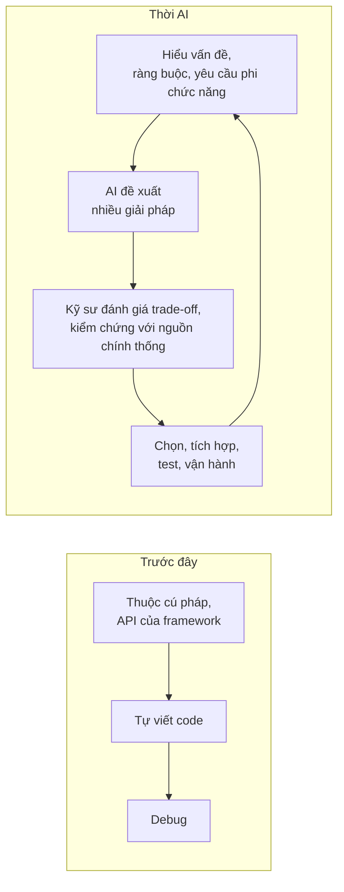
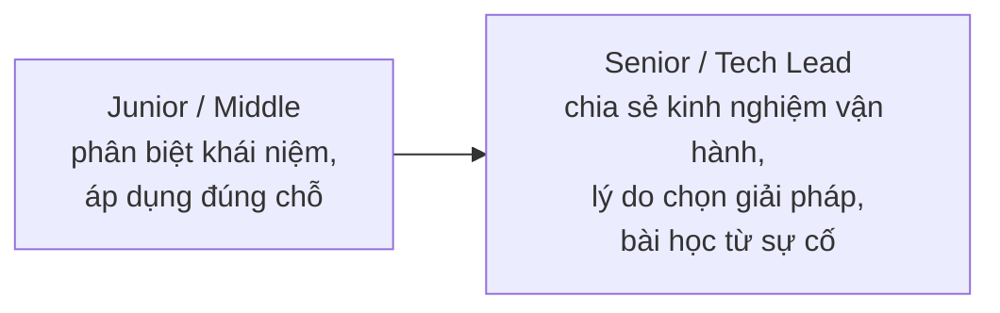

## Mục tiêu

Hiểu vì sao trong thời kỳ AI coding (vibe coding), giá trị của một kỹ sư dịch chuyển từ **viết code** sang **giải quyết vấn đề và đánh giá giải pháp**, và chuẩn bị cho cả công việc hằng ngày lẫn phỏng vấn theo hướng đó.

## Điều gì đã thay đổi

AI coding assistant viết code theo một ngôn ngữ hay framework cụ thể nhanh hơn con người, và thường đúng cú pháp. Vì vậy:

- Câu hỏi kiểu "hàm X của framework Y nhận tham số gì" mất dần ý nghĩa: AI và tài liệu trả lời tốt hơn trí nhớ.
- Câu hỏi kiểu "giải pháp này **sai ở đâu khi có lỗi mạng**, **tốn bao nhiêu khi tải tăng 10 lần**, **có an toàn khi retry không**" trở nên quan trọng hơn. AI có thể đề xuất nhiều giải pháp, nhưng người chịu trách nhiệm chọn và vận hành giải pháp vẫn là kỹ sư.

Kỳ vọng phổ biến của người phỏng vấn hiện nay có thể tóm lại một câu: **một kỹ sư có thể đánh giá trade-off của các giải pháp AI đề xuất, thay vì phụ thuộc vào những dòng code AI viết ra.**

## Những năng lực vẫn thuộc về kỹ sư

| Năng lực | Vì sao AI không thay thế được hoàn toàn | Trang liên quan |
|---|---|---|
| Hiểu vấn đề và ràng buộc | AI chỉ biết những gì bạn mô tả; yêu cầu phi chức năng (latency, chi phí, compliance) thường không nằm trong prompt | [[evaluating-ai-solutions]] |
| Đánh giá trade-off | Mỗi giải pháp đều có chi phí; chọn đúng phụ thuộc vào context của sản phẩm và đội ngũ | [[system-design-basics]] |
| Thiết kế cho lỗi | Code AI sinh ra thường chạy đúng ở happy path, hay thiếu timeout, retry an toàn, idempotency | [[backend-development-topics]], [[senior-engineering-topics]] |
| Hiểu luồng request end-to-end | Debug sự cố production đòi hỏi biết request đi qua những layer nào | [[backend-engineering-basics]] |
| Hiểu hạ tầng | Network, storage, container orchestration quyết định giải pháp có chạy được thật hay không | [[cloud-networking-and-storage]] |
| Kiến thức nền về thiết kế code | Để đọc, review và refactor code AI sinh ra | [[oop-fundamentals]] |

## Phỏng vấn đang thay đổi thế nào

### Từ học thuộc lý thuyết sang tình huống thực tế

Câu hỏi lý thuyết thuần túy ("4 tính chất của OOP là gì") có nhược điểm: người học thuộc trả lời được, còn người làm được việc lại có thể không nhớ đúng định nghĩa. Vì vậy nhiều người phỏng vấn dùng danh sách khái niệm như một **bộ khung technical points**, rồi hỏi trong **context của dự án trong CV**:

- Không hỏi "idempotency là gì", mà hỏi "ở dự án thanh toán của bạn, nếu client gửi lại request do timeout thì chuyện gì xảy ra?"
- Không hỏi "circuit breaker là gì", mà hỏi "khi dịch vụ đối tác chậm 30 giây, hệ thống của bạn phản ứng thế nào?"

Hệ quả cho người chuẩn bị: với mỗi khái niệm trong section này, hãy tìm **một tình huống cụ thể trong dự án bạn đã làm** nơi khái niệm đó xuất hiện (hoặc lẽ ra nên xuất hiện).

### Khác biệt theo level

- **Junior / Middle:** người hỏi kiểm tra bạn **phân biệt** được các khái niệm và **biết khi nào dùng** cái nào. Ví dụ: Short Polling khác Long Polling thế nào, khi nào dùng Push.
- **Senior / Tech Lead:** buổi phỏng vấn giống một cuộc **thảo luận** hơn là đánh đố. Người hỏi đưa ra chủ đề (stateful workload, distributed transaction, retry và timeout khi tích hợp nhiều hệ thống) và muốn nghe bạn đã gặp gì, chọn giải pháp nào, **vì sao**, và nếu làm lại thì đổi gì.

## Cách chuẩn bị

1. **Lập bản đồ dự án.** Với mỗi dự án trong CV, vẽ lại kiến trúc: client, load balancer, service, database, cache, queue, dịch vụ bên ngoài. Đánh dấu chỗ nào có retry, timeout, transaction, cache. Đây chính là nơi người phỏng vấn sẽ hỏi.
2. **Trả lời có cấu trúc.** Một khung dễ dùng: *vấn đề* → *các lựa chọn* → *trade-off* → *đã chọn gì và vì sao* → *kết quả và bài học*.
3. **Chủ động đưa keyword.** Khi trả lời một câu cơ bản, hãy nhắc tới khái niệm sâu hơn mà bạn thực sự nắm (ví dụ trả lời về Encapsulation và nhắc tới "bảo vệ invariant"). Người phỏng vấn thường đào tiếp vào keyword đó, giúp bạn dẫn dắt cuộc trao đổi về vùng mình mạnh. Chỉ đưa keyword bạn giải thích được đến tầng tiếp theo.
4. **Trang bị thêm 1 đến 2 domain.** Hiểu nghiệp vụ của một vài lĩnh vực (thanh toán, thương mại điện tử, logistics...) giúp bạn nói chuyện về vấn đề thật thay vì chỉ về công nghệ.
5. **Luyện với AI đúng cách.** Yêu cầu AI liệt kê **toàn bộ** giải pháp có thể kèm trade-off, rồi tự phản biện và kiểm chứng với tài liệu chính thống. Quy trình chi tiết ở [[evaluating-ai-solutions]].

> [!warning] Đừng dừng ở định nghĩa
> Thuộc định nghĩa chỉ giúp bạn qua câu hỏi đầu tiên. Câu hỏi thứ hai gần như luôn là "bạn đã dùng nó ở đâu, và nó hỏng thế nào?".

## Tự đánh giá

> [!level1] Level 1 — Nhận biết
> - Giải thích trong hai câu vì sao kỹ năng đánh giá trade-off quan trọng hơn khi AI viết code.
> - Kể tên các chủ đề trong section này và nêu chủ đề nào bạn còn yếu.

> [!level2] Level 2 — Áp dụng
> - Vẽ được kiến trúc một dự án trong CV và chỉ ra ít nhất 3 điểm có thể bị hỏi (retry, transaction, cache, scaling).
> - Trả lời một câu hỏi bất kỳ trong section theo khung vấn đề → lựa chọn → trade-off → quyết định.

> [!level3] Level 3 — Engineering
> - Dẫn dắt được một buổi thảo luận 15 phút về một quyết định kiến trúc bạn từng đưa ra, kể cả phần sai lầm và cách khắc phục.
> - Review được một giải pháp AI đề xuất và chỉ ra rủi ro vận hành mà nó bỏ qua.

## Tài liệu tham khảo

- AWS Well-Architected Framework — [docs.aws.amazon.com/wellarchitected/latest/framework/welcome.html](https://docs.aws.amazon.com/wellarchitected/latest/framework/welcome.html): bộ câu hỏi chính thức để đánh giá một kiến trúc theo sáu trụ cột (vận hành, bảo mật, độ tin cậy, hiệu năng, chi phí, bền vững).
- Microsoft Azure Well-Architected Framework, Reliability — [learn.microsoft.com/en-us/azure/well-architected/reliability/](https://learn.microsoft.com/en-us/azure/well-architected/reliability/)
- Google, *Site Reliability Engineering* (sách miễn phí) — [sre.google/sre-book/table-of-contents/](https://sre.google/sre-book/table-of-contents/)
- Martin Fowler, *Microservice Trade-Offs* — [martinfowler.com/articles/microservice-trade-offs.html](https://martinfowler.com/articles/microservice-trade-offs.html)
