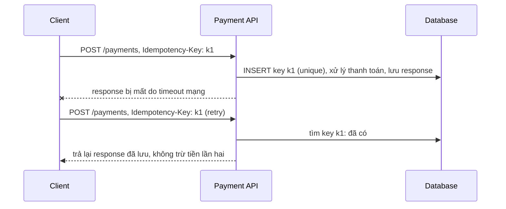
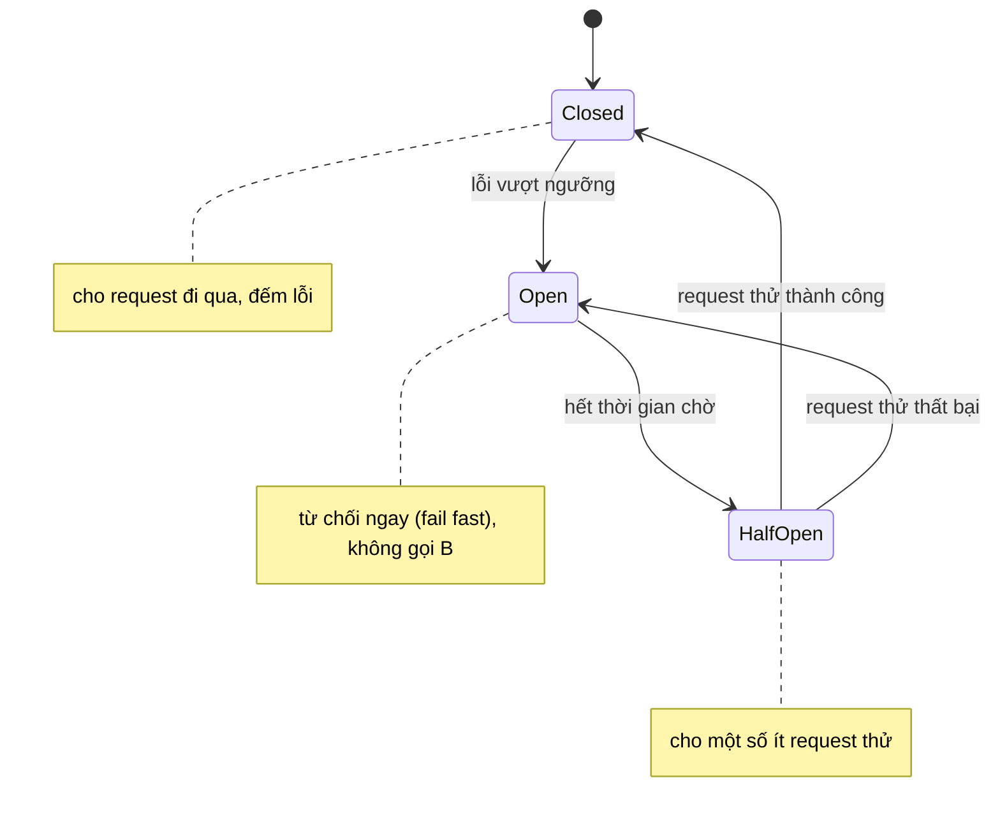

## Mục tiêu

Hiểu bốn chủ đề hay xuất hiện khi phỏng vấn Backend Developer có kinh nghiệm thực tế: **Idempotency**, **Microservices so với Monolith**, **Circuit Breaker**, và **vì sao cần container orchestration**. Đây cũng là những chỗ code AI sinh ra hay bỏ sót nhất, vì chúng chỉ lộ ra khi có lỗi mạng, retry, hoặc nhiều instance.

## Câu 1: Idempotency

*Những method nào trong REST API là idempotent? Bạn đã dùng kỹ thuật idempotency trong tình huống nào?*

### Người hỏi muốn kiểm tra gì

Bạn có hiểu vì sao idempotency quan trọng trong hệ thống phân tán (request có thể bị gửi lại), biết định nghĩa chính xác theo chuẩn HTTP, và đã từng thiết kế API an toàn khi retry chưa.

### Trả lời gợi ý

Một thao tác là **idempotent** nếu thực hiện nhiều lần **cùng một request** có **tác động lên server** giống như thực hiện một lần. Lưu ý: response có thể khác nhau (lần đầu `200`, lần sau `404` khi DELETE), điều được giữ nguyên là trạng thái trên server.

Theo RFC 9110:

| Method | Safe (không đổi trạng thái) | Idempotent |
|---|---|---|
| `GET`, `HEAD`, `OPTIONS`, `TRACE` | Có | Có |
| `PUT` | Không | Có: ghi đè tài nguyên bằng cùng một nội dung |
| `DELETE` | Không | Có: xóa lần hai không đổi thêm gì |
| `POST` | Không | Không: mỗi lần có thể tạo một tài nguyên mới |
| `PATCH` (RFC 5789) | Không | Không bắt buộc: tùy cách thiết kế patch |

Đây là **cam kết ngữ nghĩa** của chuẩn; code của bạn phải tự giữ đúng cam kết đó. Ví dụ một handler `GET` mà tăng bộ đếm hoặc gửi email là vi phạm.

**Vì sao cần:** mạng có thể mất response sau khi server đã xử lý xong. Client không biết request đã thành công hay chưa, nên gửi lại. Nếu thao tác không idempotent (tạo thanh toán), người dùng bị trừ tiền hai lần.

**Kỹ thuật phổ biến: Idempotency Key.** Client sinh một khóa duy nhất cho mỗi thao tác (ví dụ UUID) và gửi kèm trong header. Server lưu kết quả theo khóa; request lặp lại cùng khóa nhận lại kết quả cũ thay vì xử lý lại. Stripe dùng cách này cho API thanh toán, và IETF đang chuẩn hóa header `Idempotency-Key`.



> [!pseudocode] Xử lý request có Idempotency Key
> - **Dùng để:** đảm bảo một thao tác chỉ có hiệu lực một lần dù client gửi lại nhiều lần.
> - **Đầu vào:** `key` do client gửi, nội dung request.
> - **Kết quả mong đợi:** lần đầu xử lý và lưu kết quả; lần sau cùng key và cùng nội dung trả lại kết quả cũ; cùng key nhưng nội dung khác trả lỗi `422`; đang xử lý dở trả `409`.
>
> ```text
> function handle(key, request):
>     record = store.insert_if_absent(key, status="processing",
>                                     request_hash=hash(request))
>     if record was existing:
>         if record.request_hash != hash(request): return 422
>         if record.status == "processing":       return 409  # thử lại sau
>         return record.saved_response
>     response = process(request)            # thao tác có tác dụng phụ
>     store.update(key, status="done", saved_response=response)
>     return response
> ```

Phép `insert_if_absent` phải nguyên tử (ví dụ unique constraint trong database), nếu không hai request đồng thời cùng key vẫn có thể cùng được xử lý.

**Các tình huống thực tế để kể:** API thanh toán; consumer đọc message queue (đa số queue đảm bảo *at-least-once*, nên consumer phải xử lý trùng message); webhook từ bên thứ ba có thể gửi lại cùng một sự kiện; job định kỳ chạy lại sau khi crash.

### Trade-off

- Lưu key tốn storage; cần thời hạn hết hạn cho key (ví dụ 24 giờ).
- Thay vì key riêng, đôi khi có thể thiết kế thao tác tự nhiên idempotent: `PUT /carts/42/items/7 {quantity: 3}` thay vì `POST /carts/42/items {add: 1}`.
- Unique constraint trên mã nghiệp vụ (ví dụ mã đơn hàng từ client) cũng là một dạng idempotency đơn giản.

### Câu hỏi đào sâu

- Hai request cùng key đến **đồng thời** trên hai instance khác nhau. Thiết kế của bạn có đúng không?
- Consumer xử lý xong message nhưng crash trước khi ack. Chuyện gì xảy ra?
- Vì sao chỉ nên retry tự động các request idempotent? Xem [[senior-engineering-topics]].

## Câu 2: Khó khăn cơ bản của Microservices so với Monolith

### Người hỏi muốn kiểm tra gì

Bạn có nhìn microservices như một **trade-off** chứ không phải một nâng cấp mặc định, và biết chi phí thật của nó.

### Trả lời gợi ý

Microservices chia ứng dụng thành nhiều service nhỏ, triển khai độc lập, mỗi service sở hữu dữ liệu riêng. Lợi ích: triển khai độc lập, scale độc lập, ranh giới module rõ, nhiều đội làm song song. Cái giá phải trả:

| Khó khăn | Giải thích |
|---|---|
| Gọi qua mạng thay vì gọi hàm | Mỗi lời gọi có thể chậm, lỗi, timeout. Phải thiết kế timeout, retry, circuit breaker. |
| Tính nhất quán dữ liệu | Không còn một transaction database chung. Cần saga, outbox, chấp nhận eventual consistency. Xem [[senior-engineering-topics]]. |
| Vận hành | Nhiều service phải build, deploy, giám sát, cảnh báo; cần CI/CD và orchestration tốt. |
| Quan sát và debug | Một request đi qua nhiều service; cần distributed tracing, log tập trung, correlation ID. |
| Kiểm thử | Test tích hợp giữa các service khó hơn; cần contract testing hoặc môi trường đầy đủ. |
| Thay đổi interface | Đổi API giữa service phải tương thích ngược, có versioning. |
| Ranh giới sai | Chia sai ranh giới tạo ra "distributed monolith": vẫn phải deploy cùng nhau nhưng thêm toàn bộ chi phí mạng. |

Martin Fowler gọi một phần chi phí này là "microservice premium", và khuyên bắt đầu bằng monolith được module hóa tốt khi chưa rõ ranh giới nghiệp vụ (*MonolithFirst*).

### Câu hỏi đào sâu

- Dấu hiệu nào cho thấy đã đến lúc tách một module khỏi monolith?
- "Modular monolith" là gì và giải quyết được những vấn đề nào của monolith truyền thống?

## Câu 3: Vì sao cần Circuit Breaker trong microservices?

### Người hỏi muốn kiểm tra gì

Bạn có hiểu **cascading failure**: một dependency chậm có thể kéo sập cả hệ thống, và circuit breaker chặn điều đó như thế nào.

### Trả lời gợi ý

Khi service B chậm hoặc chết, service A gọi B sẽ có các request đứng chờ đến timeout. Thread, connection pool và bộ nhớ của A cạn dần, A cũng chậm theo, rồi lan sang các service gọi A. Retry liên tục còn làm B khó hồi phục hơn.

**Circuit Breaker** bọc lời gọi tới B và theo dõi tỉ lệ lỗi:



- **Closed:** hoạt động bình thường, đếm lỗi.
- **Open:** khi lỗi vượt ngưỡng, từ chối ngay mọi lời gọi tới B (fail fast) và trả lỗi hoặc dữ liệu dự phòng (fallback), giải phóng tài nguyên của A và cho B thời gian hồi phục.
- **Half-Open:** sau một khoảng thời gian, cho một số request thử; thành công thì đóng lại, thất bại thì mở tiếp.

### Trade-off

- Ngưỡng quá nhạy làm ngắt mạch khi chỉ có lỗi thoáng qua; quá chậm thì không bảo vệ kịp.
- Cần quyết định **fallback** có ý nghĩa nghiệp vụ: trả dữ liệu cache cũ, ẩn một tính năng phụ, hay báo lỗi rõ ràng.
- Circuit breaker bổ sung chứ không thay thế timeout và retry có giới hạn. Retry xử lý lỗi thoáng qua; circuit breaker xử lý lỗi kéo dài.

### Câu hỏi đào sâu

- Circuit breaker đặt ở mỗi instance hay dùng chung trạng thái? Trade-off?
- Kết hợp retry và circuit breaker thế nào để retry không làm mạch mở sai?
- Bulkhead pattern khác circuit breaker thế nào?

## Câu 4: Vì sao cần container orchestration? Docker Compose cũng làm được, vậy vì sao có Kubernetes?

### Người hỏi muốn kiểm tra gì

Bạn có hiểu vấn đề mà orchestration giải quyết (chạy nhiều container trên **nhiều máy** một cách tin cậy), và đủ tỉnh táo để không dùng Kubernetes khi không cần.

### Trả lời gợi ý

**Docker Compose** định nghĩa và chạy một ứng dụng nhiều container bằng một file YAML. Nó rất tốt cho môi trường phát triển, test và các triển khai nhỏ, nhưng mặc định chạy trên **một Docker host**.

**Kubernetes** là hệ thống orchestration cho **một cụm nhiều máy (cluster)**. Bạn khai báo **trạng thái mong muốn** (desired state), và các controller liên tục so sánh với trạng thái thực tế để điều chỉnh (reconciliation):

| Nhu cầu | Kubernetes cung cấp |
|---|---|
| Đặt container lên máy còn tài nguyên | Scheduler chọn node theo CPU, memory, ràng buộc |
| Container chết, máy chết | Self-healing: tạo lại Pod, chuyển sang node khác |
| Cập nhật không downtime | Rolling update và rollback của Deployment |
| Tìm và cân bằng tải giữa các bản | Service, DNS nội bộ, EndpointSlice |
| Scale theo tải | Horizontal Pod Autoscaler |
| Chỉ gửi traffic khi sẵn sàng | Readiness probe |
| Cấu hình và bí mật | ConfigMap, Secret |
| Workload có state | StatefulSet, PersistentVolume |

### Trade-off

- Kubernetes có độ phức tạp vận hành lớn: networking, bảo mật, nâng cấp cluster, cần người hiểu nó. Dịch vụ managed (EKS, GKE, AKS) giảm nhưng không xóa chi phí này.
- Một sản phẩm nhỏ, một vài service, một đội nhỏ thường được phục vụ tốt hơn bởi Docker Compose trên một máy, hoặc một nền tảng managed (PaaS, serverless container).
- Kubernetes đáng giá khi có nhiều service, nhiều đội, cần high availability qua nhiều máy và tự động hóa triển khai.

### Câu hỏi đào sâu

- Liveness probe và readiness probe khác nhau thế nào? Cấu hình sai liveness gây ra sự cố gì?
- Rolling update hoạt động thế nào và làm sao để không mất request trong lúc cập nhật? Xem [[senior-engineering-topics]].

## Tự đánh giá

> [!level1] Level 1 — Nhận biết
> - Liệt kê đúng các method idempotent và safe theo RFC 9110.
> - Kể được ít nhất 5 khó khăn của microservices so với monolith.
> - Vẽ được ba trạng thái của circuit breaker.

> [!level2] Level 2 — Áp dụng
> - Cài đặt idempotency key với unique constraint trong database và test với hai request đồng thời.
> - Viết consumer message queue xử lý đúng khi nhận trùng message.
> - Viết được file Docker Compose và Kubernetes Deployment + Service cho cùng một ứng dụng, giải thích khác biệt.

> [!level3] Level 3 — Engineering
> - Lập luận được cho hoặc chống việc tách microservices trong một dự án cụ thể, bằng chi phí vận hành và ranh giới nghiệp vụ.
> - Thiết kế fallback cho circuit breaker có ý nghĩa nghiệp vụ, và chọn ngưỡng dựa trên số liệu.

## Tài liệu tham khảo

- IETF RFC 9110, *HTTP Semantics*, mục 9.2.1 Safe Methods và 9.2.2 Idempotent Methods — [rfc-editor.org/rfc/rfc9110#section-9.2.2](https://www.rfc-editor.org/rfc/rfc9110#section-9.2.2)
- IETF RFC 5789, *PATCH Method for HTTP* — [rfc-editor.org/rfc/rfc5789](https://www.rfc-editor.org/rfc/rfc5789)
- IETF draft, *The Idempotency-Key HTTP Header Field* — [datatracker.ietf.org/doc/draft-ietf-httpapi-idempotency-key-header/](https://datatracker.ietf.org/doc/draft-ietf-httpapi-idempotency-key-header/)
- Stripe API Reference, *Idempotent requests* — [docs.stripe.com/api/idempotent_requests](https://docs.stripe.com/api/idempotent_requests)
- Amazon Builders' Library, *Making retries safe with idempotent APIs* — [aws.amazon.com/builders-library/making-retries-safe-with-idempotent-APIs/](https://aws.amazon.com/builders-library/making-retries-safe-with-idempotent-APIs/)
- Martin Fowler, *Microservices* — [martinfowler.com/articles/microservices.html](https://martinfowler.com/articles/microservices.html); *MonolithFirst* — [martinfowler.com/bliki/MonolithFirst.html](https://martinfowler.com/bliki/MonolithFirst.html); *Microservice Trade-Offs* — [martinfowler.com/articles/microservice-trade-offs.html](https://martinfowler.com/articles/microservice-trade-offs.html)
- Microsoft Azure Architecture Center, *Circuit Breaker pattern* — [learn.microsoft.com/en-us/azure/architecture/patterns/circuit-breaker](https://learn.microsoft.com/en-us/azure/architecture/patterns/circuit-breaker); *Bulkhead pattern* — [learn.microsoft.com/en-us/azure/architecture/patterns/bulkhead](https://learn.microsoft.com/en-us/azure/architecture/patterns/bulkhead)
- Martin Fowler, *CircuitBreaker* — [martinfowler.com/bliki/CircuitBreaker.html](https://martinfowler.com/bliki/CircuitBreaker.html)
- Docker documentation, *Docker Compose* — [docs.docker.com/compose/](https://docs.docker.com/compose/)
- Kubernetes documentation, *Overview* — [kubernetes.io/docs/concepts/overview/](https://kubernetes.io/docs/concepts/overview/); *Deployments* — [kubernetes.io/docs/concepts/workloads/controllers/deployment/](https://kubernetes.io/docs/concepts/workloads/controllers/deployment/); *Horizontal Pod Autoscaling* — [kubernetes.io/docs/tasks/run-application/horizontal-pod-autoscale/](https://kubernetes.io/docs/tasks/run-application/horizontal-pod-autoscale/)
