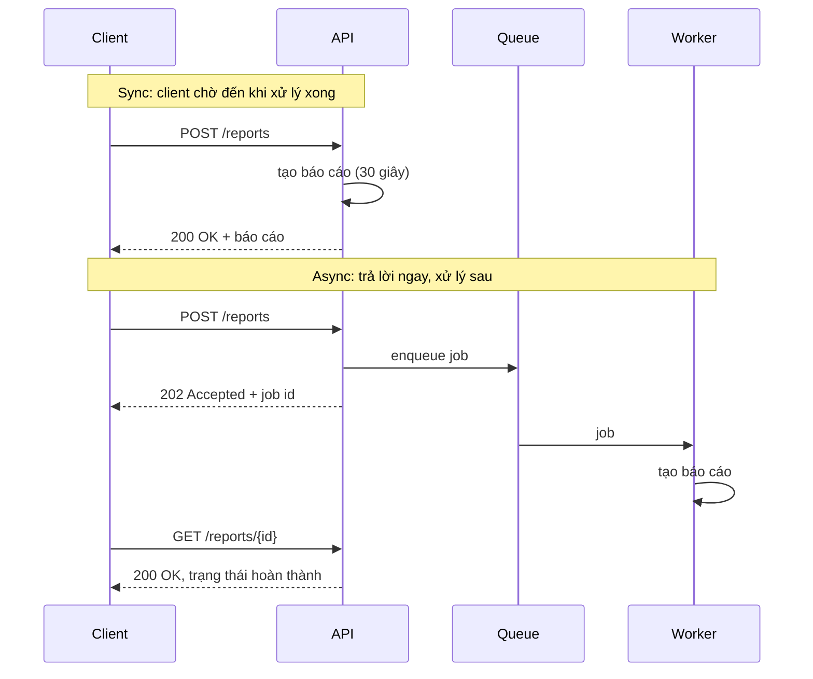
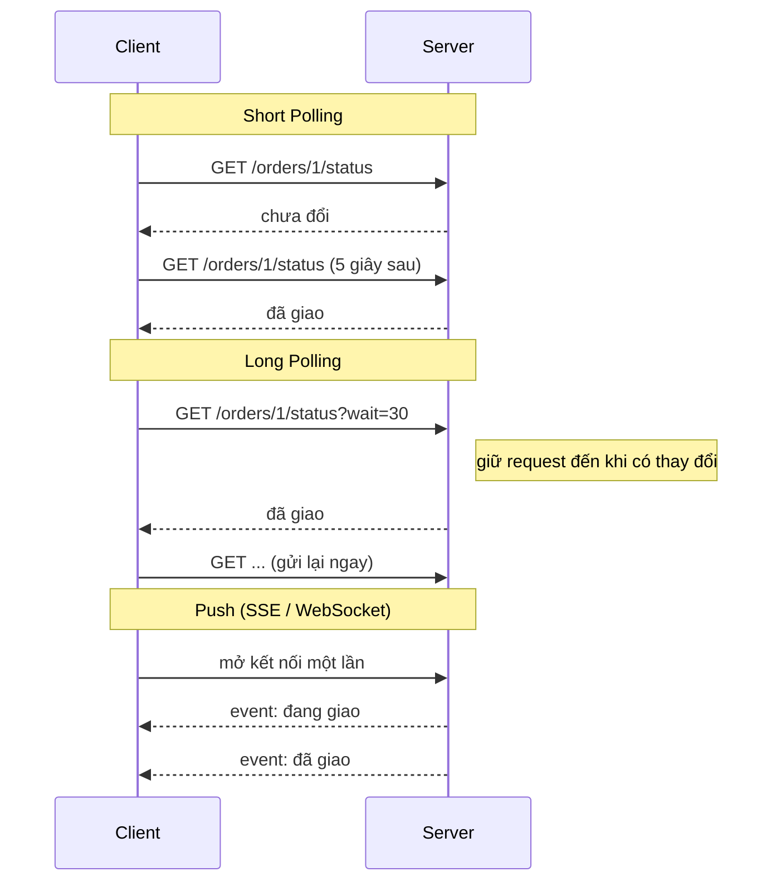
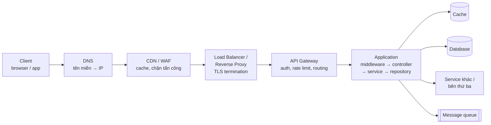
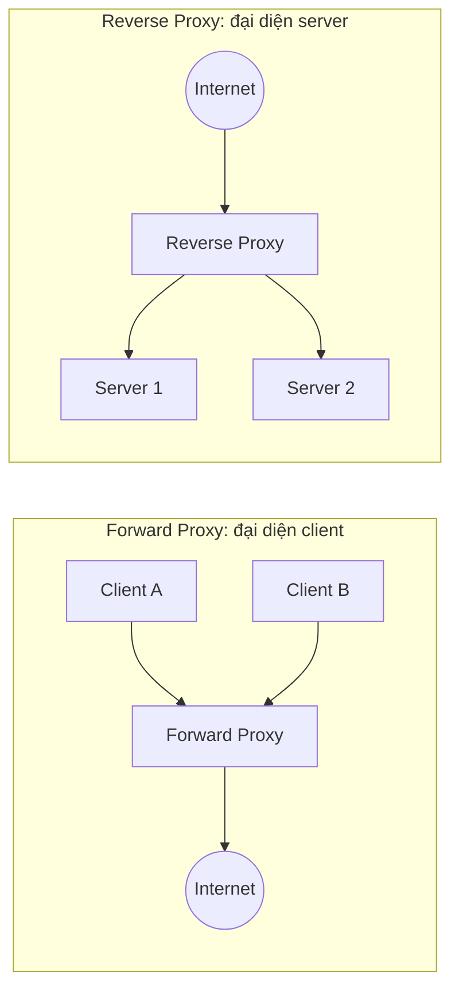

## Mục tiêu

Nắm chắc bốn khái niệm nền của backend thường dùng để mở đầu phỏng vấn Junior / Middle: **Sync và Async**, **Polling và Push**, **các layer một API request đi qua**, **Reverse Proxy và Forward Proxy**. Đây cũng là kiến thức tối thiểu để đọc hiểu và debug code AI sinh ra cho một API.

## Câu 1: Phân biệt Sync và Async

### Người hỏi muốn kiểm tra gì

Bạn có phân biệt được hai tầng nghĩa của "async" không: **cách một lời gọi chờ kết quả trong code** (blocking hay non-blocking) và **cách hai hệ thống giao tiếp** (request/response chờ ngay hay gửi message rồi xử lý sau).

### Trả lời gợi ý

- **Synchronous (sync):** bên gọi đợi đến khi có kết quả rồi mới làm việc tiếp. Trong code, một lời gọi I/O sync **block** thread hiện tại. Giữa hai hệ thống, sync là request/response: client gửi HTTP request và giữ kết nối chờ response.
- **Asynchronous (async):** bên gọi không đứng chờ; kết quả đến sau qua callback, promise/future, hoặc một message khác. Trong code, async I/O (ví dụ `async`/`await` trong Python asyncio hay JavaScript) cho phép một thread phục vụ nhiều tác vụ I/O xen kẽ nhờ **event loop**. Giữa hai hệ thống, async thường là gửi message vào **queue** hoặc trả về `202 Accepted` kèm cách kiểm tra kết quả sau.
- Async **không** có nghĩa là song song (parallel). Async là về việc không chờ; parallel là chạy cùng lúc trên nhiều CPU core.

### Trade-off

| | Sync | Async |
|---|---|---|
| Độ đơn giản | Dễ viết, dễ đọc, dễ debug | Khó hơn: thứ tự xử lý, lỗi xảy ra sau, cần theo dõi trạng thái |
| Phản hồi cho người dùng | Chờ toàn bộ thời gian xử lý | Phản hồi ngay, kết quả đến sau |
| Chịu tải | Thread bị chiếm trong lúc chờ I/O | Phục vụ nhiều kết nối hơn với ít thread; queue hấp thụ tải đột biến |
| Ghép nối giữa hệ thống | Bên gọi phụ thuộc bên được gọi phải sống | Tách rời theo thời gian; bên xử lý có thể tạm chết |

### Lỗi hay gặp

- Gọi hàm blocking (đọc file, gọi HTTP bằng thư viện sync) bên trong event loop async: một lời gọi chậm làm đứng toàn bộ server. Field note [[windows-console-server-freeze]] là một ví dụ thật.
- Cho rằng async tự động làm code nhanh hơn với tác vụ nặng CPU. Với tác vụ CPU-bound, cần nhiều process hoặc [[worker-pool]].

### Câu hỏi đào sâu

- Khi nào bạn chọn trả `202 Accepted` thay vì giữ request chờ?
- Nếu worker xử lý job thất bại, client biết bằng cách nào?
- Event loop xử lý hàng nghìn kết nối trên một thread như thế nào? Xem [[async-io-event-loop]].

## Câu 2: Polling và Push, Short Polling và Long Polling

### Người hỏi muốn kiểm tra gì

Bạn có biết các cách để client nhận dữ liệu mới từ server, và chọn được cách phù hợp theo tần suất cập nhật, số kết nối và hạ tầng.

### Trả lời gợi ý

- **Polling:** client chủ động hỏi định kỳ "có gì mới không".
  - **Short Polling:** client gửi request theo chu kỳ cố định (ví dụ mỗi 5 giây); server trả lời ngay dù có dữ liệu mới hay không. Đơn giản nhưng lãng phí khi ít thay đổi, và độ trễ tối đa bằng chu kỳ polling.
  - **Long Polling:** client gửi request, server **giữ request mở** cho đến khi có dữ liệu mới hoặc hết timeout, rồi mới trả lời; client lập tức gửi request tiếp theo. RFC 6202 mô tả kỹ thuật này và các vấn đề của nó.
- **Push:** server chủ động gửi dữ liệu khi có thay đổi qua một kết nối giữ lâu dài.
  - **Server-Sent Events (SSE):** một chiều server → client qua HTTP, có tự động kết nối lại, được định nghĩa trong chuẩn HTML.
  - **WebSocket (RFC 6455):** kênh hai chiều full-duplex sau một bước upgrade từ HTTP. Xem [[websockets]].
  - Ngoài web: mobile push notification, webhook (server gọi HTTP tới hệ thống khác khi có sự kiện).

### Khi nào dùng cái nào

| Tình huống | Lựa chọn hợp lý | Lý do |
|---|---|---|
| Cập nhật hiếm, chấp nhận trễ vài chục giây (trạng thái job báo cáo) | Short Polling | Đơn giản nhất, chạy qua mọi proxy và cache, server stateless |
| Cần gần thời gian thực nhưng hạ tầng không hỗ trợ kết nối lâu dài | Long Polling | Giảm request rỗng, vẫn là HTTP thông thường |
| Server → client liên tục (thông báo, giá cổ phiếu, log streaming) | SSE | Một chiều, đơn giản hơn WebSocket, tự kết nối lại |
| Hai chiều, tần suất cao (chat, cộng tác thời gian thực, game) | WebSocket | Độ trễ thấp, không có overhead của HTTP mỗi message |
| Hệ thống với hệ thống | Webhook, hoặc message queue | Bên nhận không phải hỏi liên tục |

### Trade-off

- Push giữ **nhiều kết nối mở**: tốn tài nguyên trên server, load balancer cần hỗ trợ kết nối lâu dài, scale ngang phức tạp hơn vì kết nối gắn với một instance (thường cần pub/sub giữa các instance, xem [[publish-subscribe-messaging]]).
- Polling dễ scale và cache hơn, nhưng lãng phí băng thông và có độ trễ.
- Mọi phương án push cần xử lý **mất kết nối**: kết nối lại với backoff ([[retry-with-exponential-backoff]]) và lấy lại các sự kiện bị lỡ.

### Câu hỏi đào sâu

- 50.000 người dùng mở trang theo dõi đơn hàng, polling mỗi 2 giây tạo ra bao nhiêu request mỗi giây? (Khoảng 25.000.) Bạn giảm bằng cách nào?
- Khi client WebSocket mất mạng 30 giây rồi kết nối lại, làm sao nó nhận các sự kiện đã lỡ?

## Câu 3: Một API request đi qua những layer nào?

### Người hỏi muốn kiểm tra gì

Bạn có hình dung được toàn bộ đường đi của request từ trình duyệt đến database và ngược lại không. Đây là nền tảng để debug latency và lỗi production, và để biết nên tối ưu ở đâu.

### Trả lời gợi ý

1. **Client:** tạo request, có thể dùng cache của trình duyệt (HTTP caching theo RFC 9111).
2. **DNS:** phân giải tên miền thành địa chỉ IP.
3. **Kết nối mạng:** TCP handshake (hoặc QUIC với HTTP/3), rồi TLS handshake để mã hóa.
4. **CDN / WAF:** trả nội dung đã cache ở edge, lọc request độc hại.
5. **Load Balancer / Reverse Proxy:** kết thúc TLS, chọn một instance còn khỏe để chuyển tiếp.
6. **API Gateway:** xác thực (authentication), phân quyền (authorization), rate limiting (ví dụ [[token-bucket]]), định tuyến tới đúng service.
7. **Application:** middleware (logging, tracing, parse body) → controller (validate input) → service (business logic) → repository (truy cập dữ liệu).
8. **Data layer và dependency:** cache, database, service khác, queue.
9. **Response** đi ngược lại qua các layer trên, có thể được cache trên đường về.

Không phải hệ thống nào cũng có đủ các layer: một ứng dụng nhỏ có thể chỉ có reverse proxy và application. Điều quan trọng là biết **mỗi layer có thể thêm latency, có thể lỗi, và có log hay metric riêng** để kiểm tra.

### Lỗi hay gặp

- Chỉ nhìn log ứng dụng khi debug, quên rằng lỗi `502`/`504` thường do load balancer hoặc reverse proxy sinh ra khi upstream chết hoặc quá chậm.
- Không truyền **request ID / trace ID** qua các layer, nên không nối được log giữa gateway, service và database.

### Câu hỏi đào sâu

- Request trả về `504 Gateway Timeout`. Layer nào sinh ra lỗi này và bạn kiểm tra gì đầu tiên?
- Rate limiting nên đặt ở gateway hay trong ứng dụng? Trade-off?
- Nếu muốn giảm latency 200 ms, bạn đo ở đâu để biết thời gian bị tốn ở layer nào?

## Câu 4: Reverse Proxy và Forward Proxy

### Người hỏi muốn kiểm tra gì

Bạn có phân biệt được proxy đứng **về phía ai**, và biết các chức năng thực tế của reverse proxy trong kiến trúc backend.

### Trả lời gợi ý

- **Forward Proxy** đứng **trước client**, đại diện cho client khi đi ra ngoài. Server đích thấy địa chỉ của proxy, không thấy client. Dùng để: kiểm soát và lọc truy cập Internet trong công ty, cache chung, ẩn danh, đi qua tường lửa. Client thường phải được cấu hình để dùng nó.
- **Reverse Proxy** đứng **trước server**, đại diện cho server khi nhận request từ ngoài vào. Client chỉ thấy reverse proxy, không biết phía sau có bao nhiêu server. Dùng để: load balancing, TLS termination, cache, nén, chặn tấn công, định tuyến theo path hoặc host, ẩn cấu trúc nội bộ. Ví dụ: Nginx, HAProxy, Envoy, load balancer của cloud.

### Trade-off

- Reverse proxy là một **điểm đi qua của mọi request**: cần chạy nhiều bản để tránh single point of failure, và thêm một chút latency.
- Khi có proxy, địa chỉ client thật nằm trong header (`Forwarded` theo RFC 7239, hoặc `X-Forwarded-For` phổ biến trên thực tế). Ứng dụng chỉ nên tin header này nếu nó đến từ proxy của mình, nếu không client có thể giả mạo.

### Câu hỏi đào sâu

- API Gateway có phải là reverse proxy không? Nó làm thêm gì?
- TLS termination ở reverse proxy nghĩa là traffic từ proxy đến server có mã hóa không? Khi nào cần mã hóa lại?

## Tự đánh giá

> [!level1] Level 1 — Nhận biết
> - Phân biệt được blocking/non-blocking trong code và sync/async giữa hai hệ thống.
> - Vẽ được đường đi của một request từ trình duyệt đến database.
> - Nêu được forward proxy và reverse proxy đại diện cho ai.

> [!level2] Level 2 — Áp dụng
> - Chọn được Short Polling, Long Polling, SSE hay WebSocket cho một tình huống cụ thể và giải thích bằng số liệu (số kết nối, request mỗi giây).
> - Chuyển một endpoint xử lý lâu từ sync sang `202 Accepted` + queue + endpoint kiểm tra trạng thái.

> [!level3] Level 3 — Engineering
> - Debug được một lỗi `502`/`504` bằng cách xác định layer sinh lỗi qua log và metric.
> - Thiết kế được push cho nhiều instance phía sau load balancer, gồm kết nối lại và lấy lại sự kiện bị lỡ.

## Tài liệu tham khảo

- IETF RFC 9110, *HTTP Semantics* — [rfc-editor.org/rfc/rfc9110](https://www.rfc-editor.org/rfc/rfc9110): định nghĩa method, status code (`202`, `502`, `503`, `504`) và vai trò của proxy, gateway.
- IETF RFC 6202, *Known Issues and Best Practices for the Use of Long Polling and Streaming in Bidirectional HTTP* — [rfc-editor.org/rfc/rfc6202](https://www.rfc-editor.org/rfc/rfc6202)
- IETF RFC 6455, *The WebSocket Protocol* — [rfc-editor.org/rfc/rfc6455](https://www.rfc-editor.org/rfc/rfc6455)
- WHATWG HTML Standard, *Server-sent events* — [html.spec.whatwg.org/multipage/server-sent-events.html](https://html.spec.whatwg.org/multipage/server-sent-events.html)
- IETF RFC 9111, *HTTP Caching* — [rfc-editor.org/rfc/rfc9111](https://www.rfc-editor.org/rfc/rfc9111)
- IETF RFC 7239, *Forwarded HTTP Extension* — [rfc-editor.org/rfc/rfc7239](https://www.rfc-editor.org/rfc/rfc7239)
- MDN, *Proxy servers and tunneling* — [developer.mozilla.org/en-US/docs/Web/HTTP/Guides/Proxy_servers_and_tunneling](https://developer.mozilla.org/en-US/docs/Web/HTTP/Guides/Proxy_servers_and_tunneling)
- MDN, *Introducing asynchronous JavaScript* — [developer.mozilla.org/en-US/docs/Learn_web_development/Extensions/Async_JS/Introducing](https://developer.mozilla.org/en-US/docs/Learn_web_development/Extensions/Async_JS/Introducing)
- Python documentation, *asyncio* — [docs.python.org/3/library/asyncio.html](https://docs.python.org/3/library/asyncio.html)
- Nginx documentation, *ngx_http_proxy_module* — [nginx.org/en/docs/http/ngx_http_proxy_module.html](https://nginx.org/en/docs/http/ngx_http_proxy_module.html)
