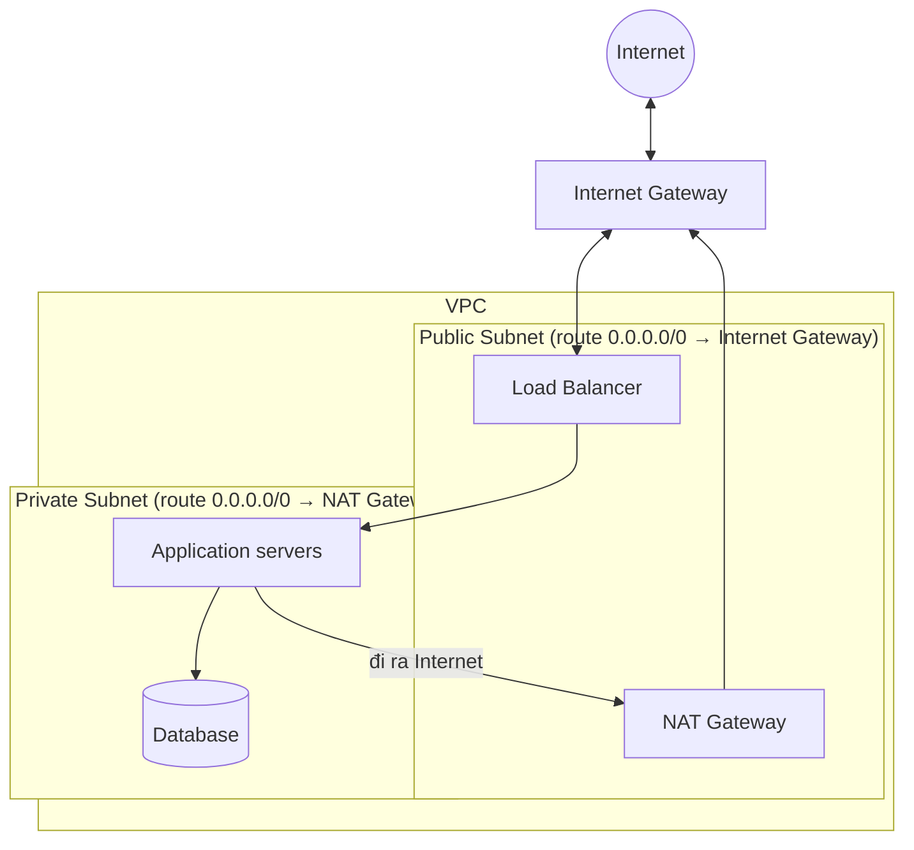
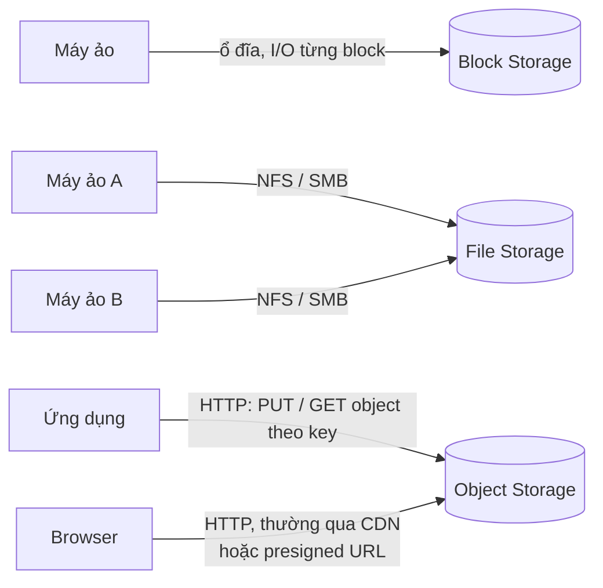

## Mục tiêu

Nắm hai nhóm kiến thức cloud nền tảng mà backend developer cần để đọc và đánh giá một thiết kế hạ tầng: **mạng (Public và Private Subnet)** và **lưu trữ (Object, Block, File Storage)**. Ví dụ dùng thuật ngữ của AWS vì phổ biến; Azure và Google Cloud có khái niệm tương đương.

## Câu 1: Phân biệt Public và Private Subnet

### Người hỏi muốn kiểm tra gì

Bạn có biết đặt thành phần nào ở đâu trong mạng để vừa phục vụ được người dùng vừa giảm bề mặt tấn công, và hiểu traffic đi ra Internet từ subnet private như thế nào.

### Trả lời gợi ý

Một **VPC** (Virtual Private Cloud) là mạng riêng của bạn trên cloud, được chia thành các **subnet**, mỗi subnet nằm trong một availability zone. Việc một subnet là public hay private **được quyết định bởi route table** của nó, không phải bởi tên:

- **Public Subnet:** route table có đường đi tới **Internet Gateway**. Tài nguyên có public IP trong subnet này có thể nhận kết nối từ Internet (nếu security group cho phép). Thường đặt: load balancer hướng Internet, NAT gateway, bastion host.
- **Private Subnet:** **không** có đường đi trực tiếp tới Internet Gateway. Tài nguyên không thể bị truy cập trực tiếp từ Internet. Muốn đi ra Internet (tải bản cập nhật, gọi API bên ngoài) thì đi qua **NAT Gateway** đặt ở public subnet: NAT cho phép kết nối **đi ra** nhưng không cho kết nối từ ngoài **khởi tạo vào**. Thường đặt: application server, database, cache.

### Trade-off

- Đặt database ở private subnet giảm mạnh rủi ro bị truy cập trái phép, nhưng việc quản trị phải đi qua bastion host, VPN, hoặc dịch vụ quản lý phiên của cloud.
- NAT Gateway có chi phí theo giờ và theo lượng dữ liệu. Traffic tới dịch vụ của chính nhà cung cấp cloud (như object storage) có thể đi qua VPC endpoint thay vì NAT để giảm chi phí và không ra Internet.
- Subnet chỉ là một lớp bảo vệ. Vẫn cần security group, network ACL, mã hóa, và phân quyền đúng.

### Câu hỏi đào sâu

- Ứng dụng trong private subnet không gọi được API bên ngoài. Bạn kiểm tra những gì? (Route table, NAT gateway, security group outbound, DNS.)
- Security group khác network ACL thế nào? (Security group là stateful, gắn với tài nguyên; network ACL là stateless, gắn với subnet.)
- Vì sao nên trải subnet qua ít nhất hai availability zone? Xem [[system-design-basics]].

## Câu 2: Object Storage khác Block Storage và File Storage thế nào?

### Người hỏi muốn kiểm tra gì

Bạn có chọn đúng loại lưu trữ cho từng loại dữ liệu: file người dùng upload, ổ đĩa của database, thư mục dùng chung giữa nhiều máy.

### Trả lời gợi ý

| | Block Storage | File Storage | Object Storage |
|---|---|---|---|
| Đơn vị lưu trữ | Các block có kích thước cố định, hệ điều hành dựng file system lên trên | File và thư mục phân cấp | Object (dữ liệu + metadata) định danh bằng key trong một bucket, không gian phẳng |
| Cách truy cập | Gắn vào máy như một ổ đĩa | Qua giao thức mạng như NFS, SMB; nhiều máy mount cùng lúc | Qua HTTP API (PUT, GET, DELETE) |
| Chia sẻ giữa nhiều máy | Thường gắn vào một máy tại một thời điểm | Có, đó là mục đích chính | Có, mọi client có quyền đều truy cập qua API |
| Sửa một phần dữ liệu | Có, ghi đè từng block, latency thấp | Có | Thường không sửa tại chỗ được: muốn đổi phải ghi lại cả object (multipart upload chỉ giúp **tải lên** object lớn theo từng phần) |
| Khả năng mở rộng | Giới hạn theo kích thước volume | Lớn | Gần như không giới hạn, chi phí thấp mỗi GB |
| Ví dụ (AWS) | Amazon EBS | Amazon EFS, FSx | Amazon S3 |
| Dùng cho | Database, ổ hệ điều hành, ứng dụng cần I/O nhanh | Thư mục dùng chung, ứng dụng cũ cần file system chung | Ảnh, video, file upload, backup, log, data lake, nội dung tĩnh cho CDN |

**Ví dụ chọn cho một ứng dụng thật:** database PostgreSQL dùng block storage; 10 TB ảnh người dùng upload dùng object storage, phục vụ qua CDN; vài máy cần đọc chung một thư mục cấu hình hoặc model thì dùng file storage.

### Trade-off và lưu ý

- Không lưu file upload trên ổ đĩa local của application server khi scale ngang: request sau có thể đến instance khác không có file đó.
- Upload file lớn từ client nên đi thẳng vào object storage bằng presigned URL, không đi qua application server.
- Mô hình nhất quán của object storage cần kiểm tra theo nhà cung cấp. Ví dụ Amazon S3 cung cấp strong read-after-write consistency từ tháng 12 năm 2020; trước đó một số thao tác chỉ eventual consistency.

### Câu hỏi đào sâu

- Vì sao database OLTP truyền thống như PostgreSQL đặt dữ liệu trên block storage chứ không trên object storage? (Gợi ý: ghi ngẫu nhiên từng trang nhỏ, `fsync`, latency mỗi thao tác.)
- Người dùng tải ảnh lên chậm và làm application server quá tải. Bạn thiết kế lại luồng upload thế nào?

## Tự đánh giá

> [!level1] Level 1 — Nhận biết
> - Nêu được yếu tố quyết định một subnet là public hay private.
> - Kể được ví dụ cho từng loại block, file, object storage.

> [!level2] Level 2 — Áp dụng
> - Vẽ được kiến trúc mạng cho một ứng dụng web ba tầng với load balancer ở public subnet, ứng dụng và database ở private subnet.
> - Cài đặt upload file trực tiếp lên object storage bằng presigned URL.

> [!level3] Level 3 — Engineering
> - Ước lượng và tối ưu chi phí NAT Gateway và truyền dữ liệu cho một ứng dụng.
> - Chọn loại storage và chiến lược backup cho từng loại dữ liệu của một hệ thống, có lý do về latency, chi phí, độ bền.

## Tài liệu tham khảo

- AWS documentation, *Subnets for your VPC* — [docs.aws.amazon.com/vpc/latest/userguide/configure-subnets.html](https://docs.aws.amazon.com/vpc/latest/userguide/configure-subnets.html)
- AWS documentation, *NAT gateways* — [docs.aws.amazon.com/vpc/latest/userguide/vpc-nat-gateway.html](https://docs.aws.amazon.com/vpc/latest/userguide/vpc-nat-gateway.html)
- AWS, *What's the Difference Between Block, Object, and File Storage?* — [aws.amazon.com/compare/the-difference-between-block-file-object-storage/](https://aws.amazon.com/compare/the-difference-between-block-file-object-storage/)
- Google Cloud, *Object vs block vs file storage* — [cloud.google.com/discover/object-vs-block-vs-file-storage](https://cloud.google.com/discover/object-vs-block-vs-file-storage)
- Amazon S3, *Strong consistency* — [aws.amazon.com/s3/consistency/](https://aws.amazon.com/s3/consistency/)
