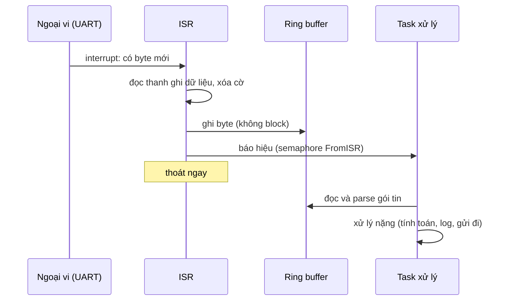
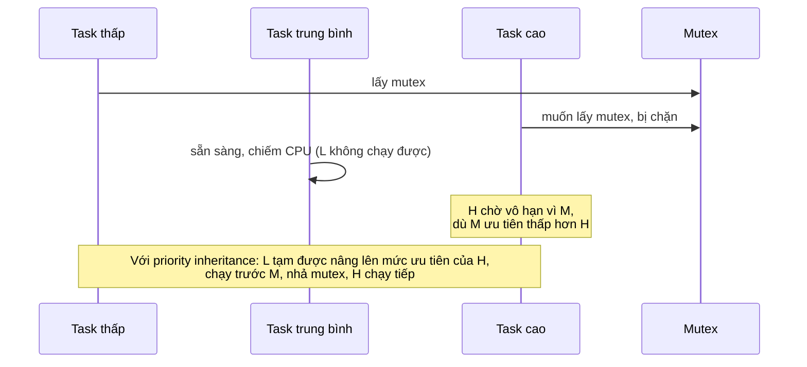

## Mục tiêu

Chuẩn bị cho kỹ sư làm **embedded / firmware** (vi điều khiển, thiết bị công nghiệp, ô tô, thiết bị đo): những khái niệm mà người phỏng vấn dùng để phân biệt người "viết được code chạy trên board" với người "làm được firmware tin cậy". Đây cũng là những chỗ code AI sinh ra cho vi điều khiển hay sai nhất, vì AI thường viết như đang lập trình trên máy tính có hệ điều hành, bộ nhớ dồi dào và không có ràng buộc thời gian thực.

> [!warning] Nguồn chính thống của embedded là datasheet
> Với embedded, "tài liệu chính thống" trước hết là **datasheet**, **reference manual** và **errata** của đúng con chip bạn dùng, cùng tài liệu của RTOS. AI rất hay bịa tên thanh ghi, sai địa chỉ, hoặc dùng API của dòng chip khác. Mọi đoạn code truy cập phần cứng do AI viết phải được đối chiếu với reference manual.

## Câu 1: Superloop (bare-metal) hay RTOS? Khi nào chọn cái nào?

### Người hỏi muốn kiểm tra gì

Bạn có chọn kiến trúc firmware dựa trên yêu cầu thời gian và độ phức tạp, thay vì theo thói quen.

### Trả lời gợi ý

- **Superloop (bare-metal):** một vòng lặp `while (1)` gọi lần lượt các tác vụ; việc gấp được xử lý trong interrupt. Đơn giản, dễ dự đoán, ít tốn RAM và flash. Nhược điểm: thời gian phản hồi của một tác vụ phụ thuộc vào tổng thời gian chạy của mọi tác vụ khác trong vòng lặp; một tác vụ chạy lâu làm chậm tất cả.
- **RTOS** (FreeRTOS, Zephyr...): nhiều task có độ ưu tiên, scheduler preemptive cho task ưu tiên cao chạy ngay khi sẵn sàng, cùng các cơ chế đồng bộ (queue, semaphore, mutex, event). Dễ tách module và đảm bảo deadline cho task quan trọng. Nhược điểm: tốn RAM cho stack mỗi task, phát sinh lỗi đồng thời (race condition, deadlock, priority inversion), cần hiểu scheduler.

| Tiêu chí | Superloop | RTOS |
|---|---|---|
| Số tác vụ độc lập | Ít | Nhiều, có độ ưu tiên khác nhau |
| Yêu cầu thời gian | Mềm, hoặc mọi việc gấp nằm trong ISR | Nhiều deadline cứng khác nhau |
| Tài nguyên | Rất hạn chế (vài KB RAM) | Đủ RAM cho stack của từng task |
| Stack phần mềm | Đơn giản | Có network stack, file system, USB... thường đi kèm RTOS |
| Rủi ro | Một tác vụ chậm làm chậm tất cả | Lỗi đồng thời, cấu hình độ ưu tiên sai |

Một hướng trung gian phổ biến là superloop kết hợp [[finite-state-machine]] và vòng lặp chạy theo nhịp cố định ([[fixed-rate-control-loops]]).

### Câu hỏi đào sâu

- Làm sao đo được thời gian chạy xấu nhất (worst-case execution time) của một vòng lặp?
- Bạn chọn stack size cho mỗi task thế nào và phát hiện tràn stack bằng cách nào?

## Câu 2: Viết ISR (Interrupt Service Routine) thế nào cho đúng?

### Người hỏi muốn kiểm tra gì

Bạn có biết những gì **không được làm** trong ISR, và cách chia sẻ dữ liệu an toàn giữa ISR và code chính.

### Trả lời gợi ý

Nguyên tắc chung:

- **ISR phải ngắn.** Trong lúc ISR chạy, các interrupt cùng hoặc thấp ưu tiên hơn bị trễ. Chỉ làm phần bắt buộc (đọc thanh ghi, xóa cờ interrupt, chép dữ liệu vào buffer), rồi **chuyển phần xử lý nặng** sang task hoặc vòng lặp chính.
- **Không gọi hàm có thể block hoặc không reentrant:** chờ mutex, `malloc`, `printf`, delay. Trong FreeRTOS, từ ISR chỉ được gọi các API có hậu tố `FromISR`.
- **Dữ liệu dùng chung với ISR** khai báo `volatile` để compiler không tối ưu bỏ việc đọc lại. Nhưng `volatile` **không** đảm bảo tính nguyên tử: biến nhiều byte (ví dụ số 32 bit trên vi điều khiển 8 bit) hoặc thao tác đọc-sửa-ghi vẫn cần critical section (tạm tắt interrupt) hoặc thao tác atomic.
- Dữ liệu dạng luồng (byte từ UART) thường đi qua [[ring-buffer]] một producer, một consumer.



> [!pseudocode] Chuyển việc từ ISR sang task với FreeRTOS (C)
> - **Dùng để:** minh họa ISR chỉ lấy dữ liệu và báo hiệu, còn task làm phần xử lý.
> - **Đầu vào:** một UART phát interrupt khi nhận byte; `rx_sem` là binary semaphore đã tạo; `uart_read_data_register()` là hàm đọc thanh ghi theo reference manual của chip.
> - **Kết quả mong đợi:** ISR thoát trong vài micro giây; task `rx_task` được đánh thức và xử lý byte, không mất dữ liệu khi task đang bận nhờ ring buffer.
>
> ```c
> void UART_IRQHandler(void) {
>     BaseType_t woken = pdFALSE;
>     uint8_t b = uart_read_data_register();   /* đọc cũng xóa cờ trên nhiều chip */
>     ring_buffer_put(&rx_rb, b);              /* không block, không malloc */
>     xSemaphoreGiveFromISR(rx_sem, &woken);
>     portYIELD_FROM_ISR(woken);               /* chuyển ngay sang task nếu nó ưu tiên cao hơn */
> }
>
> void rx_task(void *arg) {
>     for (;;) {
>         xSemaphoreTake(rx_sem, portMAX_DELAY);
>         uint8_t b;
>         while (ring_buffer_get(&rx_rb, &b)) {
>             parser_feed(b);                    /* xử lý nặng ở đây */
>         }
>     }
> }
> ```

### Lỗi hay gặp

- Gọi `printf` để debug trong ISR, làm thay đổi timing và có thể treo hệ thống.
- Quên xóa cờ interrupt, ISR bị gọi lại liên tục.
- Cho rằng `volatile` giải quyết được race condition.

### Câu hỏi đào sâu

- Interrupt latency gồm những thành phần nào? Bạn đo nó thế nào (ví dụ bật/tắt chân GPIO và đo bằng oscilloscope)?
- Nested interrupt và độ ưu tiên interrupt hoạt động thế nào trên Arm Cortex-M (NVIC)?

## Câu 3: Priority inversion là gì và xử lý thế nào?

### Người hỏi muốn kiểm tra gì

Bạn có hiểu một lỗi kinh điển của hệ thống thời gian thực, và biết vì sao mutex khác binary semaphore.

### Trả lời gợi ý

**Priority inversion** xảy ra khi task ưu tiên **cao** phải chờ một tài nguyên đang bị task ưu tiên **thấp** giữ, trong khi task ưu tiên **trung bình** (không cần tài nguyên) chiếm CPU, khiến task thấp không chạy được để nhả tài nguyên. Kết quả: task cao bị chặn trong thời gian không giới hạn bởi một task ưu tiên thấp hơn nó.



**Cách xử lý:**

- **Priority inheritance:** task đang giữ mutex tạm được nâng lên mức ưu tiên của task cao nhất đang chờ nó. Mutex của FreeRTOS có cơ chế này; binary semaphore thì không, nên dùng mutex cho loại trừ tương hỗ và semaphore cho báo hiệu.
- **Priority ceiling:** mutex được gán mức ưu tiên trần; ai giữ nó thì chạy ở mức đó.
- **Thiết kế:** giữ mutex trong thời gian ngắn nhất, tránh chia sẻ tài nguyên giữa các task có độ ưu tiên chênh lệch lớn, hoặc giao tài nguyên cho một task duy nhất và giao tiếp qua queue.

**Ví dụ thật:** năm 1997, tàu Mars Pathfinder liên tục tự reset trên sao Hỏa. Nguyên nhân là priority inversion giữa task quản lý bus (ưu tiên cao), task thu dữ liệu khí tượng (ưu tiên thấp, giữ mutex) và task truyền thông (ưu tiên trung bình). Đội JPL khắc phục bằng cách bật priority inheritance cho mutex đó qua một bản cập nhật gửi từ Trái Đất.

### Câu hỏi đào sâu

- Deadlock khác priority inversion thế nào? Kể cách phòng tránh deadlock khi một task cần hai mutex.

## Câu 4: Quản lý bộ nhớ và watchdog trong firmware

### Người hỏi muốn kiểm tra gì

Bạn có thiết kế firmware để chạy ổn định nhiều tháng, nhiều năm mà không ai khởi động lại.

### Trả lời gợi ý

**Bộ nhớ:**

- Hạn chế hoặc cấm cấp phát động (`malloc`/`free`) sau khi khởi động: heap nhỏ dễ bị **phân mảnh**, lỗi cấp phát xuất hiện sau thời gian dài và khó tái hiện. Các bộ quy tắc như MISRA C hạn chế dùng cấp phát động của thư viện chuẩn. Ưu tiên cấp phát tĩnh, memory pool có kích thước cố định, hoặc chỉ cấp phát lúc khởi động.
- Theo dõi **stack**: mỗi task có stack riêng; tràn stack ghi đè dữ liệu khác và gây lỗi ngẫu nhiên. FreeRTOS có cơ chế kiểm tra tràn stack (`configCHECK_FOR_STACK_OVERFLOW`) và hàm xem mức stack còn trống thấp nhất của task.

**Watchdog:**

- **Watchdog timer** phần cứng reset vi điều khiển nếu phần mềm không "cho ăn" (kick / refresh) trong một khoảng thời gian, giúp hệ thống tự phục hồi khi treo.
- Kick watchdog ở **nơi chứng minh được hệ thống còn khỏe**: ví dụ một task giám sát chỉ kick khi mọi task quan trọng đều đã báo "còn sống" trong chu kỳ vừa qua. Kick trong một timer ISR là sai, vì ISR vẫn chạy được khi các task đã treo.
- Sau khi reset do watchdog, ghi lại **nguyên nhân reset** (đọc thanh ghi reset cause) để chẩn đoán.

### Câu hỏi đào sâu

- Thiết bị ngoài hiện trường thỉnh thoảng tự reset. Bạn thu thập thông tin gì để tìm nguyên nhân?
- Brown-out (sụt áp) ảnh hưởng thế nào đến việc ghi flash, và bạn bảo vệ dữ liệu cấu hình ra sao? Xem [[atomic-writes-and-crash-safety]].

## Câu 5: So sánh UART, SPI, I2C, CAN

### Trả lời gợi ý

| | UART | SPI | I2C | CAN |
|---|---|---|---|---|
| Đồng bộ clock | Không (hai bên thống nhất baud rate) | Có, master phát clock | Có, master phát clock | Không có dây clock riêng; các node đồng bộ theo bit rate cấu hình chung |
| Số dây chính | TX, RX (và GND) | SCLK, MOSI, MISO, CS cho mỗi thiết bị | SDA, SCL (cần điện trở kéo lên) | CAN_H, CAN_L (vi sai) |
| Topology | Điểm-điểm | Một master, nhiều slave chọn bằng CS | Bus nhiều thiết bị, chọn bằng địa chỉ | Bus nhiều node, multi-master |
| Tốc độ | Thấp đến trung bình | Cao nhất trong nhóm, full-duplex | Thấp đến trung bình | Trung bình; chống nhiễu tốt |
| Dùng cho | Debug console, module GPS, modem | Flash, màn hình, ADC tốc độ cao | Cảm biến, EEPROM, chip quản lý nguồn | Ô tô, công nghiệp; xem [[can-bus]] |

Câu trả lời tốt nêu **vì sao chọn** trong một dự án: số chân còn trống, khoảng cách dây, tốc độ cần thiết, môi trường nhiễu, số thiết bị trên bus.

### Câu hỏi đào sâu

- Bus I2C bị treo vì một slave giữ SDA ở mức thấp. Bạn phục hồi bằng cách nào?
- Vì sao CAN dùng tín hiệu vi sai, và cơ chế arbitration theo ID hoạt động thế nào?

## Code AI sinh ra cho embedded: cần soi gì

- Dùng `malloc`, `printf`, `float` hoặc thư viện nặng trên chip không có FPU, RAM vài KB.
- Gọi API có thể block trong ISR; thiếu `volatile` hoặc thiếu critical section cho dữ liệu dùng chung.
- Giả định kích thước kiểu (`int` là 32 bit), endianness, hoặc truy cập không căn chỉnh (unaligned).
- Tên thanh ghi, bit, địa chỉ không khớp reference manual; dùng HAL của dòng chip khác.
- Busy-wait `delay` trong khi có thể dùng interrupt hoặc chế độ tiết kiệm năng lượng.
- Không xử lý timeout khi chờ phần cứng (chờ cờ mãi mãi nếu ngoại vi lỗi).

## Tự đánh giá

> [!level1] Level 1 — Nhận biết
> - Nêu được ba điều không được làm trong ISR và lý do.
> - Giải thích priority inversion bằng ví dụ ba task.
> - So sánh được UART, SPI, I2C về số dây, tốc độ và topology.

> [!level2] Level 2 — Áp dụng
> - Viết được driver nhận UART bằng interrupt và ring buffer, không mất byte ở tốc độ baud cao.
> - Cấu hình watchdog với task giám sát kiểm tra sức khỏe của mọi task quan trọng.
> - Đo được interrupt latency và mức sử dụng stack của từng task.

> [!level3] Level 3 — Engineering
> - Lập luận chọn superloop hay RTOS cho một sản phẩm cụ thể bằng yêu cầu thời gian và tài nguyên.
> - Chẩn đoán được một lỗi reset ngẫu nhiên ngoài hiện trường từ nguyên nhân reset, log và core dump.
> - Review code AI sinh ra cho vi điều khiển và chỉ ra lỗi đối chiếu với reference manual.

## Tài liệu tham khảo

- FreeRTOS documentation, *Mutexes* (priority inheritance) — [freertos.org/Documentation/02-Kernel/02-Kernel-features/02-Queues-mutexes-and-semaphores/04-Mutexes](https://freertos.org/Documentation/02-Kernel/02-Kernel-features/02-Queues-mutexes-and-semaphores/04-Mutexes)
- FreeRTOS documentation, *Stack usage and stack overflow checking* — [freertos.org/Documentation/02-Kernel/02-Kernel-features/09-Memory-management/02-Stack-usage-and-stack-overflow-checking](https://www.freertos.org/Documentation/02-Kernel/02-Kernel-features/09-Memory-management/02-Stack-usage-and-stack-overflow-checking); *xSemaphoreCreateBinary* (dùng từ ISR với `xSemaphoreGiveFromISR`) — [freertos.org/Documentation/02-Kernel/04-API-references/10-Semaphore-and-Mutexes/01-xSemaphoreCreateBinary](https://www.freertos.org/Documentation/02-Kernel/04-API-references/10-Semaphore-and-Mutexes/01-xSemaphoreCreateBinary)
- Zephyr Project documentation, *Interrupt Service Routine APIs* — [docs.zephyrproject.org/latest/doxygen/html/group__isr__apis.html](https://docs.zephyrproject.org/latest/doxygen/html/group__isr__apis.html); *Scheduling* — [docs.zephyrproject.org/latest/kernel/services/scheduling/index.html](https://docs.zephyrproject.org/latest/kernel/services/scheduling/index.html)
- Arm, *Cortex-M4 Devices Generic User Guide* (NVIC, exception model) — [developer.arm.com/documentation/dui0553/latest/](https://developer.arm.com/documentation/dui0553/latest/)
- Glenn Reeves (JPL), *What really happened on Mars Rover Pathfinder* (bản ghi lại do Mike Jones tổng hợp) — [cs.cornell.edu/courses/cs614/1999sp/papers/pathfinder.html](https://www.cs.cornell.edu/courses/cs614/1999sp/papers/pathfinder.html)
- cppreference, *volatile type qualifier* (C) — [en.cppreference.com/w/c/language/volatile](https://en.cppreference.com/w/c/language/volatile)
- MISRA, *MISRA C* — [misra.org.uk](https://misra.org.uk/)
- NXP, *UM10204 I2C-bus specification and user manual* — [nxp.com/docs/en/user-guide/UM10204.pdf](https://www.nxp.com/docs/en/user-guide/UM10204.pdf)
