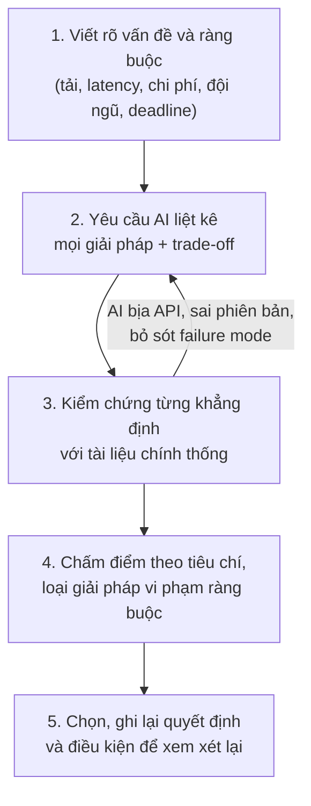

## Mục tiêu

Có một quy trình lặp lại được để dùng AI coding assistant như một người **liệt kê phương án**, còn bạn là người **ra quyết định**: làm rõ ràng buộc, yêu cầu AI đưa ra mọi giải pháp kèm trade-off, kiểm chứng với nguồn chính thống, rồi chọn và ghi lại lý do.

## Quy trình năm bước



### 1. Viết rõ vấn đề và ràng buộc

AI chỉ tối ưu theo những gì bạn nói. Trước khi hỏi, viết ra:

- **Yêu cầu chức năng:** hệ thống phải làm gì.
- **Yêu cầu phi chức năng:** số request mỗi giây, latency mục tiêu (ví dụ p99 dưới 300 ms), mức availability, giới hạn chi phí, yêu cầu bảo mật hay compliance.
- **Ràng buộc của đội:** đội đã quen công nghệ gì, ai sẽ vận hành, có on-call không.
- **Điều đã biết là sai:** các phương án đã thử và thất bại.

### 2. Yêu cầu AI liệt kê mọi giải pháp kèm trade-off

> [!pseudocode] Prompt mẫu để liệt kê giải pháp
> - **Dùng để:** buộc AI trả về nhiều phương án có so sánh, thay vì một đoạn code duy nhất.
> - **Đầu vào:** mô tả vấn đề và ràng buộc từ bước 1.
> - **Kết quả mong đợi:** một bảng 3 đến 6 phương án, mỗi phương án có ưu điểm, nhược điểm, failure mode, chi phí vận hành, và điều kiện nên chọn.
>
> ```text
> Vấn đề: <mô tả>
> Ràng buộc: <tải, latency, availability, chi phí, đội ngũ>
> Hãy liệt kê exhaustively các giải pháp khả thi (kể cả "không làm gì"
> và giải pháp đơn giản nhất). Với mỗi giải pháp, nêu:
> - cách hoạt động trong 2-3 câu
> - ưu điểm, nhược điểm
> - failure mode: chuyện gì xảy ra khi mạng lỗi, khi tải tăng 10 lần,
>   khi một thành phần chết
> - độ phức tạp vận hành và chi phí
> - khi nào nên chọn, khi nào không
> - tài liệu chính thống để kiểm chứng (RFC, docs chính thức)
> Không viết code. Cuối cùng, nêu phương án bạn khuyên và giả định đằng sau.
> ```

### 3. Kiểm chứng với nguồn chính thống

AI có thể nói tự tin về những điều sai: API không tồn tại, cấu hình của phiên bản cũ, giới hạn dịch vụ đã thay đổi. Với mỗi khẳng định quan trọng, mở tài liệu gốc:

| Loại khẳng định | Nguồn nên kiểm tra |
|---|---|
| Hành vi HTTP (method, status code, header) | RFC 9110, RFC 9111, MDN |
| Hành vi của Kubernetes | kubernetes.io/docs |
| Dịch vụ cloud, giới hạn, giá | Tài liệu chính thức của nhà cung cấp (AWS, Azure, Google Cloud) |
| Pattern kiến trúc (retry, circuit breaker, saga) | Azure Architecture Center, AWS Builders' Library, Google SRE book |
| API của ngôn ngữ, thư viện | Tài liệu chính thức của ngôn ngữ hoặc thư viện, đúng phiên bản bạn dùng |

### 4. Chấm điểm theo tiêu chí

| Tiêu chí | Câu hỏi cần trả lời |
|---|---|
| Đúng đắn | Có đúng ở mọi trường hợp, kể cả concurrent request và retry không? |
| Failure mode | Khi dependency chậm hoặc chết, hệ thống suy giảm thế nào? Có cascading failure không? |
| Khả năng mở rộng | Điểm nghẽn đầu tiên khi tải tăng 10 lần là gì? |
| Vận hành | Ai giám sát, cảnh báo dựa trên metric nào, rollback thế nào? |
| Bảo mật | Dữ liệu nhạy cảm đi đâu, ai có quyền truy cập? |
| Chi phí và độ phức tạp | Đội hiện tại có vận hành được không? Có đơn giản hơn mà vẫn đủ không? |
| Khả năng đảo ngược | Nếu chọn sai, quay lại tốn bao nhiêu? |

### 5. Ghi lại quyết định

Viết ngắn: bối cảnh, các phương án đã cân nhắc, phương án chọn, lý do, và **điều kiện để xem xét lại** (ví dụ "khi tải vượt 5.000 request/giây"). Đây cũng chính là câu chuyện bạn kể khi được hỏi trong phỏng vấn Senior.

## Dấu hiệu cảnh báo trong giải pháp AI

- Gọi dịch vụ bên ngoài **không có timeout**, hoặc dùng timeout mặc định vô hạn. Xem [[senior-engineering-topics]].
- **Retry mọi lỗi**, kể cả lỗi 4xx do request sai (khác với `429 Too Many Requests`, vốn nên retry theo `Retry-After`) và thao tác không idempotent như tạo đơn hàng. Xem [[backend-development-topics]] và [[retry-with-exponential-backoff]].
- Retry ở nhiều layer cùng lúc, nhân số request lên nhiều lần khi hệ thống đang quá tải.
- Đề xuất **microservices hoặc Kubernetes** cho một sản phẩm nhỏ, đội nhỏ, chưa có nhu cầu scale độc lập.
- Giữ state (session, file upload) trong bộ nhớ của một instance rồi đặt sau load balancer nhiều instance.
- Dùng **distributed transaction** khi có thể thiết kế lại ranh giới dữ liệu để tránh nó.
- Gọi API hoặc tham số cấu hình mà bạn không tìm thấy trong tài liệu chính thức.

## Bài luyện tập

Mỗi bài: tự viết ràng buộc, chạy prompt ở bước 2, kiểm chứng, rồi so với phần trả lời gợi ý trong trang được link.

1. Ứng dụng cần hiển thị trạng thái đơn hàng gần thời gian thực cho 50.000 người dùng đồng thời. Polling, Long Polling, Server-Sent Events hay WebSocket? Xem [[backend-engineering-basics]].
2. API tạo thanh toán bị client gửi lại khi timeout, gây trừ tiền hai lần. Thiết kế cách khắc phục. Xem [[backend-development-topics]].
3. Hệ thống chậm hẳn mỗi khi có chương trình khuyến mãi. Bắt đầu điều tra từ đâu? Xem [[system-design-basics]].
4. Một quy trình đặt hàng cập nhật ba service: Order, Payment, Inventory. Đảm bảo tính nhất quán thế nào? Xem [[senior-engineering-topics]].
5. Ứng dụng cần lưu 10 TB ảnh người dùng upload và một database PostgreSQL. Chọn loại storage nào cho từng thứ? Xem [[cloud-networking-and-storage]].

## Tự đánh giá

> [!level1] Level 1 — Nhận biết
> - Kể được ít nhất 4 dấu hiệu cảnh báo trong giải pháp AI đề xuất.
> - Biết nguồn chính thống cần mở cho từng loại khẳng định.

> [!level2] Level 2 — Áp dụng
> - Viết được mô tả ràng buộc đầy đủ (chức năng, phi chức năng, đội ngũ) cho một bài toán thật.
> - Hoàn thành ít nhất 3 bài luyện tập và ghi lại quyết định.

> [!level3] Level 3 — Engineering
> - Phát hiện được ít nhất một khẳng định sai hoặc một failure mode bị bỏ sót trong câu trả lời của AI, và chứng minh bằng tài liệu chính thống.
> - Viết được tài liệu quyết định kiến trúc có điều kiện xem xét lại đo lường được.

## Tài liệu tham khảo

- Microsoft, Azure Architecture Center: Cloud design patterns — [learn.microsoft.com/en-us/azure/architecture/patterns/](https://learn.microsoft.com/en-us/azure/architecture/patterns/): mỗi pattern có mục "Issues and considerations" và "When to use this pattern", rất hợp để đối chiếu trade-off.
- Amazon, The Amazon Builders' Library — [aws.amazon.com/builders-library/](https://aws.amazon.com/builders-library/)
- AWS Well-Architected Framework — [docs.aws.amazon.com/wellarchitected/latest/framework/welcome.html](https://docs.aws.amazon.com/wellarchitected/latest/framework/welcome.html)
- Google, *Site Reliability Engineering* — [sre.google/sre-book/table-of-contents/](https://sre.google/sre-book/table-of-contents/)
- IETF RFC 9110, *HTTP Semantics* — [rfc-editor.org/rfc/rfc9110](https://www.rfc-editor.org/rfc/rfc9110)
