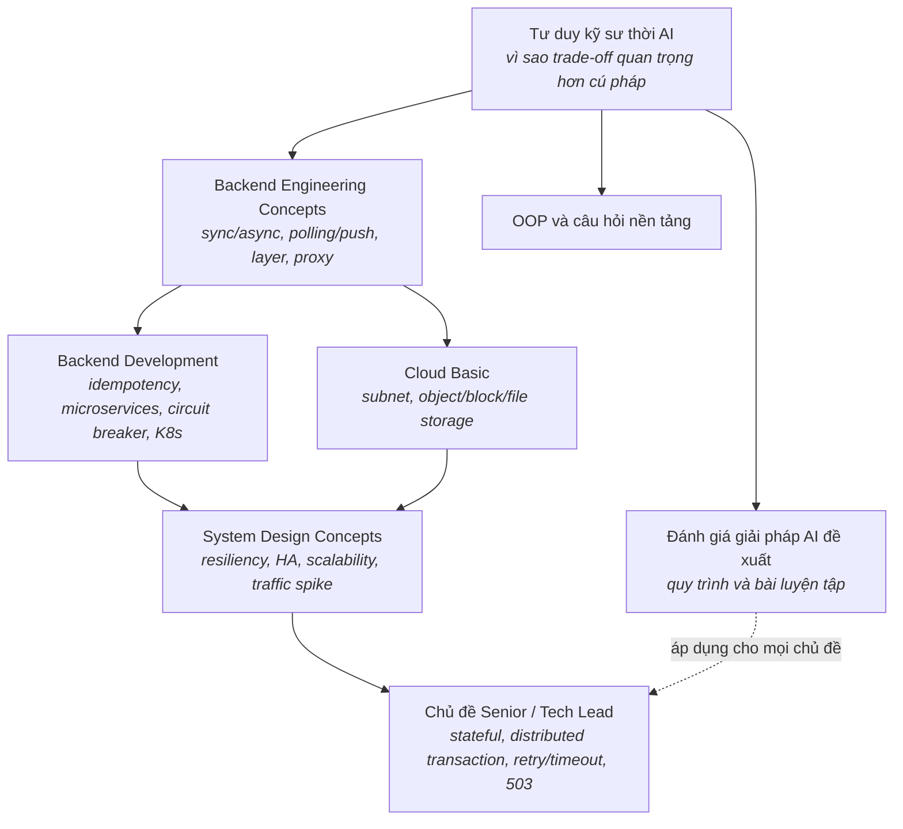
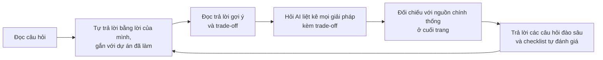

Khi AI viết được phần lớn code, việc gõ code trực tiếp không còn là kỹ năng khan hiếm. Thứ còn lại, và trở nên quan trọng hơn, là **problem solving**: hiểu đúng vấn đề, biết các giải pháp phổ biến, đánh giá được **trade-off** của từng giải pháp (kể cả giải pháp AI đề xuất), và thiết kế hệ thống chạy ổn định khi có lỗi và khi tải tăng.

Section này dùng cho hai mục đích:

1. **Củng cố kiến thức nền** cho developer làm việc cùng AI coding assistant: những khái niệm backend, system design và cloud mà bạn phải tự nắm để kiểm chứng code AI sinh ra.
2. **Chuẩn bị phỏng vấn** Backend / Fullstack Developer khi nhà tuyển dụng không còn hỏi sâu về ngôn ngữ hay framework, mà hỏi về khái niệm, tình huống thực tế và trade-off.

> [!info] Nguồn nội dung
> Danh sách câu hỏi được tổng hợp từ chia sẻ cộng đồng về cách phỏng vấn Fullstack Developer hiện nay. Mọi câu trả lời gợi ý đều dựa trên tài liệu chính thống (RFC, tài liệu chính thức của Kubernetes, AWS, Microsoft Azure, Google SRE, MDN, Oracle, Python) và được liệt kê ở cuối mỗi trang.

## Bản đồ section

| Trang | Dành cho | Trả lời câu hỏi |
|---|---|---|
| [[ai-era-mindset\|Tư duy kỹ sư thời AI]] | Mọi level | Khi AI viết code, kỹ sư cần giỏi điều gì? Phỏng vấn đang thay đổi ra sao? |
| [[evaluating-ai-solutions\|Đánh giá giải pháp AI đề xuất]] | Mọi level | Làm sao kiểm chứng và chọn giữa các giải pháp AI đưa ra? |
| [[backend-engineering-basics\|Backend Engineering Concepts]] | Junior, Middle | Sync/Async, Polling/Push, request đi qua những layer nào, Reverse/Forward Proxy |
| [[backend-development-topics\|Backend Development]] | Junior, Middle | Idempotency, Microservices vs Monolith, Circuit Breaker, container orchestration |
| [[system-design-basics\|System Design Concepts]] | Middle | Resiliency, High Availability, Scalability; scale ngang/dọc; xử lý traffic tăng đột biến |
| [[cloud-networking-and-storage\|Cloud Basic]] | Junior, Middle | Public/Private Subnet; Object, Block, File Storage |
| [[senior-engineering-topics\|Chủ đề Senior / Tech Lead]] | Senior | Stateful vs Stateless workload, distributed transaction, retry và timeout, vòng đời workload K8s và sự cố 503 |
| [[oop-fundamentals\|OOP và câu hỏi nền tảng]] | Junior | 4 tính chất OOP trả lời theo hướng ứng dụng thực tế |

## Cách học với section này

- Mỗi câu hỏi có cùng một khung: **người hỏi muốn kiểm tra gì**, **trả lời gợi ý**, **trade-off**, **lỗi hay gặp**, **câu hỏi đào sâu**.
- Các câu hỏi là **checklist technical points**, không phải đề thi để học thuộc. Trong phỏng vấn thực tế, người hỏi thường chọn 2 đến 3 câu phù hợp với dự án trong CV của bạn rồi đào sâu.
- Mỗi trang kết thúc bằng checklist tự đánh giá theo ba level của wiki (xem [[how-to-learn]]): nhận biết, triển khai, engineering.
- Nhiều câu trả lời link sang trang concept có sẵn trong wiki (bằng tiếng Anh) như [[retry-with-exponential-backoff]], [[token-bucket]] hay [[async-io-event-loop]], nơi có code chạy được và test.
