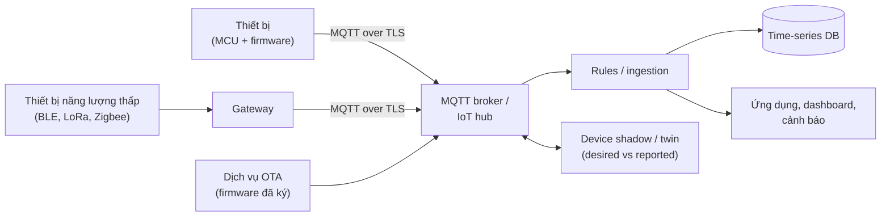
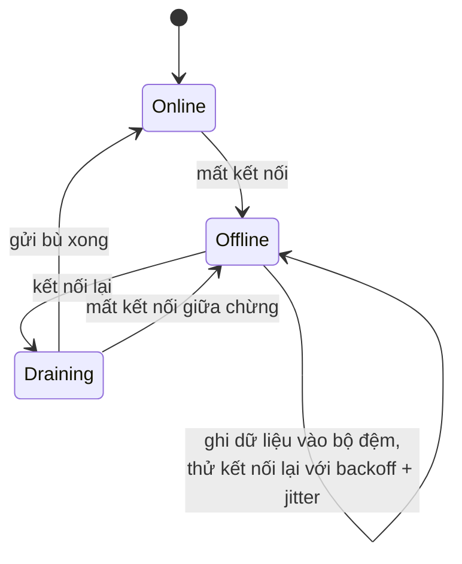
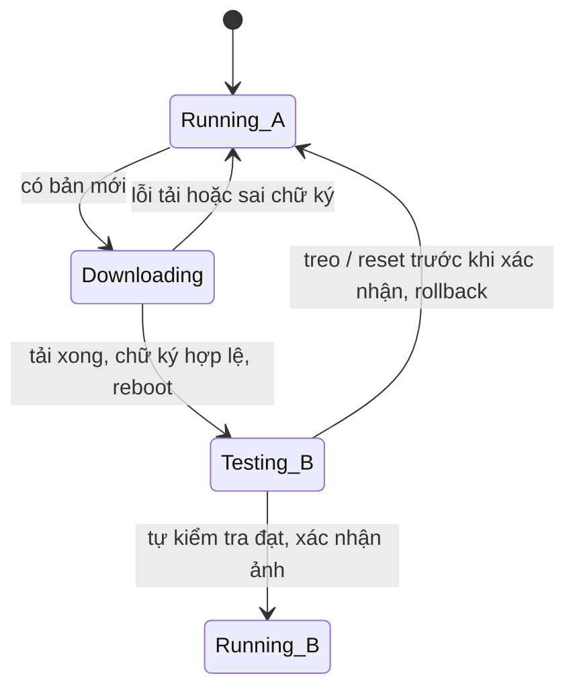

## Mục tiêu

Chuẩn bị cho kỹ sư làm **hệ thống IoT**: nơi firmware trên thiết bị, kết nối mạng chập chờn và backend trên cloud phải cùng hoạt động. Các câu hỏi xoay quanh năm vấn đề đặc thù: **giao thức nhẹ cho thiết bị**, **mất kết nối là chuyện bình thường**, **cập nhật firmware từ xa không được làm "chết" thiết bị**, **bảo mật cho hàng nghìn thiết bị ngoài hiện trường**, và **quản lý trạng thái của cả đội thiết bị**.

IoT là nơi giao nhau của [[embedded-firmware-topics|embedded]] và [[backend-development-topics|backend]], nên nhiều khái niệm ở hai trang đó (idempotency, retry có backoff, watchdog) xuất hiện lại ở đây.

## Câu 1: Vì sao thiết bị IoT hay dùng MQTT? QoS 0, 1, 2 khác nhau thế nào?

### Người hỏi muốn kiểm tra gì

Bạn hiểu mô hình publish/subscribe qua broker, và chọn được mức đảm bảo giao nhận phù hợp thay vì mặc định dùng mức cao nhất.

### Trả lời gợi ý

**MQTT** là giao thức publish/subscribe qua một **broker**, chạy trên TCP (thường kèm TLS). Thiết bị giữ một kết nối lâu dài, publish lên **topic** và subscribe các topic cần nhận lệnh. Lý do phổ biến với thiết bị: header rất nhỏ, thiết bị không cần biết ai nhận dữ liệu ([[publish-subscribe-messaging]]), server gửi lệnh xuống được qua kết nối thiết bị đã mở (không cần mở port trên thiết bị nằm sau NAT).

| QoS | Đảm bảo | Cơ chế | Khi nào dùng |
|---|---|---|---|
| 0 | At most once: có thể mất | Gửi một lần, không xác nhận | Telemetry gửi dày đặc, mất một mẫu không sao |
| 1 | At least once: có thể trùng | Bên gửi giữ message đến khi nhận `PUBACK`; nếu mất kết nối trước đó thì gửi lại khi kết nối lại | Mặc định hợp lý cho sự kiện quan trọng; bên nhận phải xử lý trùng (idempotent) |
| 2 | Exactly once | Bắt tay bốn gói (`PUBLISH`, `PUBREC`, `PUBREL`, `PUBCOMP`) | Ít dùng: tốn băng thông, độ trễ cao; thường thay bằng QoS 1 + khử trùng ở ứng dụng |

Lưu ý: QoS áp dụng **từng chặng** (publisher → broker, broker → subscriber). Mức QoS subscriber nhận được bị giới hạn bởi mức QoS mà nó đăng ký, nên "exactly once" không tự động đúng từ đầu đến cuối.

**Các tính năng khác thường được hỏi:**

- **Retained message:** broker giữ message retained cuối cùng của một topic và gửi ngay cho subscriber mới. Dùng cho trạng thái hiện tại (ví dụ `device/42/status`).
- **Last Will and Testament:** thiết bị đăng ký trước một message; broker tự publish nó khi thiết bị **mất kết nối bất thường** (hết keep alive). Dùng để báo thiết bị offline.
- **Keep Alive:** khoảng thời gian tối đa giữa hai gói tin client gửi (không có dữ liệu thì gửi `PINGREQ`); broker ngắt kết nối nếu quá 1,5 lần khoảng này mà không nhận được gì. Giúp phát hiện kết nối chết qua NAT hoặc mạng di động.
- **Persistent session** (MQTT 5: `Clean Start` = 0 kèm `Session Expiry Interval`): broker giữ subscription và message QoS 1/2 chưa giao trong lúc thiết bị offline.

**Lựa chọn khác:** CoAP (RFC 7252) chạy trên UDP, kiểu REST, hợp cho thiết bị rất hạn chế tài nguyên; HTTPS hợp với thiết bị gửi dữ liệu thưa và không cần nhận lệnh tức thời.

### Câu hỏi đào sâu

- 100.000 thiết bị cùng mất kết nối khi broker khởi động lại. Chuyện gì xảy ra khi chúng kết nối lại cùng lúc, và bạn phòng tránh thế nào? (Thundering herd; reconnect với exponential backoff và jitter, xem [[retry-with-exponential-backoff]].)
- Thiết kế cây topic thế nào để phân quyền theo thiết bị?

## Câu 2: Thiết bị mất kết nối thường xuyên thì thiết kế thế nào?

### Người hỏi muốn kiểm tra gì

Bạn coi mất kết nối là trạng thái bình thường, không phải ngoại lệ.

### Trả lời gợi ý

- **Store-and-forward:** khi offline, thiết bị ghi dữ liệu vào bộ đệm cục bộ ([[ring-buffer]] trong RAM hoặc trên flash), gửi bù khi có mạng. Phải quyết định khi đầy thì bỏ dữ liệu cũ hay mới, và tốc độ gửi bù để không làm nghẽn băng thông.
- **Gắn timestamp tại thiết bị**, không dựa vào thời điểm server nhận. Thiết bị cần đồng bộ thời gian (SNTP) và xử lý trường hợp chưa có giờ đúng sau khi khởi động.
- **Ingestion idempotent:** dữ liệu gửi bù có thể trùng (QoS 1, retry). Gắn mã định danh duy nhất cho mỗi bản ghi (ví dụ device ID + số thứ tự) để backend khử trùng ([[backend-development-topics]]).
- **Thiết bị tự hoạt động được khi offline:** logic an toàn và điều khiển cục bộ không phụ thuộc cloud. Ví dụ bộ điều nhiệt vẫn giữ nhiệt độ khi mất Internet.
- **Phân biệt "offline" với "hỏng":** dùng Last Will, heartbeat, và thời điểm gửi dữ liệu cuối cùng.

### Câu hỏi đào sâu

- Bộ đệm trên flash: làm sao tránh mòn flash do ghi liên tục, và không hỏng dữ liệu khi mất điện giữa lúc ghi? Xem [[atomic-writes-and-crash-safety]].

## Câu 3: Thiết kế cập nhật firmware từ xa (OTA) an toàn

### Người hỏi muốn kiểm tra gì

Bạn có biết OTA là tính năng rủi ro nhất của IoT: một bản cập nhật lỗi có thể biến hàng nghìn thiết bị thành "cục gạch" (brick) mà không ai đến tận nơi sửa được.

### Trả lời gợi ý

- **Hai vùng ảnh (A/B slots):** ảnh mới được ghi vào vùng không chạy; vùng đang chạy không bị đụng tới. Mất điện giữa lúc tải về không ảnh hưởng firmware hiện tại.
- **Xác thực trước khi chạy:** ảnh firmware được **ký số**; bootloader kiểm tra chữ ký (và hash, xem [[cryptographic-hash-functions]]) trước khi boot. Chặn cả lỗi truyền lẫn firmware giả mạo.
- **Boot thử và tự rollback:** bootloader boot ảnh mới ở chế độ thử; ứng dụng phải tự kiểm tra sức khỏe (kết nối được mạng, cảm biến hoạt động) rồi mới **xác nhận** ảnh. Nếu ảnh mới treo hoặc reset trước khi xác nhận (kết hợp watchdog), bootloader quay về ảnh cũ. MCUboot hỗ trợ mô hình này.
- **Chống hạ phiên bản (anti-rollback)** để kẻ tấn công không cài lại bản cũ có lỗ hổng.
- **Triển khai từng đợt (staged rollout):** cập nhật 1% thiết bị, theo dõi tỉ lệ lỗi, rồi mới mở rộng; có cách dừng đợt triển khai.
- **Điều kiện cập nhật:** đủ pin, không đang làm tác vụ quan trọng, mạng ổn định.

### Câu hỏi đào sâu

- Flash không đủ chỗ cho hai vùng ảnh. Bạn có những lựa chọn nào và đánh đổi gì?
- Khóa bí mật để ký firmware được bảo vệ thế nào trong pipeline build?

## Câu 4: Bảo mật cho đội thiết bị

### Trả lời gợi ý

Các tiêu chuẩn cơ bản như ETSI EN 303 645 và NIST IR 8259A đưa ra những yêu cầu tối thiểu mà câu trả lời nên chạm tới:

- **Không dùng mật khẩu mặc định chung** cho mọi thiết bị; mỗi thiết bị có **danh tính riêng** (ví dụ chứng chỉ X.509 riêng, khóa riêng sinh và lưu trong secure element nếu có).
- **Mã hóa kết nối** (TLS) và xác thực hai chiều thiết bị với server.
- **Phân quyền tối thiểu trên broker:** thiết bị chỉ publish/subscribe được topic của chính nó, để một thiết bị bị chiếm quyền không đọc được dữ liệu của thiết bị khác.
- **Cơ chế cập nhật an toàn** (câu 3) và chính sách hỗ trợ cập nhật trong bao lâu.
- **Thu hồi danh tính** của thiết bị bị đánh cắp hoặc thải bỏ.
- **Kênh tiếp nhận báo cáo lỗ hổng.**

### Câu hỏi đào sâu

- Đưa chứng chỉ riêng vào từng thiết bị lúc sản xuất (provisioning) thế nào khi nhà máy là bên thứ ba?

## Câu 5: Device shadow / device twin để làm gì?

### Trả lời gợi ý

Backend cần biết và điều khiển trạng thái của thiết bị ngay cả khi thiết bị offline. **Device shadow** (AWS IoT) hay **device twin** (Azure IoT Hub) là một tài liệu JSON lưu trên cloud cho mỗi thiết bị, gồm:

- **Desired:** trạng thái ứng dụng muốn (ví dụ `"target_temp": 24`).
- **Reported:** trạng thái thiết bị báo lên (ví dụ `"target_temp": 22`).
- Khi thiết bị kết nối lại, nó đọc phần chênh lệch (delta), áp dụng, rồi báo lại reported. Đây là mô hình **reconciliation** giống controller của Kubernetes: khai báo trạng thái mong muốn, hệ thống tự hội tụ ([[backend-development-topics]]).

Cần lưu ý: xung đột khi nhiều bên cùng sửa desired (dùng version), và thiết bị phải kiểm tra giá trị desired có hợp lệ, an toàn trước khi áp dụng.

## Code AI sinh ra cho IoT: cần soi gì

- Kết nối MQTT không TLS, hoặc tắt kiểm tra chứng chỉ để "cho chạy được".
- Khóa bí mật hoặc mật khẩu viết cứng trong code.
- Kết nối lại ngay lập tức trong vòng lặp, không backoff, không jitter.
- Mặc định QoS 2 cho mọi thứ, hoặc QoS 1 mà backend không khử trùng.
- OTA ghi đè trực tiếp lên firmware đang chạy, không kiểm tra chữ ký, không rollback.
- Giả định thiết bị luôn có giờ đúng và luôn online.

## Tự đánh giá

> [!level1] Level 1 — Nhận biết
> - Phân biệt được QoS 0, 1, 2 và nêu khi nào dùng mỗi mức.
> - Giải thích retained message và Last Will.
> - Kể được ít nhất 4 yêu cầu bảo mật cơ bản cho thiết bị IoT.

> [!level2] Level 2 — Áp dụng
> - Viết client MQTT trên thiết bị có TLS, reconnect với backoff + jitter, store-and-forward khi offline.
> - Cài đặt ingestion phía backend khử trùng bản ghi theo device ID và số thứ tự.
> - Cấu hình bootloader A/B với kiểm tra chữ ký và rollback.

> [!level3] Level 3 — Engineering
> - Thiết kế quy trình OTA cho đội 100.000 thiết bị: ký, triển khai từng đợt, giám sát, dừng khẩn cấp.
> - Thiết kế provisioning danh tính thiết bị với nhà máy bên thứ ba.

## Tài liệu tham khảo

- OASIS, *MQTT Version 5.0* — [docs.oasis-open.org/mqtt/mqtt/v5.0/mqtt-v5.0.html](https://docs.oasis-open.org/mqtt/mqtt/v5.0/mqtt-v5.0.html)
- IETF RFC 7252, *The Constrained Application Protocol (CoAP)* — [rfc-editor.org/rfc/rfc7252](https://www.rfc-editor.org/rfc/rfc7252)
- IETF RFC 9019, *A Firmware Update Architecture for Internet of Things* — [rfc-editor.org/rfc/rfc9019](https://www.rfc-editor.org/rfc/rfc9019)
- MCUboot documentation, *Bootloader design* — [docs.mcuboot.com/design.html](https://docs.mcuboot.com/design.html)
- ETSI, *Consumer IoT security* (EN 303 645) — [etsi.org/technologies/consumer-iot-security](https://www.etsi.org/technologies/consumer-iot-security)
- NIST IR 8259A, *IoT Device Cybersecurity Capability Core Baseline* — [csrc.nist.gov/pubs/ir/8259/a/final](https://csrc.nist.gov/pubs/ir/8259/a/final)
- AWS IoT Core documentation, *Device Shadow service* — [docs.aws.amazon.com/iot/latest/developerguide/iot-device-shadows.html](https://docs.aws.amazon.com/iot/latest/developerguide/iot-device-shadows.html)
- Microsoft, *Understand and use device twins in IoT Hub* — [learn.microsoft.com/en-us/azure/iot-hub/iot-hub-devguide-device-twins](https://learn.microsoft.com/en-us/azure/iot-hub/iot-hub-devguide-device-twins)
- Amazon Builders' Library, *Timeouts, retries, and backoff with jitter* — [aws.amazon.com/builders-library/timeouts-retries-and-backoff-with-jitter/](https://aws.amazon.com/builders-library/timeouts-retries-and-backoff-with-jitter/)
