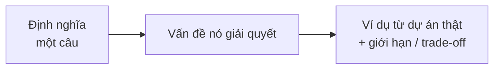
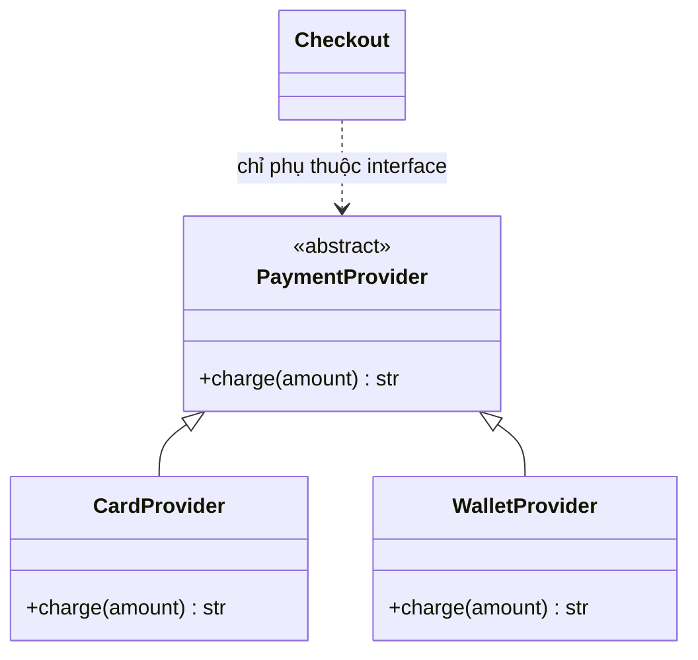

## Mục tiêu

Trả lời câu hỏi kinh điển "**4 tính chất của lập trình hướng đối tượng và cách dùng trong ứng dụng thực tế**" theo hướng người phỏng vấn mong đợi: không chỉ định nghĩa, mà **mỗi tính chất giải quyết vấn đề gì** và **bạn đã dùng nó ở đâu**. Kiến thức này cũng là nền để đọc, review và refactor code AI sinh ra.

## Vì sao câu hỏi này vẫn được hỏi

Đây là câu nhập môn, độ sâu tùy level. Nhiều ứng viên, kể cả người không học đại học chuyên ngành, làm việc được nhưng trả lời không trọn vẹn vì chỉ nhớ định nghĩa. Người phỏng vấn thường không cần thuật ngữ hàn lâm; họ muốn thấy bạn hiểu **mục đích**. Một câu trả lời tốt có ba lớp:



## Bốn tính chất

### Encapsulation (đóng gói)

- **Định nghĩa:** gom dữ liệu và các thao tác trên dữ liệu đó vào một đơn vị, và **ẩn trạng thái bên trong**, chỉ cho phép thay đổi qua các phương thức được kiểm soát.
- **Vấn đề giải quyết:** bảo vệ **invariant** (điều kiện luôn phải đúng) của đối tượng. Ví dụ số dư tài khoản không được âm: nếu ai cũng gán trực tiếp `balance = -100` được thì không ai đảm bảo được điều đó.
- **Cách thể hiện:** access modifiers (`private`, `protected`, `public` trong Java; quy ước `_name` và `@property` trong Python), getter/setter có kiểm tra.
- **Điểm ăn điểm:** getter và setter cho **mọi** field (như Lombok `@Getter @Setter` sinh tự động) **không** phải là encapsulation thực sự nếu setter cho phép gán bất kỳ giá trị nào. Encapsulation tốt là đưa ra **hành vi có ý nghĩa nghiệp vụ** (`withdraw(amount)`) thay vì `setBalance(x)`.

> [!mwe] Encapsulation bảo vệ invariant (Python 3.10+)
> - **Dùng để:** minh họa đóng gói bằng hành vi nghiệp vụ thay vì setter tự do.
> - **Đầu vào:** không có; chạy file trực tiếp.
> - **Kết quả mong đợi:** in `70`, rồi in `từ chối: số dư không đủ`.
>
> ```python
> class Account:
>     def __init__(self, balance: int = 0) -> None:
>         self._balance = balance          # "_" = nội bộ, không gán trực tiếp
>
>     @property
>     def balance(self) -> int:            # chỉ đọc từ bên ngoài
>         return self._balance
>
>     def withdraw(self, amount: int) -> None:
>         if amount <= 0:
>             raise ValueError("số tiền phải dương")
>         if amount > self._balance:
>             raise ValueError("số dư không đủ")
>         self._balance -= amount
>
> acc = Account(100)
> acc.withdraw(30)
> print(acc.balance)
> try:
>     acc.withdraw(500)
> except ValueError as e:
>     print("từ chối:", e)
> ```

### Abstraction (trừu tượng hóa)

- **Định nghĩa:** chỉ đưa ra những gì bên sử dụng cần biết (**cái gì**), ẩn đi chi tiết thực hiện (**làm thế nào**).
- **Vấn đề giải quyết:** giảm độ phức tạp và độ phụ thuộc. Code nghiệp vụ gọi `storage.save(file)` mà không cần biết file được lưu lên S3 hay ổ đĩa.
- **Cách thể hiện:** interface, abstract class (Java `interface`, Python `abc.ABC` hoặc `typing.Protocol`).
- **Phân biệt với encapsulation:** abstraction là thiết kế **giao diện** từ góc nhìn người dùng; encapsulation là cơ chế **che giấu và bảo vệ** trạng thái bên trong. Hai thứ thường đi cùng nhau.

### Inheritance (kế thừa)

- **Định nghĩa:** lớp con nhận lại thuộc tính và hành vi của lớp cha, có thể mở rộng hoặc ghi đè.
- **Vấn đề giải quyết:** tái sử dụng code và biểu diễn quan hệ "là một" (is-a).
- **Trade-off quan trọng:** kế thừa tạo ghép nối chặt; thay đổi lớp cha có thể làm hỏng lớp con. Nguyên tắc phổ biến là **ưu tiên composition hơn inheritance** khi quan hệ thật ra là "có một" (has-a) hoặc chỉ muốn tái sử dụng code. Nêu được điều này thường ghi điểm ở level Middle trở lên.

### Polymorphism (đa hình)

- **Định nghĩa:** cùng một lời gọi, đối tượng khác nhau thực hiện theo cách riêng của chúng.
- **Vấn đề giải quyết:** thêm biến thể mới mà **không sửa code đang gọi**, thay vì chuỗi `if/else` theo loại.
- **Cách thể hiện:** ghi đè phương thức (overriding, đa hình lúc chạy); nạp chồng (overloading, đa hình lúc biên dịch, có trong Java, không có theo cùng cách trong Python); duck typing trong Python.

> [!mwe] Abstraction và polymorphism với cổng thanh toán (Python 3.10+)
> - **Dùng để:** minh họa code nghiệp vụ chỉ phụ thuộc vào interface, thêm cổng thanh toán mới không phải sửa hàm `checkout`.
> - **Đầu vào:** không có; chạy file trực tiếp.
> - **Kết quả mong đợi:** in hai dòng `card: charged 100` và `wallet: charged 100`.
>
> ```python
> from abc import ABC, abstractmethod
>
> class PaymentProvider(ABC):              # abstraction: chỉ nói "cái gì"
>     @abstractmethod
>     def charge(self, amount: int) -> str: ...
>
> class CardProvider(PaymentProvider):
>     def charge(self, amount: int) -> str:
>         return f"card: charged {amount}"
>
> class WalletProvider(PaymentProvider):
>     def charge(self, amount: int) -> str:
>         return f"wallet: charged {amount}"
>
> def checkout(provider: PaymentProvider, amount: int) -> None:
>     print(provider.charge(amount))       # polymorphism: không cần if/else theo loại
>
> for p in (CardProvider(), WalletProvider()):
>     checkout(p, 100)
> ```



## Cách trả lời trong phỏng vấn

1. **Mở bằng một câu định nghĩa cho mỗi tính chất**, đừng sa vào thuật ngữ.
2. **Gắn mỗi tính chất với một ví dụ từ dự án**, ví dụ: "Ở dự án thanh toán, em định nghĩa interface `PaymentProvider`, mỗi cổng là một lớp riêng; thêm ví điện tử mới không phải sửa luồng checkout."
3. **Chủ động đưa một keyword sâu hơn** mà bạn giải thích được: *invariant*, *composition over inheritance*, *dependency inversion*, *design pattern Strategy*. Người phỏng vấn thường đào tiếp vào đó, giúp bạn dẫn dắt về vùng mình mạnh.
4. **Nêu giới hạn:** kế thừa sâu khó bảo trì; getter/setter tràn lan làm mất ý nghĩa đóng gói.

### Câu hỏi đào sâu

- Composition khác inheritance thế nào? Cho ví dụ nên đổi từ kế thừa sang composition.
- Interface khác abstract class thế nào trong ngôn ngữ bạn dùng?
- Design pattern nào dựa trên polymorphism mà bạn từng dùng? (Strategy, [[command-pattern]], Template Method...)

## Tự đánh giá

> [!level1] Level 1 — Nhận biết
> - Định nghĩa được 4 tính chất, mỗi tính chất một câu.
> - Phân biệt được encapsulation và abstraction.

> [!level2] Level 2 — Áp dụng
> - Viết lại một lớp có getter/setter tự do thành lớp có hành vi nghiệp vụ bảo vệ invariant.
> - Thay một chuỗi `if/else` theo loại bằng polymorphism.

> [!level3] Level 3 — Engineering
> - Lập luận được khi nào kế thừa là hợp lý, khi nào nên dùng composition, có ví dụ từ dự án.
> - Review được code AI sinh ra và chỉ ra chỗ vi phạm đóng gói hoặc ghép nối chặt do kế thừa.

## Tài liệu tham khảo

- Oracle, The Java Tutorials, *Object-Oriented Programming Concepts* — [docs.oracle.com/javase/tutorial/java/concepts/](https://docs.oracle.com/javase/tutorial/java/concepts/)
- Oracle, The Java Tutorials, *Controlling Access to Members of a Class* — [docs.oracle.com/javase/tutorial/java/javaOO/accesscontrol.html](https://docs.oracle.com/javase/tutorial/java/javaOO/accesscontrol.html); *Polymorphism* — [docs.oracle.com/javase/tutorial/java/IandI/polymorphism.html](https://docs.oracle.com/javase/tutorial/java/IandI/polymorphism.html)
- Python documentation, *Classes* — [docs.python.org/3/tutorial/classes.html](https://docs.python.org/3/tutorial/classes.html); *abc — Abstract Base Classes* — [docs.python.org/3/library/abc.html](https://docs.python.org/3/library/abc.html)
- Project Lombok, *@Getter and @Setter* — [projectlombok.org/features/GetterSetter](https://projectlombok.org/features/GetterSetter)
