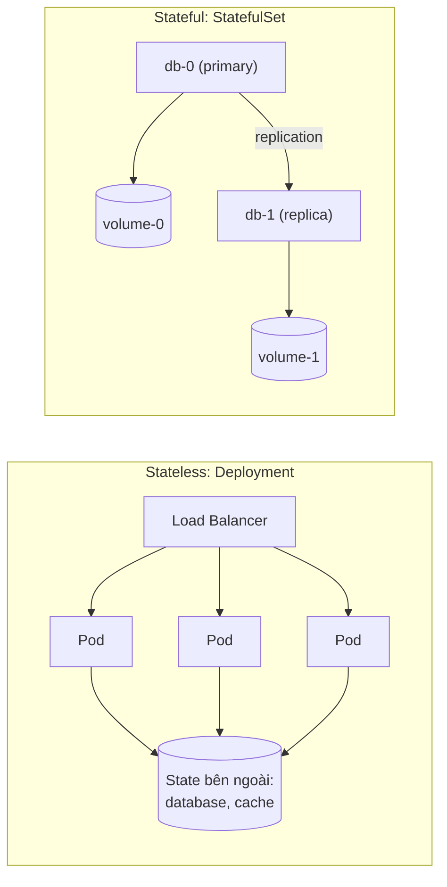
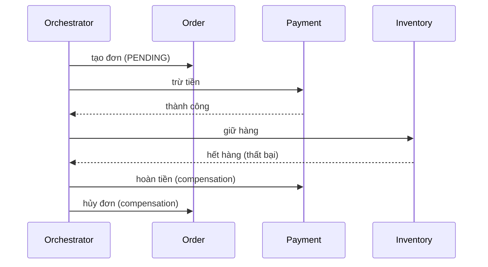
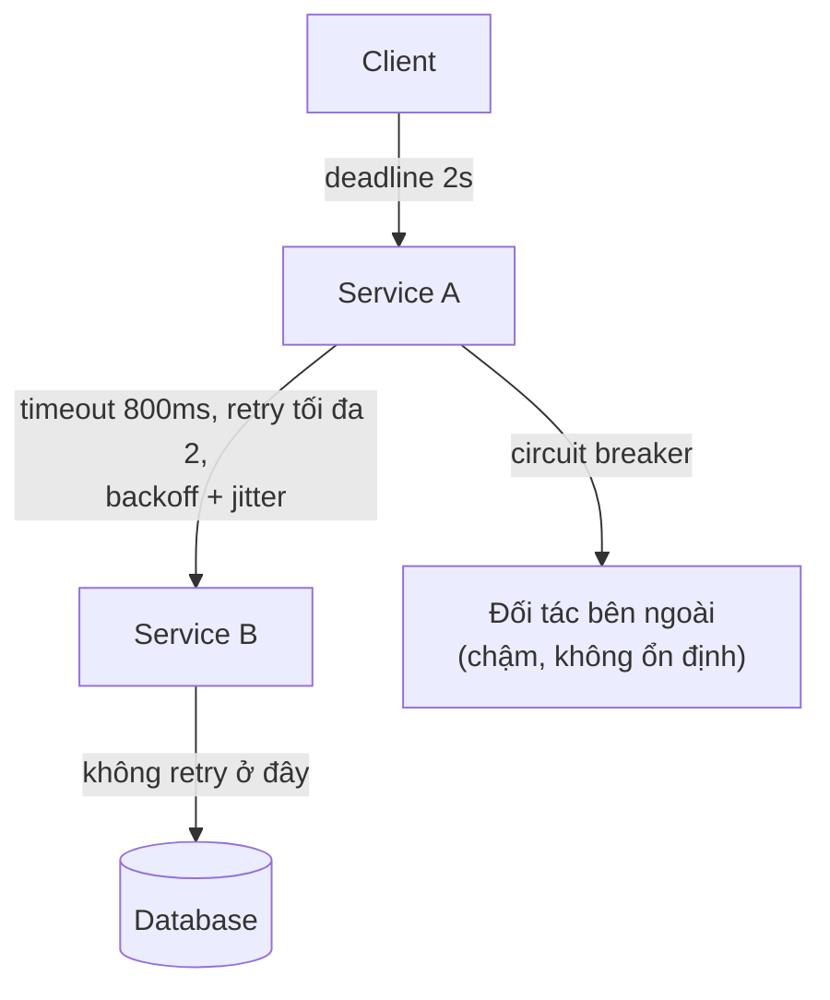
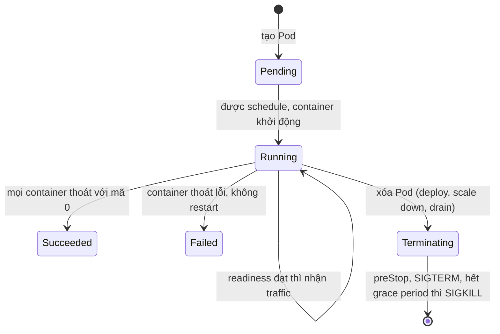
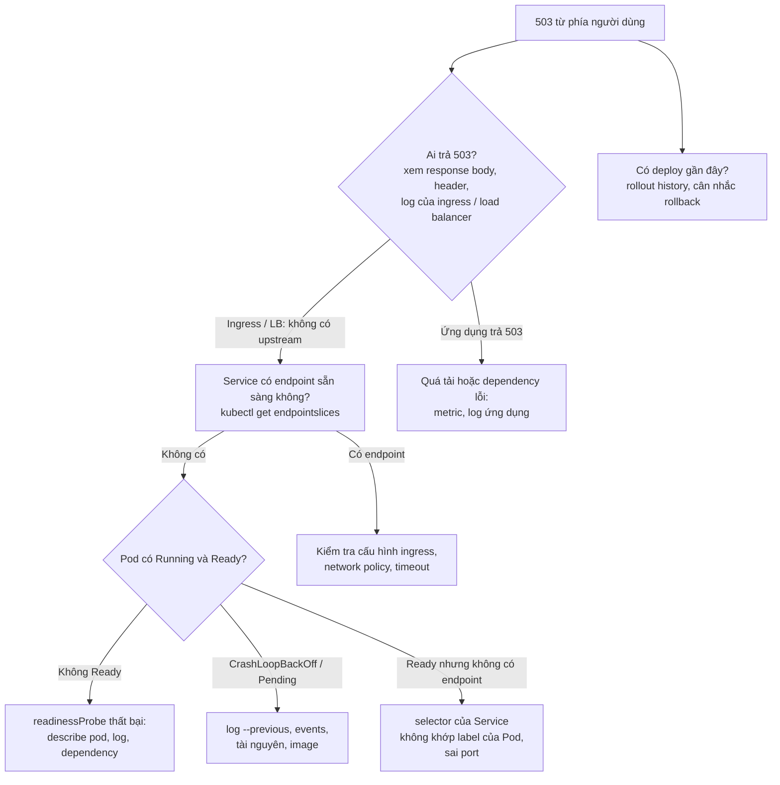

## Mục tiêu

Chuẩn bị cho dạng phỏng vấn **thảo luận** ở level Senior / Tech Lead: người hỏi đưa ra một chủ đề và muốn nghe kinh nghiệm thực chiến, lý do chọn giải pháp và bài học. Bốn chủ đề: **Stateful và Stateless workload**, **distributed transaction**, **retry và timeout khi tích hợp nhiều hệ thống**, **vòng đời workload trên Kubernetes và quy trình xử lý sự cố 503**.

Ở level này không có "đáp án đúng" duy nhất. Phần trả lời gợi ý dưới đây là **bản đồ các giải pháp và trade-off** đã được tài liệu chính thống mô tả; câu trả lời tốt là câu trả lời đặt các giải pháp đó vào **context dự án của bạn**, nói rõ vì sao chọn và cái giá đã trả.

> [!tip] Khung kể chuyện cho mỗi chủ đề
> Bối cảnh (hệ thống, tải, đội) → vấn đề gặp phải → các phương án đã cân nhắc → quyết định và lý do → kết quả đo được → nếu làm lại thì đổi gì.

## Chủ đề 1: Vận hành và mở rộng Stateful và Stateless workload

### Người hỏi muốn nghe gì

Bạn đã vận hành cả hai loại workload chưa, biết vì sao stateless dễ scale, và đã giải quyết những khó khăn đặc thù của stateful (dữ liệu, thứ tự khởi động, backup, failover) như thế nào.

### Bản đồ kiến thức

- **Stateless workload:** mỗi request mang đủ thông tin để xử lý; instance không giữ dữ liệu cần thiết cho request sau. Bất kỳ instance nào cũng phục vụ được bất kỳ request nào, nên có thể thêm, bớt, thay thế tự do. Nguyên tắc "Processes" của The Twelve-Factor App: process stateless, mọi dữ liệu cần lưu lại nằm trong một backing service (database, cache).
- **Stateful workload:** instance giữ dữ liệu hoặc danh tính riêng: database, message broker, cache phân tán, service giữ kết nối WebSocket. Không thể thay thế tùy ý vì dữ liệu gắn với nó.

| Khía cạnh | Stateless | Stateful |
|---|---|---|
| Scale | Thêm instance sau load balancer, autoscaling dễ | Cần replication, sharding, cân bằng lại dữ liệu |
| Trên Kubernetes | `Deployment`: Pod có thể thay thế cho nhau | `StatefulSet`: tên mạng cố định, storage riêng ổn định cho mỗi Pod, khởi động và cập nhật theo thứ tự |
| Khi instance chết | Tạo cái mới, xong | Phải gắn lại đúng volume, có thể cần failover, kiểm tra dữ liệu |
| Triển khai mới | Rolling update đơn giản | Cần cẩn thận với schema, phiên bản giao thức giữa các node, thứ tự |
| Backup | Không cần cho instance | Bắt buộc, và phải **diễn tập restore** |



### Những điểm nên có trong câu trả lời

- **Đẩy state ra khỏi tầng ứng dụng** để tầng đó stateless: session vào cache hoặc database, file vào object storage ([[cloud-networking-and-storage]]). Sticky session là giải pháp tạm, làm phân phối tải lệch và mất session khi instance chết.
- **Với stateful, cân nhắc dịch vụ managed** (database managed của cloud) trước khi tự vận hành trên Kubernetes. Tự vận hành nghĩa là tự lo backup, failover, nâng cấp phiên bản, giám sát replication lag.
- **Bảo vệ khi bảo trì:** `PodDisruptionBudget` để không mất quá nhiều replica cùng lúc khi drain node.
- **Workload giữ kết nối lâu (WebSocket)** cũng là stateful theo nghĩa kết nối: scale cần pub/sub giữa các instance ([[publish-subscribe-messaging]]), deploy cần drain kết nối từ từ.

### Câu hỏi đào sâu

- Kể một sự cố liên quan đến dữ liệu của stateful workload bạn từng xử lý. Phát hiện thế nào, mất bao lâu để phục hồi?
- Lần gần nhất bạn diễn tập restore từ backup là khi nào?

## Chủ đề 2: Distributed transaction

*Anh thường tiếp cận giải pháp gì cho các bài toán distributed transaction, lý do là gì?*

### Người hỏi muốn nghe gì

Bạn có biết các giải pháp chính, trade-off của chúng, và quan trọng nhất là **lý do** chọn trong từng bài toán, kể cả lựa chọn "thiết kế lại để không cần distributed transaction".

### Bản đồ giải pháp

**0. Tránh nó nếu có thể.** Nếu hai dữ liệu luôn phải thay đổi cùng nhau một cách nguyên tử, có thể chúng thuộc cùng một service và cùng một database. Ranh giới service đặt sai là nguyên nhân phổ biến của nhu cầu distributed transaction.

**1. Two-Phase Commit (2PC).** Một coordinator hỏi mọi bên "sẵn sàng commit chưa" (prepare), rồi ra lệnh commit hoặc rollback cho tất cả.

- Ưu: nhất quán mạnh (atomic thật).
- Nhược: **blocking**: nếu coordinator chết sau khi các bên đã prepare, các bên giữ lock cho đến khi coordinator phục hồi; latency cao vì nhiều vòng mạng; cần mọi bên hỗ trợ giao thức (XA, `PREPARE TRANSACTION` của PostgreSQL); không phù hợp khi một bên là API HTTP của bên thứ ba.

**2. Saga.** Chia thành chuỗi transaction cục bộ, mỗi bước có một **compensating transaction** để hoàn tác về mặt nghiệp vụ nếu bước sau thất bại.

- **Choreography:** mỗi service phát event, service khác lắng nghe và làm bước tiếp. Ít ghép nối, nhưng khó theo dõi luồng khi có nhiều bước.
- **Orchestration:** một orchestrator điều phối từng bước. Dễ hiểu và giám sát hơn, nhưng orchestrator là một thành phần cần vận hành.
- Nhược: chỉ đạt **eventual consistency**; **thiếu isolation** (người khác có thể thấy trạng thái trung gian), cần các biện pháp như semantic lock (trạng thái "đang xử lý"); compensating transaction phải idempotent và không phải lúc nào cũng hoàn tác được (email đã gửi).



**3. Transactional Outbox.** Giải quyết vấn đề "ghi database và gửi message phải cùng thành công": ghi dữ liệu nghiệp vụ và một bản ghi event vào bảng `outbox` **trong cùng một transaction cục bộ**; một tiến trình riêng đọc bảng outbox và publish lên message broker. Đảm bảo at-least-once, nên consumer phải idempotent ([[backend-development-topics]]). Thường là nền tảng để cài đặt saga kiểu choreography một cách tin cậy.

| Giải pháp | Nhất quán | Độ phức tạp | Khi nào chọn |
|---|---|---|---|
| Gộp ranh giới | Mạnh (transaction cục bộ) | Thấp | Dữ liệu luôn thay đổi cùng nhau |
| 2PC | Mạnh | Trung bình, phụ thuộc hạ tầng | Ít bên, cùng hạ tầng hỗ trợ XA, latency không quá quan trọng |
| Saga + Outbox | Eventual | Cao | Nhiều service, có bên thứ ba, quy trình nghiệp vụ dài |

### Câu hỏi đào sâu

- Compensating transaction thất bại thì sao?
- Người dùng nhìn thấy trạng thái trung gian của saga thế nào trên giao diện?
- Vì sao "ghi database rồi publish message" trong code ứng dụng không an toàn?

## Chủ đề 3: Retry và timeout khi tích hợp nhiều hệ thống

### Người hỏi muốn nghe gì

Bạn có hiểu retry và timeout là con dao hai lưỡi: dùng đúng thì hệ thống chịu được lỗi thoáng qua, dùng sai thì biến một sự cố nhỏ thành sự cố lớn.

### Những điểm nên có trong câu trả lời

**Timeout:**

- **Mọi lời gọi qua mạng phải có timeout**, gồm cả connect timeout và request timeout. Nhiều thư viện HTTP mặc định không có timeout.
- Chọn timeout dựa trên **phân phối latency thực tế** của dependency (ví dụ quanh p99 hoặc p99.9), không phải số đoán. Amazon Builders' Library mô tả cách chọn theo tỉ lệ false timeout chấp nhận được.
- Dùng **deadline** cho cả chuỗi gọi: service đầu nhận request với ngân sách 2 giây thì truyền phần còn lại xuống các service phía sau, để không làm việc vô ích cho request mà client đã bỏ. gRPC hỗ trợ deadline propagation.

**Retry:**

- **Chỉ retry lỗi thoáng qua** (timeout, `503`, `429` có `Retry-After`, lỗi kết nối); không retry lỗi `4xx` do request sai.
- **Chỉ retry thao tác idempotent**, hoặc thao tác có idempotency key.
- **Exponential backoff kèm jitter** để các client không retry đồng loạt. Xem [[retry-with-exponential-backoff]].
- **Giới hạn số lần và ngân sách retry** (retry budget), ví dụ bằng [[token-bucket]]: khi tỉ lệ lỗi cao, ngừng retry thay vì nhân tải lên dependency đang quá tải.
- **Retry ở một layer**, không phải mọi layer. Ba layer mỗi layer retry 3 lần thì một request có thể thành 27 lần gọi tới tầng dưới cùng.
- Kết hợp **circuit breaker** cho lỗi kéo dài ([[backend-development-topics]]).



**Khi tích hợp với hệ thống bên ngoài:**

- Đọc kỹ cam kết của đối tác: SLA, rate limit, idempotency, cách họ báo lỗi.
- Với thao tác quan trọng mà kết quả không chắc chắn (timeout khi đang thanh toán), thiết kế **luồng đối soát** (truy vấn trạng thái sau, job reconciliation) thay vì đoán.
- Nếu không cần kết quả ngay, chuyển lời gọi sang **xử lý bất đồng bộ qua queue**, retry trong worker với dead-letter queue cho message thất bại nhiều lần.

### Câu hỏi đào sâu

- Timeout khi gọi API thanh toán của đối tác: tiền đã bị trừ hay chưa? Bạn xử lý thế nào?
- Làm sao phát hiện retry storm trong production?

## Chủ đề 4: Vòng đời workload trên Kubernetes và quy trình xử lý sự cố 503

### Bản đồ kiến thức: vòng đời Pod

- **Phase của Pod:** `Pending` (đã được chấp nhận, chưa chạy đủ container: đang chờ schedule hoặc kéo image), `Running`, `Succeeded`, `Failed`, `Unknown`.
- **Trạng thái container:** `Waiting` (ví dụ lý do `ImagePullBackOff`, `CrashLoopBackOff`), `Running`, `Terminated`.
- **Probe:**
  - `startupProbe`: cho ứng dụng khởi động chậm thời gian; các probe khác chờ nó thành công.
  - `readinessProbe`: thất bại thì Pod bị **loại khỏi endpoint của Service**, không nhận traffic, nhưng không bị restart.
  - `livenessProbe`: thất bại thì container bị **restart**. Cấu hình liveness kiểm tra cả database là lỗi phổ biến: database chậm khiến mọi Pod bị restart cùng lúc.
- **Khi Pod bị dừng** (deploy mới, scale down, drain node): Pod chuyển sang trạng thái terminating và bị gỡ khỏi endpoint; hook `preStop` (nếu có) chạy; container nhận `SIGTERM`; sau `terminationGracePeriodSeconds` (mặc định 30 giây) mà chưa thoát thì bị `SIGKILL`. Việc gỡ endpoint diễn ra song song với `SIGTERM`, nên load balancer hoặc ingress có thể vẫn gửi request tới Pod trong chốc lát. Ứng dụng cần **graceful shutdown**: ngừng nhận request mới, xử lý xong request đang chạy, rồi thoát. Một `preStop` chờ vài giây là cách phổ biến để tránh mất request.



### Quy trình xử lý sự cố 503

`503 Service Unavailable` (RFC 9110) nghĩa là server **tạm thời** không xử lý được request. Trên Kubernetes, câu hỏi đầu tiên là **ai sinh ra mã 503**: ingress controller hoặc load balancer (thường do không có backend sẵn sàng), service mesh proxy, hay chính ứng dụng (quá tải, dependency chết).



> [!pseudocode] Lệnh chẩn đoán theo thứ tự
> - **Dùng để:** đi từ Service xuống Pod để tìm vì sao không có backend phục vụ request.
> - **Đầu vào:** namespace `<ns>`, tên Service `<svc>`, Deployment `<deploy>`, Pod `<pod>`; quyền đọc trên cluster.
> - **Kết quả mong đợi:** thấy được Service có endpoint sẵn sàng hay không, trạng thái và lý do lỗi của Pod (probe thất bại, `CrashLoopBackOff`, `OOMKilled`), và lần rollout gần nhất.
>
> ```bash
> kubectl -n <ns> get endpointslices -l kubernetes.io/service-name=<svc>
> kubectl -n <ns> get pods -o wide --show-labels
> kubectl -n <ns> describe pod <pod>          # Events: probe thất bại, OOMKilled, lỗi kéo image
> kubectl -n <ns> logs <pod> --previous       # log của lần chạy trước khi crash
> kubectl -n <ns> get events --sort-by=.lastTimestamp
> kubectl -n <ns> rollout history deployment/<deploy>
> kubectl -n <ns> rollout undo deployment/<deploy>   # chỉ khi đã xác định lỗi do bản deploy mới
> ```

**Nguyên nhân hay gặp:**

- Mọi Pod cùng không Ready: dependency chung (database) lỗi và readiness probe kiểm tra nó, hoặc bản deploy mới lỗi.
- 503 ngắt quãng trong lúc deploy: thiếu graceful shutdown, `maxUnavailable` quá lớn, readiness probe đạt trước khi ứng dụng thật sự sẵn sàng.
- Selector của Service không khớp label sau khi đổi manifest.
- Ứng dụng quá tải: HPA chưa kịp scale, hoặc giới hạn tài nguyên khiến container bị `OOMKilled` liên tục.

**Sau sự cố:** viết postmortem không đổ lỗi, bổ sung alert cho tín hiệu đã bỏ sót (ví dụ số endpoint sẵn sàng của Service), và sửa nguyên nhân gốc.

### Câu hỏi đào sâu

- Bạn cấu hình readiness và liveness probe cho một service phụ thuộc database thế nào?
- Làm sao để rolling update hoàn toàn không mất request?

## Tự đánh giá

> [!level2] Level 2 — Áp dụng
> - Chuyển được một ứng dụng giữ session trong bộ nhớ thành stateless.
> - Cài đặt transactional outbox và consumer idempotent cho một luồng đặt hàng.
> - Cấu hình timeout, retry có backoff và jitter, giới hạn retry cho một HTTP client.
> - Cấu hình đúng startup, readiness, liveness probe và graceful shutdown cho một service.

> [!level3] Level 3 — Engineering
> - Kể được một quyết định thật về distributed transaction, gồm phương án bị loại và lý do.
> - Tính được hệ số khuếch đại retry của một chuỗi gọi và đề xuất chỉ retry ở một layer.
> - Dẫn dắt xử lý một sự cố 503 trên Kubernetes từ triệu chứng đến nguyên nhân gốc và postmortem.

## Tài liệu tham khảo

- The Twelve-Factor App, *VI. Processes* — [12factor.net/processes](https://12factor.net/processes)
- Kubernetes documentation, *StatefulSets* — [kubernetes.io/docs/concepts/workloads/controllers/statefulset/](https://kubernetes.io/docs/concepts/workloads/controllers/statefulset/); *Pod Lifecycle* — [kubernetes.io/docs/concepts/workloads/pods/pod-lifecycle/](https://kubernetes.io/docs/concepts/workloads/pods/pod-lifecycle/); *Configure Liveness, Readiness and Startup Probes* — [kubernetes.io/docs/tasks/configure-pod-container/configure-liveness-readiness-startup-probes/](https://kubernetes.io/docs/tasks/configure-pod-container/configure-liveness-readiness-startup-probes/); *Debug Services* — [kubernetes.io/docs/tasks/debug/debug-application/debug-service/](https://kubernetes.io/docs/tasks/debug/debug-application/debug-service/); *EndpointSlices* — [kubernetes.io/docs/concepts/services-networking/endpoint-slices/](https://kubernetes.io/docs/concepts/services-networking/endpoint-slices/); *Disruptions* — [kubernetes.io/docs/concepts/workloads/pods/disruptions/](https://kubernetes.io/docs/concepts/workloads/pods/disruptions/)
- Microsoft Azure Architecture Center, *Saga distributed transactions pattern* — [learn.microsoft.com/en-us/azure/architecture/patterns/saga](https://learn.microsoft.com/en-us/azure/architecture/patterns/saga); *Compensating Transaction pattern* — [learn.microsoft.com/en-us/azure/architecture/patterns/compensating-transaction](https://learn.microsoft.com/en-us/azure/architecture/patterns/compensating-transaction); *Retry pattern* — [learn.microsoft.com/en-us/azure/architecture/patterns/retry](https://learn.microsoft.com/en-us/azure/architecture/patterns/retry)
- Chris Richardson, microservices.io, *Pattern: Saga* — [microservices.io/patterns/data/saga.html](https://microservices.io/patterns/data/saga.html); *Pattern: Transactional outbox* — [microservices.io/patterns/data/transactional-outbox.html](https://microservices.io/patterns/data/transactional-outbox.html)
- PostgreSQL documentation, *PREPARE TRANSACTION* — [postgresql.org/docs/current/sql-prepare-transaction.html](https://www.postgresql.org/docs/current/sql-prepare-transaction.html)
- Amazon Builders' Library, *Timeouts, retries, and backoff with jitter* — [aws.amazon.com/builders-library/timeouts-retries-and-backoff-with-jitter/](https://aws.amazon.com/builders-library/timeouts-retries-and-backoff-with-jitter/)
- gRPC documentation, *Deadlines* — [grpc.io/docs/guides/deadlines/](https://grpc.io/docs/guides/deadlines/)
- Google, *Site Reliability Engineering*: *Addressing Cascading Failures* — [sre.google/sre-book/addressing-cascading-failures/](https://sre.google/sre-book/addressing-cascading-failures/); *Postmortem Culture* — [sre.google/sre-book/postmortem-culture/](https://sre.google/sre-book/postmortem-culture/)
- IETF RFC 9110, *503 Service Unavailable* — [rfc-editor.org/rfc/rfc9110#name-503-service-unavailable](https://www.rfc-editor.org/rfc/rfc9110#name-503-service-unavailable)
