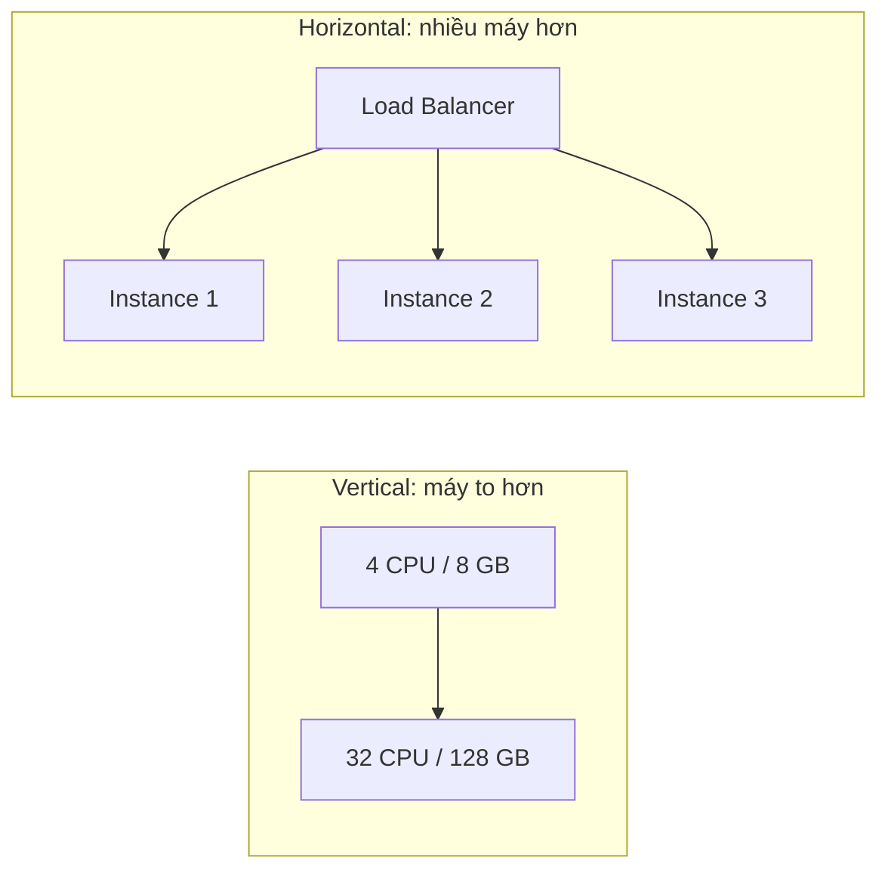
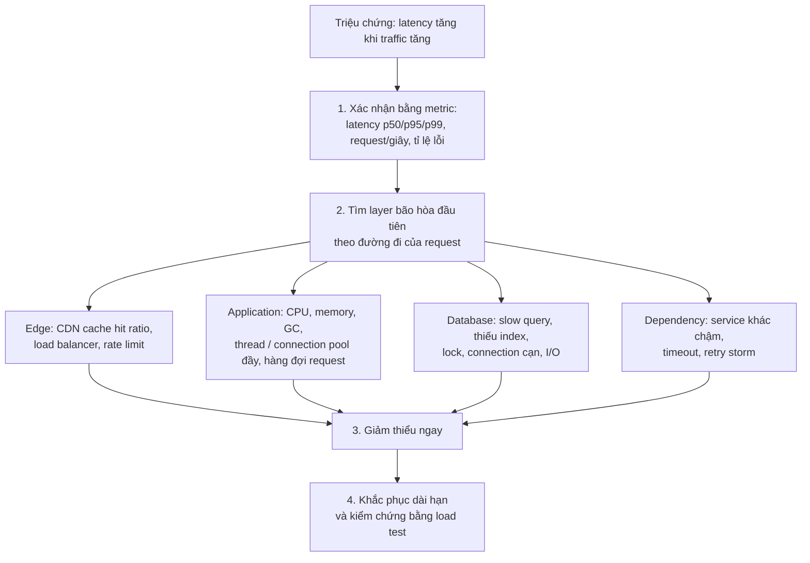

## Mục tiêu

Phân biệt chính xác ba thuộc tính hay bị dùng lẫn lộn là **Resiliency**, **High Availability** và **Scalability**; biết khi nào **scale ngang** hay **scale dọc**; và có một quy trình có hệ thống để xử lý câu hỏi tổng hợp: *hệ thống chậm khi traffic tăng đột biến, bạn kiểm tra và tối ưu ở những layer nào, bắt đầu từ đâu?*

## Câu 1: Phân biệt Resiliency, High Availability, Scalability

### Người hỏi muốn kiểm tra gì

Bạn có dùng đúng thuật ngữ, và hiểu rằng ba thuộc tính liên quan nhưng giải quyết ba câu hỏi khác nhau.

### Trả lời gợi ý

| Thuộc tính | Câu hỏi nó trả lời | Đo bằng | Kỹ thuật điển hình |
|---|---|---|---|
| **Resiliency** (khả năng phục hồi) | Khi có lỗi, hệ thống **chống chịu và phục hồi** thế nào? | Thời gian phục hồi (MTTR), mức suy giảm khi lỗi | Timeout, retry có backoff, circuit breaker, bulkhead, graceful degradation, tự động khởi động lại |
| **High Availability** (tính sẵn sàng cao) | Hệ thống **phục vụ được bao nhiêu phần trăm thời gian**? | Availability, thường tính bằng "số 9": 99,9% ≈ 8,76 giờ downtime mỗi năm; 99,99% ≈ 52,6 phút mỗi năm | Dư thừa (redundancy), loại bỏ single point of failure, nhiều availability zone, failover tự động |
| **Scalability** (khả năng mở rộng) | Khi **tải tăng**, hệ thống có thêm năng lực tương ứng không? | Throughput và latency khi tải tăng; chi phí cho mỗi đơn vị tải | Scale ngang, cache, sharding, xử lý bất đồng bộ qua queue |

Quan hệ giữa chúng:

- Resiliency là một **phương tiện** để đạt high availability: hệ thống phục hồi nhanh thì thời gian không phục vụ được ngắn.
- Scalability khác hai thuộc tính kia: một hệ thống có thể sẵn sàng 99,99% ở tải hiện tại nhưng sập khi tải tăng gấp 5 lần. Ngược lại, quá tải là một nguyên nhân phổ biến làm giảm availability, nên chúng liên quan.
- Thiết kế high availability thường cần nhiều bản chạy song song, điều này cũng giúp scale ngang.

### Câu hỏi đào sâu

- Hệ thống có ba thành phần nối tiếp, mỗi thành phần 99,9%. Availability tổng khoảng bao nhiêu? (Khoảng 99,7%, vì nhân các xác suất: 0,999³.)
- Graceful degradation là gì? Cho ví dụ trong một sản phẩm thương mại điện tử.

## Câu 2: Horizontal Scaling khác Vertical Scaling thế nào? Khi nào chọn cái nào?

### Trả lời gợi ý

- **Vertical scaling (scale up):** tăng tài nguyên cho một máy (thêm CPU, RAM, ổ nhanh hơn).
- **Horizontal scaling (scale out):** thêm nhiều máy hoặc instance chạy song song, chia tải bằng load balancer.

| | Vertical | Horizontal |
|---|---|---|
| Thay đổi code | Thường không cần | Ứng dụng phải **stateless** hoặc tách state ra ngoài |
| Giới hạn | Có trần phần cứng; giá tăng nhanh ở cấu hình cao | Gần như không có trần lý thuyết, nhưng gặp giới hạn ở thành phần dùng chung (database) |
| Availability | Vẫn là một máy: single point of failure | Một instance chết, các instance khác vẫn phục vụ |
| Độ phức tạp | Thấp | Cao hơn: load balancing, phân phối state, nhất quán dữ liệu |
| Thời gian áp dụng | Thường cần restart | Có thể thêm instance khi đang chạy, tự động theo tải |

**Khi nào chọn:**

- Chọn **vertical** khi cần nhanh, khi thành phần khó phân tán (nhiều database quan hệ có một node ghi chính), hoặc khi tải còn nằm xa trần phần cứng.
- Chọn **horizontal** cho tầng ứng dụng stateless, khi cần high availability, khi tải biến động và muốn autoscaling.
- Thực tế thường kết hợp: tầng ứng dụng scale ngang; database scale dọc trước, sau đó thêm read replica, rồi mới đến sharding khi thật cần.

### Câu hỏi đào sâu

- Để scale ngang tầng ứng dụng, session người dùng phải được lưu ở đâu? Xem [[senior-engineering-topics]].
- Read replica giúp gì và gây ra vấn đề gì (replication lag, đọc dữ liệu cũ ngay sau khi ghi)?

## Câu 3 (tổng hợp): Hệ thống chậm khi traffic tăng đột biến

*Bạn kiểm tra và tối ưu ở những layer nào, bắt đầu từ đâu?*

### Người hỏi muốn kiểm tra gì

Đây là câu hỏi tổng hợp: nó kiểm tra bạn hiểu luồng request qua các layer ([[backend-engineering-basics]]), biết **đo trước khi sửa**, phân biệt được **giảm thiểu ngay** và **khắc phục dài hạn**.

### Trả lời gợi ý

**Nguyên tắc: đo trước, đoán sau.** Bắt đầu từ góc nhìn người dùng, rồi đi theo request từ ngoài vào trong để tìm layer đầu tiên bị bão hòa. Google SRE book đề xuất bốn tín hiệu vàng (four golden signals) cho mỗi thành phần: **latency, traffic, errors, saturation**.

**Bước 1: Xác nhận và khoanh vùng.** Tất cả endpoint đều chậm hay chỉ vài endpoint? Bắt đầu cùng lúc với sự kiện nào (khuyến mãi, deploy mới, job batch)? Distributed tracing cho biết thời gian tốn ở span nào.

**Bước 2: Kiểm tra theo layer, từ ngoài vào trong.**

| Layer | Dấu hiệu | Cách xử lý thường gặp |
|---|---|---|
| Client / CDN | Cache hit ratio giảm, request tĩnh dồn về origin | Cache tĩnh ở CDN, header cache đúng (RFC 9111) |
| Load balancer / gateway | Kết nối chờ, lỗi `503`, rate limit kích hoạt | Thêm instance phía sau, rate limiting, ưu tiên request quan trọng |
| Application | CPU cao, GC dài, thread pool hoặc connection pool đầy, hàng đợi request dài | Scale ngang, sửa code nóng, tăng pool hợp lý, chuyển việc nặng sang queue ([[producer-consumer-queue]]) |
| Cache | Hit ratio thấp, cache stampede khi key hết hạn | Cache dữ liệu đọc nhiều, TTL có jitter, chống stampede |
| Database | Slow query log, thiếu index, lock contention, hết connection | Thêm index, sửa query N+1, connection pooling, read replica, giảm transaction dài |
| Dependency | Latency của service ngoài tăng, retry nhân request | Timeout chặt, retry có giới hạn và jitter, circuit breaker, bulkhead |

**Bước 3: Giảm thiểu ngay (trong sự cố).** Scale ngang tầng ứng dụng nếu nó là điểm nghẽn; bật rate limiting hoặc **load shedding** (chủ động từ chối một phần request để phần còn lại vẫn nhanh); tắt tạm tính năng không cốt lõi; rollback nếu sự cố bắt đầu sau một lần deploy.

**Bước 4: Khắc phục dài hạn.** Autoscaling theo metric phù hợp; cache; xử lý bất đồng bộ; tối ưu database; **load test** định kỳ ở mức tải dự kiến để biết trước điểm nghẽn tiếp theo; capacity planning trước các sự kiện lớn.

### Lỗi hay gặp

- Scale ngang tầng ứng dụng khi điểm nghẽn là database: thêm instance làm tăng số connection, khiến database chậm hơn.
- Tăng timeout khi dependency chậm: request giữ tài nguyên lâu hơn, hệ thống sập nhanh hơn.
- Retry ở nhiều layer: một request của người dùng thành hàng chục request tới dependency đang quá tải (retry storm).
- Chỉ nhìn latency trung bình: trung bình che giấu tail latency (p99) mà nhiều người dùng gặp.

### Câu hỏi đào sâu

- Vì sao chủ động từ chối request (load shedding) lại giúp **nhiều** người dùng được phục vụ hơn?
- Autoscaling mất vài phút để có instance mới. Bạn xử lý những phút đầu của đợt tăng đột biến thế nào?
- Bạn đặt alert dựa trên metric nào để phát hiện vấn đề trước khi người dùng phàn nàn?

## Tự đánh giá

> [!level1] Level 1 — Nhận biết
> - Định nghĩa đúng Resiliency, High Availability, Scalability và cho mỗi cái một kỹ thuật điển hình.
> - Quy đổi được 99,9% và 99,99% sang thời gian downtime mỗi năm.
> - Kể tên bốn golden signals.

> [!level2] Level 2 — Áp dụng
> - Chạy load test cho một API và chỉ ra layer bão hòa đầu tiên bằng metric.
> - Chuyển một ứng dụng giữ session trong bộ nhớ sang lưu session ngoài để scale ngang được.

> [!level3] Level 3 — Engineering
> - Trình bày quy trình xử lý sự cố traffic tăng đột biến, tách rõ giảm thiểu ngay và khắc phục dài hạn, có số liệu.
> - Thiết kế load shedding và autoscaling cho một dịch vụ có tải biến động theo sự kiện.

## Tài liệu tham khảo

- AWS Well-Architected Framework, *Reliability Pillar* — [docs.aws.amazon.com/wellarchitected/latest/reliability-pillar/welcome.html](https://docs.aws.amazon.com/wellarchitected/latest/reliability-pillar/welcome.html)
- Microsoft Azure Well-Architected Framework, *Reliability* — [learn.microsoft.com/en-us/azure/well-architected/reliability/](https://learn.microsoft.com/en-us/azure/well-architected/reliability/)
- Google, *Site Reliability Engineering*: *Monitoring Distributed Systems* (four golden signals) — [sre.google/sre-book/monitoring-distributed-systems/](https://sre.google/sre-book/monitoring-distributed-systems/); *Handling Overload* — [sre.google/sre-book/handling-overload/](https://sre.google/sre-book/handling-overload/); *Addressing Cascading Failures* — [sre.google/sre-book/addressing-cascading-failures/](https://sre.google/sre-book/addressing-cascading-failures/); *Availability Table* — [sre.google/sre-book/availability-table/](https://sre.google/sre-book/availability-table/)
- Amazon Builders' Library, *Using load shedding to avoid overload* — [aws.amazon.com/builders-library/using-load-shedding-to-avoid-overload/](https://aws.amazon.com/builders-library/using-load-shedding-to-avoid-overload/)
- Google Cloud Architecture Center, *Patterns for scalable and resilient apps* — [cloud.google.com/architecture/scalable-and-resilient-apps](https://cloud.google.com/architecture/scalable-and-resilient-apps)
- Kubernetes documentation, *Horizontal Pod Autoscaling* — [kubernetes.io/docs/tasks/run-application/horizontal-pod-autoscale/](https://kubernetes.io/docs/tasks/run-application/horizontal-pod-autoscale/)
- IETF RFC 9111, *HTTP Caching* — [rfc-editor.org/rfc/rfc9111](https://www.rfc-editor.org/rfc/rfc9111)
