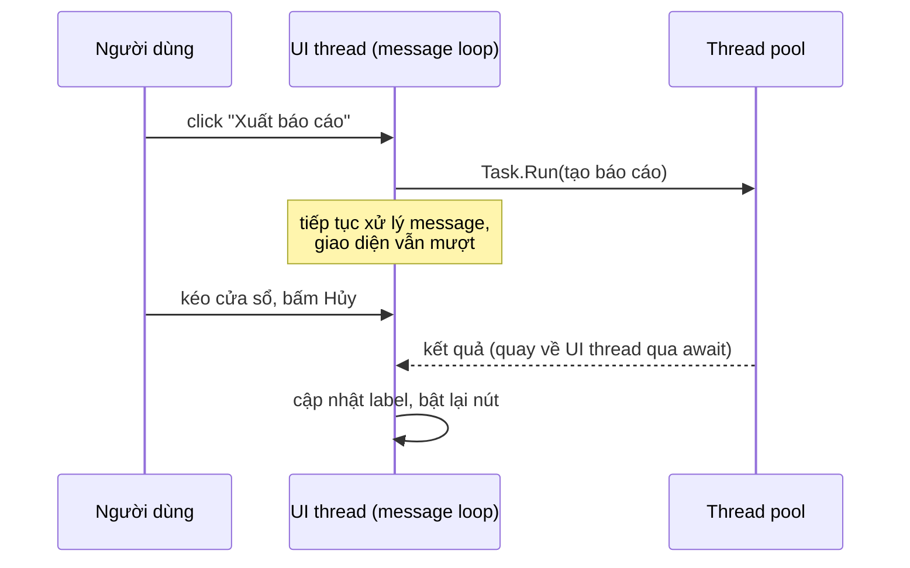
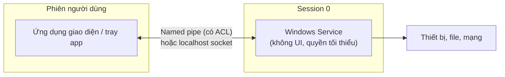
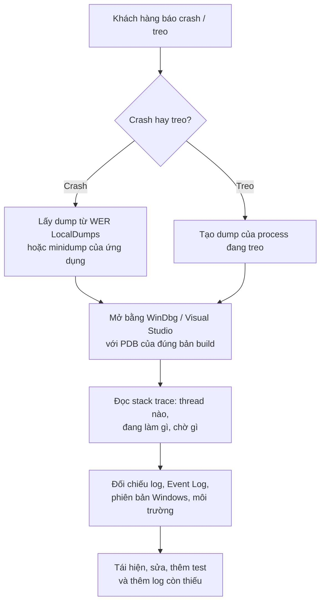

## Mục tiêu

Chuẩn bị cho kỹ sư làm **ứng dụng desktop và phần mềm công cụ trên Windows**: công cụ nội bộ, phần mềm điều khiển thiết bị, tiện ích hệ thống, phần mềm cài trên máy khách hàng. Khác với web, phần mềm chạy **trên máy của người dùng**: bạn không kiểm soát môi trường, không xem log trực tiếp, và mỗi bản cập nhật phải đi qua bộ cài. Các câu hỏi tập trung vào những lỗi mà người dùng thấy ngay (treo giao diện, không ghi được file, đòi quyền admin) và cách chẩn đoán lỗi xảy ra ở máy người khác.

Ví dụ code dùng C#/.NET vì đây là lựa chọn phổ biến cho ứng dụng desktop Windows; khái niệm tương tự với Win32/C++, Qt hay Electron.

## Câu 1: Vì sao ứng dụng bị "Not Responding"? Giữ giao diện mượt thế nào?

### Người hỏi muốn kiểm tra gì

Bạn có hiểu mô hình **UI thread và message loop** của Windows, và biết đưa việc nặng ra khỏi UI thread rồi cập nhật giao diện an toàn.

### Trả lời gợi ý

- Mỗi cửa sổ thuộc về **thread đã tạo ra nó**. Thread đó chạy **message loop**: lấy message (click, phím, vẽ lại) từ hàng đợi và gửi tới window procedure. WinForms, WPF và các framework khác đều xây trên mô hình này.
- Nếu UI thread bận (đọc file lớn, gọi mạng, tính toán, chờ lock), nó không xử lý message, cửa sổ không vẽ lại và không phản hồi. Windows coi cửa sổ là bị treo khi nó không lấy message trong khoảng 5 giây (theo tài liệu `IsHungAppWindow`), và hiển thị "(Not Responding)".
- **Cách xử lý:** đưa việc chậm sang thread khác hoặc dùng async I/O; khi xong, **quay về UI thread** để cập nhật control, vì control chỉ được truy cập từ thread sở hữu nó (`Control.Invoke`/`BeginInvoke` trong WinForms, `Dispatcher` trong WPF, `PostMessage` trong Win32). Trong .NET, `await` trong event handler tự quay về UI thread nhờ `SynchronizationContext`.
- Báo tiến độ và cho phép hủy (`CancellationToken`) với tác vụ dài.



> [!pseudocode] Đưa việc nặng ra khỏi UI thread (C#, WinForms)
> - **Dùng để:** minh họa event handler không chặn UI thread và cập nhật control đúng thread.
> - **Đầu vào:** một form có `exportButton`, `statusLabel`; `_cts` là `CancellationTokenSource` mà nút Hủy gọi `Cancel()`; `BuildReport` là hàm tốn vài giây, kiểm tra token định kỳ.
> - **Kết quả mong đợi:** trong lúc tạo báo cáo, cửa sổ vẫn kéo được và không hiện "(Not Responding)"; xong thì `statusLabel` hiện tên file; lỗi được hiển thị thay vì làm sập ứng dụng.
>
> ```csharp
> private async void exportButton_Click(object sender, EventArgs e)
> {
>     exportButton.Enabled = false;
>     try
>     {
>         // chạy trên thread pool; UI thread quay lại xử lý message
>         string path = await Task.Run(() => BuildReport(_cts.Token));
>         statusLabel.Text = $"Đã lưu {path}";   // sau await: đã về lại UI thread
>     }
>     catch (OperationCanceledException) { statusLabel.Text = "Đã hủy"; }
>     catch (IOException ex)             { statusLabel.Text = $"Lỗi: {ex.Message}"; }
>     finally { exportButton.Enabled = true; }
> }
> ```

### Lỗi hay gặp

- Gọi `.Result` hoặc `.Wait()` trên một `Task` từ UI thread: UI thread bị chặn, và nếu task cần quay về UI thread thì sinh **deadlock**.
- Cập nhật control từ thread khác, gây lỗi ngẫu nhiên hoặc exception "cross-thread operation".
- Ghi log đồng bộ ra console hoặc file trên thread xử lý chính. Field note [[windows-console-server-freeze]] là một trường hợp thật trên Windows.

### Câu hỏi đào sâu

- `async void` khác `async Task` thế nào, và vì sao chỉ nên dùng `async void` cho event handler?
- Bạn tìm nguyên nhân treo giao diện ở máy khách hàng thế nào? (Dump của process đang treo, xem stack của UI thread; xem câu 5.)

## Câu 2: Khi nào làm Windows Service thay vì ứng dụng thường? Service và giao diện giao tiếp thế nào?

### Trả lời gợi ý

- **Windows Service** do Service Control Manager quản lý: chạy nền, có thể khởi động cùng hệ thống trước khi người dùng đăng nhập, tự khởi động lại khi lỗi (cấu hình recovery). Hợp cho tác vụ phải chạy liên tục: đồng bộ dữ liệu, giao tiếp thiết bị, agent giám sát.
- Từ Windows Vista, service chạy trong **Session 0**, tách biệt với phiên của người dùng (**Session 0 isolation**), nên service **không hiển thị được giao diện** cho người dùng. Kiến trúc đúng là tách thành service (không có UI) và một ứng dụng giao diện chạy trong phiên người dùng, giao tiếp qua **IPC**.
- **Chạy với quyền tối thiểu:** chọn tài khoản `LocalService`, `NetworkService` hoặc virtual account thay vì `LocalSystem` khi không cần toàn quyền.



**Lựa chọn IPC phổ biến:**

| Cơ chế | Ưu điểm | Lưu ý |
|---|---|---|
| Named pipe | Có sẵn, đặt được security descriptor để giới hạn ai kết nối | Phải tự thiết kế giao thức message |
| Socket trên localhost | Quen thuộc, dùng lại được HTTP/gRPC | Cần chặn truy cập từ process không mong muốn; chọn port tránh xung đột |
| Shared memory (file mapping) | Nhanh nhất cho dữ liệu lớn | Phải tự đồng bộ (mutex, event) |
| COM | Tích hợp sâu với Windows, gọi hàm giữa process | Phức tạp, khó debug |

**Bảo mật:** service chạy quyền cao mà nhận lệnh từ IPC không kiểm tra quyền là một lỗ hổng leo thang đặc quyền kinh điển. Đặt ACL cho pipe và kiểm tra dữ liệu nhận được.

### Câu hỏi đào sâu

- Service cần hiện thông báo cho người dùng. Bạn làm thế nào khi service không có UI?
- Service dừng thì ứng dụng giao diện xử lý ra sao?

## Câu 3: Những lỗi file system hay gặp trên Windows

### Trả lời gợi ý

- **Đường dẫn dài:** mặc định nhiều API giới hạn đường dẫn ở `MAX_PATH` (260 ký tự). Từ Windows 10 phiên bản 1607 có thể bỏ giới hạn nhưng cần **cả hai**: bật `LongPathsEnabled` trong registry và khai báo `longPathAware` trong manifest của ứng dụng; hoặc dùng tiền tố `\\?\`. Ứng dụng phải xử lý được lỗi đường dẫn quá dài thay vì sập.
- **File bị khóa:** một process mở file với share mode không cho phép thì process khác không ghi, xóa hay đổi tên được. Antivirus, trình đánh chỉ mục, hoặc chính người dùng mở file trong Excel thường giữ file trong chốc lát. Xử lý: báo lỗi rõ ràng, retry ngắn có giới hạn với lỗi sharing violation, và mở file với share mode tối thiểu cần thiết.
- **Ghi file an toàn khi mất điện hoặc crash:** ghi ra file tạm cùng thư mục, flush, rồi thay thế file cũ (`ReplaceFile`, hoặc `MoveFileEx` với `MOVEFILE_REPLACE_EXISTING`), thay vì ghi đè trực tiếp. Xem [[atomic-writes-and-crash-safety]].
- **Ghi dữ liệu đúng chỗ:** không ghi vào thư mục cài đặt (`Program Files`), vì người dùng thường không có quyền ghi ở đó. Dữ liệu của từng người dùng đặt trong `%LOCALAPPDATA%` hoặc `%APPDATA%`, dữ liệu dùng chung cho mọi người dùng đặt trong `%ProgramData%`.
- **Unicode:** API Win32 có bản `W` dùng UTF-16 và bản `A` dùng code page hiện hành. Dùng bản `A` với tên file tiếng Việt có dấu dễ lỗi trên máy cấu hình ngôn ngữ khác; dùng bản `W` (hoặc khai báo UTF-8 code page trong manifest, có từ Windows 10 phiên bản 1903).

### Câu hỏi đào sâu

- Người dùng báo "lưu file thỉnh thoảng thất bại, thử lại thì được". Bạn nghi ngờ gì đầu tiên?
- Đường dẫn mạng (UNC, ổ ánh xạ) khác ổ cục bộ thế nào về hiệu năng và lỗi có thể gặp?

## Câu 4: Quyền admin, UAC, cài đặt và phân phối

### Trả lời gợi ý

- **UAC:** kể cả tài khoản admin, ứng dụng mặc định chạy với token quyền thường. Manifest khai báo `requestedExecutionLevel`: `asInvoker` (mặc định nên dùng), `highestAvailable`, `requireAdministrator`. Ứng dụng đòi admin cho mọi lần chạy chỉ để làm một việc nhỏ là thiết kế kém: hãy tách việc cần quyền cao thành một helper riêng hoặc một service, và chỉ nâng quyền khi thật cần.
- **Bộ cài:** MSI (Windows Installer) phổ biến trong doanh nghiệp, triển khai được qua công cụ quản trị; MSIX đóng gói theo kiểu container, gỡ cài sạch và hỗ trợ cập nhật tự động. Bộ cài cần hỗ trợ nâng cấp, gỡ cài sạch, và cài không giao diện (silent install) cho quản trị viên.
- **Ký số (code signing):** ký file thực thi và bộ cài bằng chứng chỉ code signing (SignTool). File không ký thường bị SmartScreen cảnh báo, và bị chính sách bảo mật của doanh nghiệp chặn.
- **Cập nhật:** cơ chế tự cập nhật phải tải bản đã ký qua HTTPS, kiểm tra chữ ký trước khi chạy, và không làm hỏng bản đang dùng nếu cập nhật thất bại.

### Câu hỏi đào sâu

- Ứng dụng cần ghi một khóa registry trong `HKLM` một lần lúc cài. Bạn đặt việc đó ở bộ cài hay ở ứng dụng? Vì sao?

## Câu 5: Ứng dụng crash ở máy khách hàng, bạn chẩn đoán thế nào?

### Trả lời gợi ý

- **Crash dump:** cấu hình Windows Error Reporting lưu dump cục bộ qua khóa registry `LocalDumps`, hoặc ứng dụng tự ghi minidump khi gặp exception không bắt được. Mở dump bằng WinDbg hoặc Visual Studio để xem stack trace tại thời điểm crash.
- **Symbols:** lưu file PDB của **đúng** từng bản build phát hành; không có PDB khớp thì stack trace khó đọc. Dùng symbol server nội bộ.
- **Treo (hang):** lấy dump của process đang treo (Task Manager: "Create dump file", hoặc ProcDump) và xem UI thread đang chờ gì.
- **Log và telemetry:** log có cấu trúc, xoay vòng theo kích thước, ghi bất đồng bộ; Event Log của Windows cho lỗi quan trọng; ETW cho tracing hiệu năng chi tiết. Hỏi ý kiến người dùng trước khi gửi dữ liệu về.
- **Tái hiện môi trường:** phiên bản Windows, DPI và nhiều màn hình, ngôn ngữ hệ thống, antivirus, quyền người dùng thường. Nhiều lỗi chỉ xuất hiện ở máy không phải admin hoặc có tên người dùng chứa ký tự Unicode.



### Câu hỏi đào sâu

- Vì sao phải giữ PDB của mọi bản phát hành, kể cả bản cũ?
- Ứng dụng chỉ crash trên máy có màn hình 4K đặt scale 150%. Bạn nghi ngờ gì? (DPI awareness, tính toán tọa độ.)

## Code AI sinh ra cho Windows desktop: cần soi gì

- Làm I/O hoặc gọi mạng đồng bộ trong event handler; dùng `.Result`/`.Wait()` trên UI thread.
- Cập nhật control từ thread nền.
- Ghi file vào thư mục cài đặt, hoặc ghép đường dẫn bằng cộng chuỗi thay vì `Path.Combine`; giả định ổ `C:`.
- Đặt `requireAdministrator` để "cho chạy được".
- Service có UI, hoặc service chạy `LocalSystem` và mở IPC không ACL.
- Ghi đè file trực tiếp, không có bản tạm, không xử lý file bị khóa.

## Tự đánh giá

> [!level1] Level 1 — Nhận biết
> - Giải thích vì sao chặn UI thread làm ứng dụng "Not Responding".
> - Nêu được Session 0 isolation và hệ quả cho service.
> - Biết nơi đúng để lưu dữ liệu người dùng và dữ liệu dùng chung.

> [!level2] Level 2 — Áp dụng
> - Chuyển một thao tác chậm sang async, có báo tiến độ và hủy được.
> - Viết service và ứng dụng giao diện giao tiếp qua named pipe có ACL.
> - Cấu hình thu thập crash dump và đọc được stack trace với đúng PDB.

> [!level3] Level 3 — Engineering
> - Thiết kế kiến trúc quyền cho một công cụ cần thao tác hệ thống nhưng chạy dưới tài khoản người dùng thường.
> - Thiết kế quy trình phát hành: ký số, bộ cài, tự cập nhật an toàn, lưu symbols.

## Tài liệu tham khảo

- Microsoft Learn, *Window Messages (Get Started with Win32 and C++)* — [learn.microsoft.com/en-us/windows/win32/learnwin32/window-messages](https://learn.microsoft.com/en-us/windows/win32/learnwin32/window-messages)
- Microsoft Learn, *IsHungAppWindow function* — [learn.microsoft.com/en-us/windows/win32/api/winuser/nf-winuser-ishungappwindow](https://learn.microsoft.com/en-us/windows/win32/api/winuser/nf-winuser-ishungappwindow)
- Microsoft Learn, *How to handle cross-thread operations with controls* (Windows Forms) — [learn.microsoft.com/en-us/dotnet/desktop/winforms/controls/how-to-make-thread-safe-calls](https://learn.microsoft.com/en-us/dotnet/desktop/winforms/controls/how-to-make-thread-safe-calls); *Threading Model* (WPF) — [learn.microsoft.com/en-us/dotnet/desktop/wpf/advanced/threading-model](https://learn.microsoft.com/en-us/dotnet/desktop/wpf/advanced/threading-model)
- Microsoft Learn, *Services* — [learn.microsoft.com/en-us/windows/win32/services/services](https://learn.microsoft.com/en-us/windows/win32/services/services); *Interactive Services* (Session 0 isolation) — [learn.microsoft.com/en-us/windows/win32/services/interactive-services](https://learn.microsoft.com/en-us/windows/win32/services/interactive-services)
- Microsoft Learn, *Interprocess Communications* — [learn.microsoft.com/en-us/windows/win32/ipc/interprocess-communications](https://learn.microsoft.com/en-us/windows/win32/ipc/interprocess-communications); *Named Pipes* — [learn.microsoft.com/en-us/windows/win32/ipc/named-pipes](https://learn.microsoft.com/en-us/windows/win32/ipc/named-pipes)
- Microsoft Learn, *Maximum Path Length Limitation* — [learn.microsoft.com/en-us/windows/win32/fileio/maximum-file-path-limitation](https://learn.microsoft.com/en-us/windows/win32/fileio/maximum-file-path-limitation); *ReplaceFileW function* — [learn.microsoft.com/en-us/windows/win32/api/winbase/nf-winbase-replacefilew](https://learn.microsoft.com/en-us/windows/win32/api/winbase/nf-winbase-replacefilew)
- Microsoft Learn, *Unicode in the Windows API* — [learn.microsoft.com/en-us/windows/win32/intl/unicode-in-the-windows-api](https://learn.microsoft.com/en-us/windows/win32/intl/unicode-in-the-windows-api); *Use UTF-8 code pages in Windows apps* — [learn.microsoft.com/en-us/windows/apps/design/globalizing/use-utf8-code-page](https://learn.microsoft.com/en-us/windows/apps/design/globalizing/use-utf8-code-page)
- Microsoft Learn, *User Account Control* — [learn.microsoft.com/en-us/windows/security/application-security/application-control/user-account-control/](https://learn.microsoft.com/en-us/windows/security/application-security/application-control/user-account-control/)
- Microsoft Learn, *What is MSIX?* — [learn.microsoft.com/en-us/windows/msix/overview](https://learn.microsoft.com/en-us/windows/msix/overview); *SignTool* — [learn.microsoft.com/en-us/windows/win32/seccrypto/signtool](https://learn.microsoft.com/en-us/windows/win32/seccrypto/signtool)
- Microsoft Learn, *Collecting User-Mode Dumps* — [learn.microsoft.com/en-us/windows/win32/wer/collecting-user-mode-dumps](https://learn.microsoft.com/en-us/windows/win32/wer/collecting-user-mode-dumps); *Event Tracing for Windows (ETW)* — [learn.microsoft.com/en-us/windows-hardware/drivers/devtest/event-tracing-for-windows--etw-](https://learn.microsoft.com/en-us/windows-hardware/drivers/devtest/event-tracing-for-windows--etw-)
