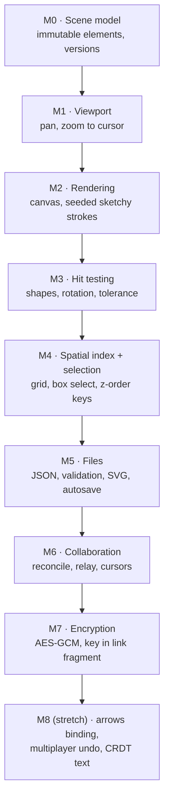
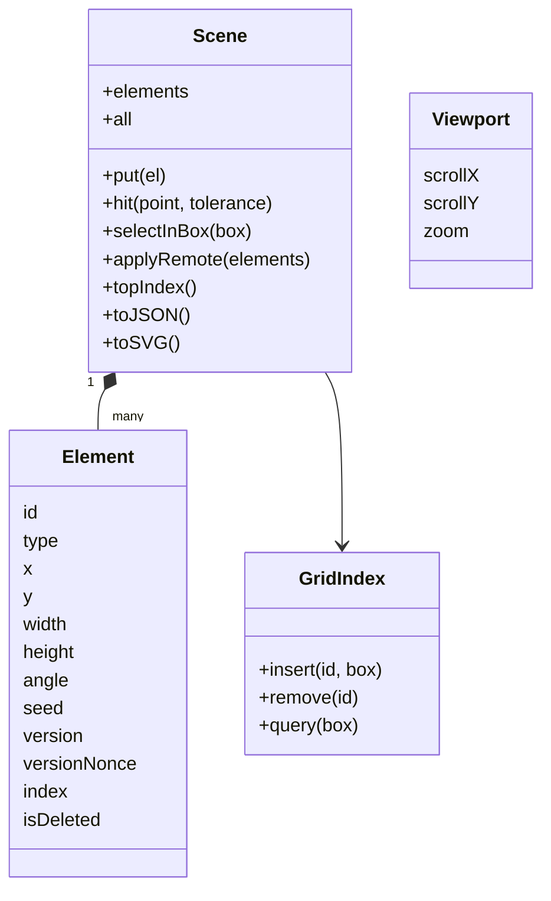

Build the engine of an Excalidraw-like whiteboard: an infinite canvas, hand-drawn shapes, selection, files, and encrypted real-time collaboration. Reference language: **TypeScript** — the browser is where a whiteboard lives, and the engine runs unchanged in Node for tests. No dependencies except `ws` for the relay server.

Product context: [[excalidraw]].

## Milestone map



| # | Goal | Study first | Done when |
|---|---|---|---|
| M0 | Elements | [[vector-graphics-and-scene-model]] | updates return new objects, version + 1 |
| M1 | Pan/zoom | [[coordinate-transforms]], [[infinite-canvas]] | round trip exact; zoom keeps cursor point fixed; zoom clamped |
| M2 | Sketchy drawing | [[seeded-pseudorandom-numbers]], [[hand-drawn-shapes]], [[canvas-2d-drawing]] | same seed → identical strokes; endpoints exact |
| M3 | Hit tests | [[hit-testing]] | segment distance clamps; concave polygons; rotated rectangles |
| M4 | Selection at scale | [[spatial-index]], [[fractional-indexing]], [[selection-and-transform]] | grid = brute force; topmost hit; keys stay ordered under 2000 inserts |
| M5 | Persistence | [[scene-files-and-export]], [[debounce-and-throttle]] | JSON round trip; bad files rejected; deterministic SVG; debounced autosave |
| M6 | Multiplayer | [[conflict-resolution]], [[websockets]], [[real-time-collaboration]] | 3 replicas converge under shuffled delivery; relay demo converges |
| M7 | Privacy | [[end-to-end-encryption]], [[encrypted-sharing-links]], [[web-crypto-aes-gcm]] | round trip; wrong key and tampering rejected; key never in the request |
| M8 | Product depth | [[undo-redo-history]], [[command-pattern]] | see stretch goals |

## Architecture you are building



Pure functions do the thinking (`hitTest`, `reconcile`, `keyBetween`, `sketchyLine`, `zoomAt`, `encryptJSON`); `Scene` only stores and indexes. Browser code (canvas, pointer events, WebSocket) is a thin shell around them.

## Milestone notes

### M0–M1 — Model and viewport

Elements are readonly records; `updateElement` copies and bumps `version`, sets a fresh `versionNonce`. Viewport formulas: `screen = (scene + scroll) × zoom`; zoom-to-cursor solves for the new scroll.

### M2 — Rendering

Each element stores a `seed`; `sketchyLine(a, b, seed + edgeIndex)` gives each edge its wobble. Render with the canvas transform; cache per element version ([[canvas-2d-drawing]]).

### M3–M4 — Picking

Un-rotate the pointer, then test the unrotated shape. Index bounding boxes in a uniform grid; query candidates, sort by `(index, id)`, test from the top. New elements get `keyBetween(topKey, null)`.

### M5 — Files

`{type, version, elements}`; reject unknown types and newer versions; autosave with `debounce(…, 300)`.

### M6 — Collaboration

Broadcast changed elements; on receive, `reconcile` (higher version, then lower nonce; tombstones for deletes; never overwrite the element the user is dragging). Throttle cursor messages to ~20 per second.

### M7 — Encryption

Room key generated by the creator, shared in `#room=id,key`; every message is `[12-byte IV | AES-GCM ciphertext]`; the relay forwards bytes it cannot read.

### M8 — Stretch goals

- Arrows that stay attached to shapes when they move (store binding ids; recompute endpoints).
- Multiplayer undo: undo only your own changes by recording inverse element versions per user.
- Per-property merges, or Yjs for text inside shapes ([[conflict-resolution]]).
- Persist rooms: store encrypted snapshots so a room survives when everyone leaves.
- Port hit testing to a C++/WebAssembly module and benchmark against TypeScript.

## Reference implementation

> [!tested] `examples/whiteboard/typescript/` — `sketchkit`
> - **Used for:** Comparing your milestones with a tested solution and watching two clients collaborate.
> - **Input:** Node.js 22.18+; the relay demo also needs network access to install `ws`.
> - **Expected output:** `# pass 27` and `# fail 0` from the unit tests; the smoke test then prints both clients' scenes and `converged: both clients show the same scene`.
>
> ```bash
> cd examples/whiteboard/typescript && node --test
> cd .. && ./smoke_test.sh
> ```
>
> | File | Milestones |
> |---|---|
> | `src/elements.ts` | M0, M3 |
> | `src/viewport.ts` | M1 |
> | `src/random.ts` | M2 |
> | `src/geometry.ts` | M3 |
> | `src/spatial.ts`, `src/fractional.ts` | M4 |
> | `src/scene.ts`, `src/timing.ts` | M4, M5 |
> | `src/reconcile.ts`, `relay/` | M6 |
> | `src/crypto.ts` | M7 |
> | `tests/` | acceptance tests for all milestones |

## Self-assessment

1. Why does each element store a random seed instead of calling `Math.random()` while drawing?
2. How do you test whether a point hits a rectangle rotated by 30°?
3. Two users change the same element at the same version. Which change wins, and why do both clients agree?
4. Why can a stateless relay server not read the drawing, and what can it still learn?
5. Why do z-order keys avoid conflicts that integer positions cause?
