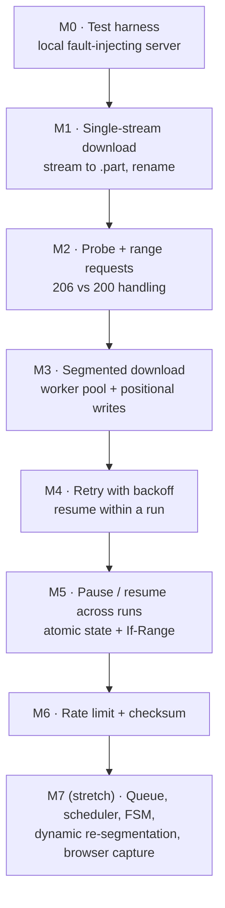
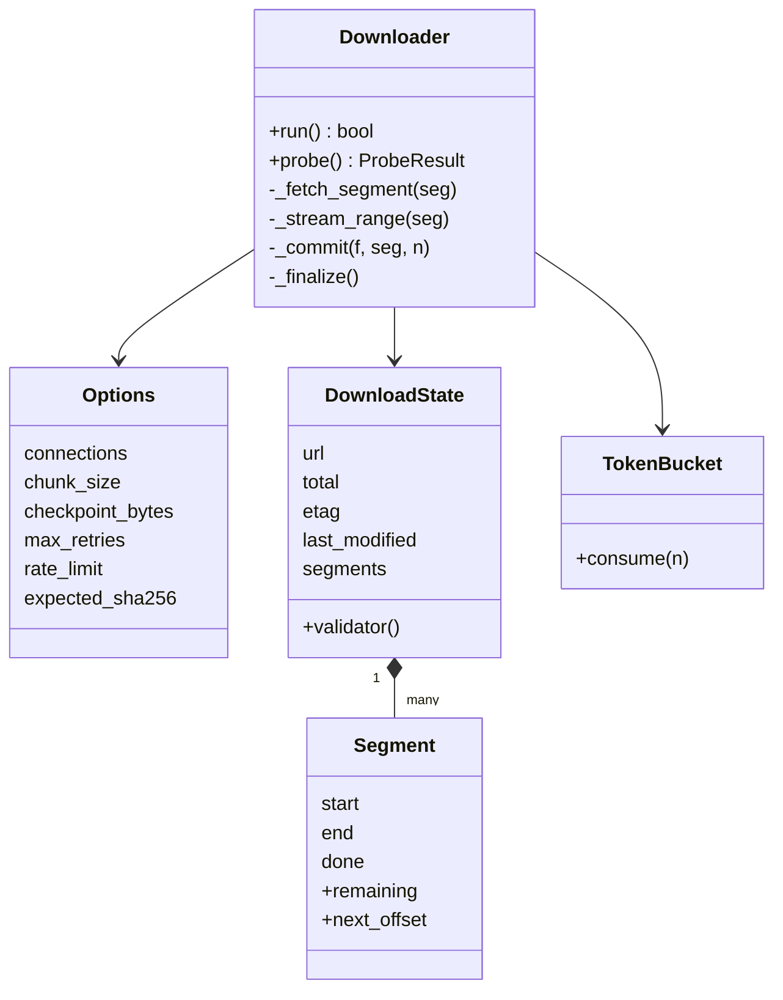

Build an IDM-like download engine step by step. Each milestone adds one capability, names the concepts to study first, and ends with **acceptance tests** you can write before the code. Reference language: Python (standard library only); the same plan works in TypeScript or C++ with the cookbook pages.

Product context: [[internet-download-manager]].

## Milestone map



| # | Goal | Study first | Done when |
|---|---|---|---|
| M0 | Deterministic test server | [[testing-network-code-locally]] | server can serve ranges, drop connections, return 503, change ETag |
| M1 | Stream URL → file | [[http-streaming-in-python]] | 1 MB file downloaded byte-identical; final name appears only on success |
| M2 | Detect range support | [[http-range-requests]] | probe returns total + flag; falls back when server sends 200 |
| M3 | N parallel segments | [[worker-pool]], [[random-access-file-io]], [[parallel-tcp-throughput]] | 4 segments, uneven file size, byte-identical; one request per segment |
| M4 | Survive drops and 503s | [[retry-with-exponential-backoff]] | 3 injected drops → still identical; no offset requested twice; 404 fails fast |
| M5 | Pause, crash, resume | [[atomic-writes-and-crash-safety]], [[http-conditional-requests]], [[pause-and-resume]] | resume fetches only missing bytes; changed ETag → restart; corrupt state → restart |
| M6 | Speed cap, verification | [[token-bucket]], [[cryptographic-hash-functions]] | fake-clock limiter tests pass; wrong SHA-256 → error and no final file |
| M7 | Product features | [[download-queue-and-scheduler]], [[finite-state-machine]], [[browser-download-capture]] | see stretch goals |

## Architecture you are building



## Milestone notes

### M1 — Single stream

> [!pseudocode]
> ```
> open dest.part for writing
> for chunk in response (64 KiB at a time): write chunk
> fsync; rename dest.part → dest
> ```
Pitfalls: forgetting `timeout`, reading the whole body into memory, leaving a half file under the final name.

### M2 — Probe

Send `Range: bytes=0-0`. `206` → parse `Content-Range` total; `200` → no ranges; `416` → empty file. Store `ETag` and `Last-Modified` now — M5 needs them.

### M3 — Segments

Split with inclusive ranges (`split_ranges(total, n, min_size)`), preallocate with `truncate`, give each worker its own file handle, seek once, write sequentially within the segment. Validate each `Content-Range` start.

### M4 — Retries

Wrap the segment fetch in a loop. On transient errors, keep the bytes already written, sleep with full jitter, request `bytes=<next_offset>-<end>`. Reset the attempt counter whenever progress is made.

### M5 — Persistence

Sidecar `dest.part.json` with segments and validators, written atomically. **fsync the data file before recording progress.** On start: valid sidecar + `.part` → skip probe and resume with `If-Range`; any non-206 → discard and restart once.

### M6 — Limits and verification

One shared `TokenBucket` consumed after each chunk read. After completion, stream-hash the `.part`, compare, then rename.

### M7 — Stretch goals

- Wrap the downloader in a task with an explicit [[finite-state-machine]]; add a dispatcher with global and per-host limits ([[download-queue-and-scheduler]]).
- Dynamic re-segmentation: split the largest remaining segment when a worker finishes early ([[segmented-download#dynamic-re-segmentation]]).
- Adaptive connection count from measured throughput ([[parallel-tcp-throughput]]).
- Browser extension + native host to capture downloads ([[browser-download-capture]]).
- Port the engine to TypeScript or C++ using the cookbook pages.

## Reference implementation

> [!tested] `examples/download-manager/python/` — `minidm`
> ```bash
> cd examples/download-manager/python
> python -m pytest -q                                    # 20 tests
> python -m minidm https://raw.githubusercontent.com/python/cpython/main/LICENSE LICENSE.txt -c 4
> ```
> | File | Milestones |
> |---|---|
> | `minidm/ranges.py` | M2, M3 |
> | `minidm/downloader.py` | M1–M6 |
> | `minidm/state.py` | M5 |
> | `minidm/ratelimit.py` | M6 |
> | `tests/rangeserver.py`, `tests/conftest.py` | M0 |
> | `tests/test_downloader.py`, `tests/test_units.py` | acceptance tests for all milestones |

Try writing each milestone yourself first, then compare. Differences are learning material: write down *why* the reference chose differently.

## Self-assessment

After M6 you should be able to answer without notes:

1. Why does the probe use `Range: bytes=0-0` instead of `HEAD`?
2. What happens if the progress file is written **before** the data is fsynced and the machine loses power?
3. Why must `If-Range` never carry a weak ETag?
4. Why is the backoff delay random?
5. When do more connections **not** make a download faster?
