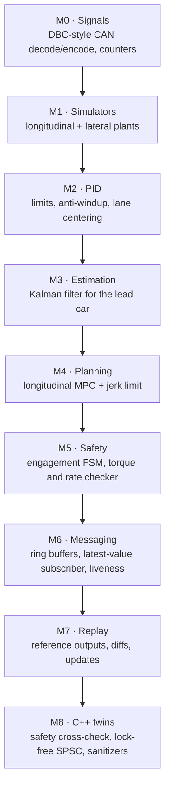
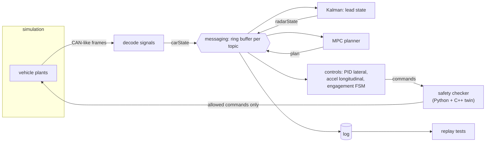

> [!danger] Simulation only
> This project never touches a real vehicle. Its purpose is to learn how such systems are structured, controlled and tested. Do not connect any of this code to a car, a CAN bus in a car, or any actuator that can hurt someone.

Build, in simulation, the layers that a system like [[openpilot]] combines: decoding vehicle data, estimating state, planning and controlling speed and steering, an independent safety checker, messaging between components, and record/replay testing. Reference language: **Python** (as most of openpilot), with **C++** for the safety checker and lock-free messaging — the places where real stacks use C/C++.

## Milestone map



| # | Goal | Study first | Done when |
|---|---|---|---|
| M0 | Read car data | [[can-bus]], [[vehicle-integration]] | known Intel/Motorola bytes decode; 1000 random round trips; counter errors detected |
| M1 | Plants to test against | [[fixed-rate-control-loops]] | deterministic step functions with explicit `dt` |
| M2 | Feedback control | [[pid-controller]], [[lane-centering]] | P leaves offset, PI removes it; anti-windup 3× faster recovery; lane offset < 5 cm |
| M3 | Estimation | [[kalman-filter]] | relative speed within 0.3 m/s from range only; P stays SPD |
| M4 | Planning | [[model-predictive-control]], [[adaptive-cruise-control]] | no collision when lead brakes; limits and jerk ≤ 4 m/s³ hold |
| M5 | Safety | [[functional-safety]], [[independent-safety-layer]], [[finite-state-machine]] | random commands never yield an unsafe forwarded sequence; brake wins |
| M6 | Messaging | [[publish-subscribe-messaging]], [[ring-buffer]] | dropped counts exact; stale topic detected within 2.5 periods |
| M7 | Regression safety net | [[record-and-replay-testing]], [[drive-logging-and-replay]] | replay passes; an intentional change shows a readable diff |
| M8 | Systems language | [[realtime-cpp]] | C++ and Python agree on 50 000 decisions; TSan and UBSan clean |

## Architecture you are building



## Milestone notes

### M0 — Signals

Implement bit positions for Intel and Motorola, scale/offset and two's complement; verify on known bytes before random tests. Add a rolling-counter checker.

### M1–M2 — Plants and PID

Give every simulator an explicit `dt`; no wall-clock time. Implement PID with limits, conditional-integration anti-windup and derivative on measurement; tune lane centering against overshoot and settling targets.

### M3 — Kalman filter

Constant-velocity model `[gap, relative speed]`, range-only measurements. Validate with simulated truth and innovation statistics.

### M4 — MPC

Linear prediction, quadratic cost on gap, speed, acceleration and jerk; box constraints on acceleration; projected-gradient solver; apply the first action; add a hard jerk rate limit after the optimizer (drivekit's tests showed the jerk *cost* alone allowed 6 m/s³).

### M5 — Safety

Grant control only on the rising edge of engagement; revoke on brake; check magnitude and asymmetric rate limits; prove with randomized command streams that the *forwarded* sequence is always within limits.

### M6 — Messaging

Overwrite-oldest ring per topic; subscribers keep a cursor and count drops; liveness from timestamps and expected rates.

### M7 — Replay

Record inputs; run the process with fresh state; diff against a committed reference with tolerances; `UPDATE_REFERENCE=1` for intended changes, reviewed in the git diff.

### M8 — C++ twins

Port the safety checker without heap or exceptions; generate a random event stream in Python and compare decisions line by line; build a lock-free SPSC queue and run it under ThreadSanitizer.

## Reference implementation

> [!tested] `examples/driver-assist/` — `drivekit` (Python) and C++ twins
> - **Used for:** Comparing your milestones with a tested solution.
> - **Input:** Python 3.10+ with numpy and pytest; g++ with C++17 and ThreadSanitizer support for the smoke test.
> - **Expected output:** `23 passed` from pytest; the smoke test prints `spsc_ring: 2000000 messages delivered in order` (twice, the second under TSan), `C++ and Python agree on every decision` and `smoke tests passed`.
>
> ```bash
> cd examples/driver-assist/python && python -m pytest -q
> cd .. && ./smoke_test.sh
> ```
>
> | File | Milestones |
> |---|---|
> | `drivekit/can.py` | M0 |
> | `drivekit/sim.py` | M1 |
> | `drivekit/pid.py` | M2 |
> | `drivekit/kalman.py` | M3 |
> | `drivekit/mpc.py` | M4 |
> | `drivekit/safety.py`, `drivekit/engagement.py` | M5 |
> | `drivekit/messaging.py` | M6 |
> | `drivekit/replay.py`, `tests/reference/` | M7 |
> | `cpp/safety.hpp`, `cpp/safety_replay.cpp`, `cpp/spsc_ring.cpp` | M8 |

## Self-assessment

1. Why does the safety checker allow torque to decrease faster than it increases?
2. Why must engagement require a *rising edge* of the car's cruise signal?
3. What does an integrator do while the output is saturated, and why is that a problem?
4. Why is replay testing "open loop", and what does closed-loop simulation add?
5. Why does a ring-buffer publisher never wait for its subscribers, and how does a subscriber know it fell behind?
