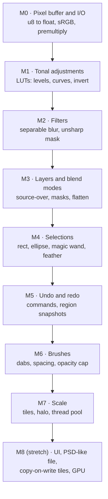
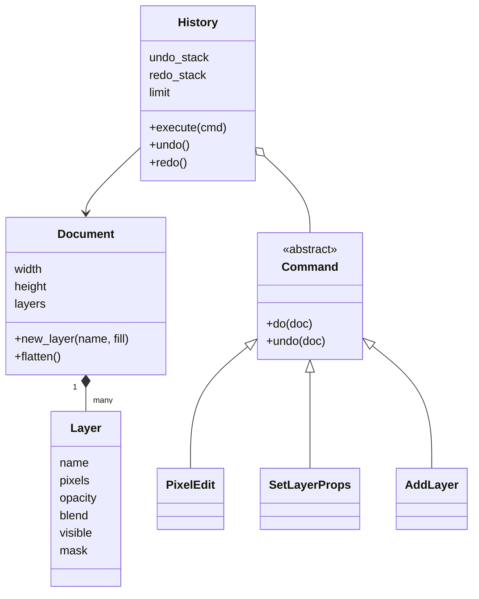

Build the engine of a Photoshop-like editor step by step: pixels, adjustments, filters, layers, selections, brushes and undo. Each milestone names the concepts to study first and the tests that prove it works. Reference language: Python + NumPy; port milestones to C++ or TypeScript with the cookbook pages.

Product context: [[adobe-photoshop]].

## Milestone map



| # | Goal | Study first | Done when |
|---|---|---|---|
| M0 | Load/convert pixels | [[raster-images-and-pixel-formats]], [[color-spaces-and-gamma]] | u8↔float round trip exact; sRGB known values; premultiply round trip |
| M1 | Levels, Curves, Invert | [[lookup-tables]], [[tonal-adjustments]] | identity LUT exact; Levels endpoints and midpoint; alpha untouched |
| M2 | Blur and sharpen | [[convolution-and-kernels]], [[image-filters]] | kernel sums to 1; constant image unchanged; impulse response; no dark fringe |
| M3 | Layer stack | [[alpha-compositing]], [[layers-and-blend-modes]] | 13 blend-mode cases; transparency identities; order, visibility, mask |
| M4 | Selections | [[flood-fill]], [[selections-and-masks]] | contiguous vs global; tolerance; 4 vs 8 connectivity; add/subtract/intersect |
| M5 | Undo/redo | [[command-pattern]], [[undo-redo-history]] | undo restores bytes exactly; redo replays; new edit drops redo; limit |
| M6 | Brushes | [[brush-painting]] | even spacing across segments; opacity cap; bbox covers stroke |
| M7 | Large images | [[tiled-image-processing]], [[worker-pool]] | tiled blur equals whole-image blur; halo 0 shows seams |
| M8 | Product polish | [[copy-on-write]], [[canvas-imagedata]] | see stretch goals |

## Architecture you are building



Pure functions (`composite`, `gaussian_blur`, `apply_lut`, `magic_wand`, `paint_stroke`) take arrays and return arrays; only commands mutate the document. That split keeps everything testable.

## Milestone notes

### M0 — Representation

Pick one internal format and convert at the edges. pixkit uses float32, straight RGBA, sRGB-encoded, shape `(H, W, 4)`. Write `to_float`, `to_u8` (round, clip), `srgb_to_linear`, `linear_to_srgb`, `premultiply`, `unpremultiply`.

### M1 — Adjustments

Build a 256-entry table from a function once, then index. Levels: `t = clamp((v − black)/(white − black))^(1/gamma)`.

### M2 — Filters

Gaussian kernel with radius `ceil(3σ)`, normalized. Two 1-D passes. Premultiply before blurring RGBA.

### M3 — Layers

Implement the W3C source-over-with-blend formula once; every blend mode is a 1-line function `B(Cb, Cs)`. Flatten bottom to top.

### M4 — Selections

Masks are `(H, W)` floats. Magic wand = predicate + BFS with an explicit queue. Feather = Gaussian blur of the mask with zero borders.

### M5 — Undo

`PixelEdit(layer, bbox, fn)` stores `before` and `after` patches; redo writes `after` back. Every mutation goes through `History.execute`.

### M6 — Brushes

Resample the path every `spacing × diameter` px carrying leftover distance; stroke coverage = max of dabs; composite once with `alpha = coverage × opacity`. Compute the bbox *before* painting for the undo snapshot.

### M7 — Tiles

`apply_tiled(img, fn, tile, halo, workers)`: read tile + halo, run `fn`, write back only the tile's own pixels.

### M8 — Stretch goals

- A minimal UI: browser canvas front end ([[canvas-imagedata]]) talking to the engine, or a Qt/Dear ImGui desktop app in C++.
- Copy-on-write tile store so undo of small strokes on huge images stays cheap ([[copy-on-write]]).
- Save/load a layered file: a ZIP of PNG layers + JSON metadata (the same idea as OpenRaster `.ora`).
- Port the hot paths (blur, composite) to C++ ([[image-processing-in-cpp]]) and compare speed.

## Reference implementation

> [!tested] `examples/image-editor/python/` — `pixkit`
> - **Used for:** Comparing your milestones with a tested solution and running the whole engine from the command line.
> - **Input:** For the CLI, an input image, an output path, and operations (`--levels B,W,G`, `--blur SIGMA`, `--sharpen SIGMA,AMOUNT`).
> - **Expected output:** `42 passed` from pytest; the CLI writes the processed image and prints `wrote out.png (WxH)`.
>
> ```bash
> cd examples/image-editor/python
> python -m pip install numpy pytest Pillow
> python -m pytest -q
> python -m pixkit in.png out.png --levels 10,245,1.2 --blur 1.5 --sharpen 1.0,0.8
> ```
>
> | File | Milestones |
> |---|---|
> | `pixkit/color.py` | M0 |
> | `pixkit/adjust.py` | M1 |
> | `pixkit/filters.py` | M2 |
> | `pixkit/blend.py`, `pixkit/layers.py` | M3 |
> | `pixkit/selection.py` | M4 |
> | `pixkit/history.py` | M5 |
> | `pixkit/brush.py` | M6 |
> | `pixkit/tiles.py` | M7 |
> | `tests/` | acceptance tests for all milestones |

C++ and TypeScript companions: `examples/image-editor/cpp/` (blur cross-checked against pixkit, undo stack) and `examples/image-editor/typescript/` (blend modes, scanline flood fill); `examples/image-editor/smoke_test.sh` runs them.

## Self-assessment

1. Why does blurring straight RGBA produce dark fringes, and what fixes it?
2. Why can Levels and Curves be lookup tables but blur cannot?
3. What does a blend mode do where the backdrop is fully transparent?
4. How much memory do 50 full-image undo steps cost for a 6000×4000 RGBA8 image, and how do editors avoid it?
5. Why must a tile's halo be at least the kernel radius?
