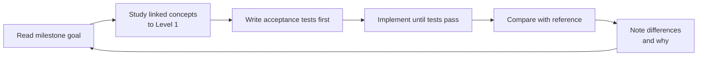

A blueprint turns knowledge into a buildable project: ordered milestones, the concepts to study before each one, acceptance tests, and a reference implementation to compare against afterwards.

| Blueprint | Product inspiration | Skills exercised | Reference |
|---|---|---|---|
| [[build-a-download-manager]] | [[internet-download-manager\|IDM]] | HTTP, concurrency, file I/O, crash safety, rate limiting, testing | `examples/download-manager/python` (tested) |
| [[build-a-layered-image-editor]] | [[adobe-photoshop\|Photoshop]] | NumPy, image maths, compositing, convolution, undo architecture, tiling | `examples/image-editor/python` (tested) |

## How to use a blueprint

Planned: *build a caching reverse proxy* (Cloudflare slice), *build a mini search engine* (Google Search slice). See [[roadmap]].
