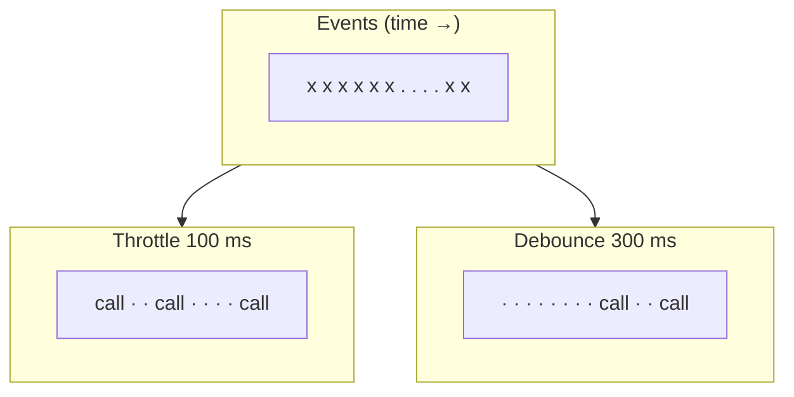

## Problem and purpose

UIs produce bursts of events: 60–240 pointer moves per second, a keystroke every 100 ms, a resize event per frame. Reacting to every one (broadcasting a cursor, saving to storage, searching a server) wastes CPU and bandwidth. **Throttle** limits a function to at most once per interval; **debounce** waits until the burst stops and calls it once.

## Core concepts and terminology

- **Throttle** — "at most every N ms": good for continuous streams (cursor broadcast, scroll handlers).
- **Debounce** — "N ms after the last event": good for "done typing" actions (autosave, search-as-you-type).
- **Leading / trailing edge** — whether to call at the start of a burst, at its end, or both.
- **requestAnimationFrame** — throttle to the display refresh for rendering.

*Search keywords:* `debounce vs throttle`, `trailing edge throttle`, `lodash debounce`, `requestAnimationFrame throttle`.

## How it works



## Related features and components

[[real-time-collaboration]] (cursor broadcast, update batching) · [[scene-files-and-export]] (autosave) · [[token-bucket]] (rate limiting with bursts, the server-side cousin) · [[brush-painting]] (coalesced pointer events).

## Required technical knowledge

Closures, timers (`setTimeout`), the [[async-io-event-loop]].

## Implementation techniques and APIs

> [!tested] TypeScript — `throttle` and `debounce` in `src/timing.ts`
> - **Used for:** Limiting cursor broadcasts and delaying autosave.
> - **Input:** A function and an interval in ms.
> - **Expected output:** Throttle 100 ms: calls `t(1); t(2); t(3)` deliver `1` immediately and `3` (the latest) 100 ms later. Debounce 300 ms: `d("a")`, 200 ms, `d("b")`, then 300 ms of quiet delivers only `"b"`.
>
> ```ts
> import { throttle, debounce } from "./src/timing.ts";
>
> const sendCursor = throttle((p: { x: number; y: number }) => socket.send(JSON.stringify(p)), 50);
> canvas.addEventListener("pointermove", (e) => sendCursor({ x: e.offsetX, y: e.offsetY }));
> const autosave = debounce(() => localStorage.setItem("scene", scene.toJSON()), 300);
> ```
> Tests: `throttle: first call immediately, then at most one per interval, trailing call kept`, `debounce: one call after the burst ends` (using `node:test` mock timers, so no real waiting).

Libraries: lodash `throttle`/`debounce`; RxJS `throttleTime`/`debounceTime`.

## Error handling and edge cases

- Lost final value: a throttle without a trailing call drops the last cursor position — the cursor freezes slightly off.
- Stale trailing value: if a new call takes the leading edge while an older one is still pending, the pending one must be discarded, or it is delivered *after* the newer value and the cursor jumps backwards (found by testing sketchkit's `throttle`).
- Pending debounced saves on page close: flush on `visibilitychange`/`pagehide`.
- `this` and argument handling when wrapping methods.
- Timers in background tabs are slowed by browsers (often to ≥ 1 s).

## Testing and debugging

- Use fake timers (`node:test` `mock.timers`, Jest/Vitest fake timers) to test timing deterministically.
- Count calls in a burst to verify the rate.

## Limitations and engineering trade-offs

- Throttle adds up to one interval of latency to the trailing value; debounce adds a full interval after the burst.
- For rendering, `requestAnimationFrame` beats fixed-interval throttling.

## Competency checklist

> [!level1] Recognition
> Explain throttle vs debounce, leading vs trailing edge, and pick one for a given event.

> [!level2] Implementation
> Implement both with trailing-edge delivery and test them with fake timers.

## References

- MDN, *Debounce* (glossary) — https://developer.mozilla.org/en-US/docs/Glossary/Debounce
- MDN, *Throttle* (glossary) — https://developer.mozilla.org/en-US/docs/Glossary/Throttle
- Node.js, *Mocking timers* in `node:test` — https://nodejs.org/api/test.html#timers
