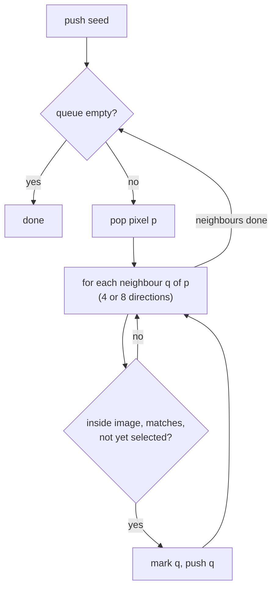

## Problem and purpose

Given a starting pixel, find every pixel **connected** to it that satisfies a condition (same colour within a tolerance). This powers the paint bucket and magic wand, and — as graph search on a grid — connected-component labelling, Minesweeper's empty-area reveal, Go/territory games, island counting in interviews, and maze solving.

## Core concepts and terminology

- **Seed** — starting pixel. **Predicate** — "does this pixel belong?" (e.g. within tolerance of the seed colour).
- **Connectivity** — 4-connected (up/down/left/right) or 8-connected (plus diagonals).
- **BFS / DFS** — breadth-first (queue) or depth-first (stack) traversal of the grid graph.
- **Scanline fill** — fills whole horizontal runs at once, pushing only one seed per run above/below; far fewer stack operations.
- **Visited set** — prevents revisiting; a boolean array the size of the image.

*Search keywords:* `flood fill algorithm scanline`, `BFS grid connected components`, `4 vs 8 connectivity`, `recursion depth flood fill stack overflow`.

## How it works



Each pixel is marked once and examined from at most 4 (or 8) neighbours: O(N) time and O(N) memory for N pixels in the region.

## Related features and components

[[selections-and-masks]] (magic wand) · paint bucket tool · [[layers-and-blend-modes]] (fill a selected region on a layer).

## Required technical knowledge

Queues and stacks ([[producer-consumer-queue]] for the queue idea); 2-D array indexing; graphs as grids.

## Implementation techniques and APIs

> [!tested] Python BFS — `pixkit.magic_wand`
> - **Used for:** Selecting the connected region around a seed pixel.
> - **Input:** RGBA float image, seed `(x, y)`, tolerance on a 0–255 scale, connectivity 4 or 8.
> - **Expected output:** A float mask (1 = selected). For two diagonal white pixels, 4-connectivity selects 1 pixel and 8-connectivity selects 2.
>
> ```python
> from collections import deque
> # core loop (see pixkit/selection.py for the full function)
> queue = deque([(y, x)]); selected[y, x] = True
> while queue:
>     cy, cx = queue.popleft()
>     for dy, dx in steps:                       # 4 or 8 neighbour offsets
>         ny, nx = cy + dy, cx + dx
>         if 0 <= ny < h and 0 <= nx < w and match[ny, nx] and not selected[ny, nx]:
>             selected[ny, nx] = True             # mark when pushed, not when popped
>             queue.append((ny, nx))
> ```

> [!tested] TypeScript scanline fill — `examples/image-editor/typescript/imagedata-ops.ts`
> - **Used for:** A paint bucket on canvas `ImageData` that is safe for huge regions.
> - **Input:** RGBA bytes, width, height, seed `(x, y)`, fill colour, tolerance.
> - **Expected output:** Returns the number of filled pixels and recolours them in place; the self-test prints `imagedata-ops: all checks passed`.
>
> ```bash
> node examples/image-editor/typescript/imagedata-ops.ts
> ```

Library equivalents: `scipy.ndimage.label` (connected components), OpenCV `cv2.floodFill`, scikit-image `flood`.

## Error handling and edge cases

- **Recursive DFS** overflows the call stack on large regions (Python's default recursion limit is 1000) — use an explicit queue/stack.
- Mark pixels **when pushing**, not when popping, or the same pixel enters the queue many times.
- Seed outside the image; tolerance compared in which space (RGB max difference here).
- Filling with the same colour as the target: with a colour-based predicate and no visited set, this loops forever.

## Testing and debugging

- Tiny hand-drawn grids where you know the answer: diagonals (4 vs 8), holes, regions touching the border.
- Count of filled pixels as a simple assertion.
- Large-region test (e.g. 2000×2000 uniform) to prove no recursion limit or quadratic behaviour.

## Limitations and engineering trade-offs

- BFS with a Python loop is O(N) but slow per pixel; vectorized or C implementations are 100× faster.
- Scanline fill reduces queue traffic; for many fills on the same image, label connected components once.

## Competency checklist

> [!level1] Recognition
> Explain flood fill as graph search on a grid; 4 vs 8 connectivity; why recursion is risky.

> [!level2] Implementation
> Implement BFS flood fill with tolerance and connectivity, plus tests on small grids.

> [!level3] Engineering
> Implement scanline fill, anti-aliased fills, and connected-component labelling; compare performance.

## References

- Wikipedia, *Flood fill* — https://en.wikipedia.org/wiki/Flood_fill
- Sedgewick & Wayne, *Algorithms*, 4th ed., ch. 4.1 (graph search) — https://algs4.cs.princeton.edu/41graph/
- scikit-image `flood` — https://scikit-image.org/docs/stable/auto_examples/segmentation/plot_floodfill.html
