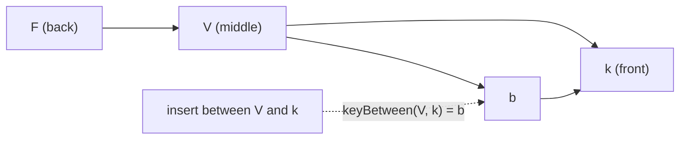

## Problem and purpose

Ordered lists — z-order of shapes, cards in a Trello column, rows in a task list — need reordering. Storing positions as `0, 1, 2, …` means moving one item renumbers many others, and two users reordering concurrently overwrite each other's renumbering. **Fractional indexing** gives each item a key that sorts correctly as a string and lets you always create a new key *between* any two neighbours, so a move changes exactly one item.

Used by Figma, Excalidraw (z-order of elements in recent versions), Linear, Jira (LexoRank) and many collaborative list apps.

## Core concepts and terminology

- **Order key** — string compared with plain string comparison.
- **keyBetween(a, b)** — returns a key `k` with `a < k < b`; `null` means unbounded.
- **Alphabet / base** — digits used in keys (base 62 here); more digits = shorter keys.
- **Key growth** — repeated insertion at the same spot makes keys longer; rebalancing occasionally rewrites them.
- **Tie-breaking** — two users may generate the same key concurrently; sort by `(key, id)`.

*Search keywords:* `fractional indexing`, `figma realtime editing ordered sequences`, `LexoRank`, `order key between two strings`.

## How it works



Think of keys as base-62 fractions after a decimal point: "V" ≈ 0.5, "F" ≈ 0.24. Between any two distinct fractions there is always another one — at worst one digit longer.

## Related features and components

[[real-time-collaboration]] · [[selection-and-transform]] (bring to front / send backward) · [[vector-graphics-and-scene-model]].

## Required technical knowledge

String comparison, number bases; [[conflict-resolution]] (why renumbering conflicts).

## Implementation techniques and APIs

> [!tested] TypeScript — `keyBetween` and `byIndex` in `src/fractional.ts`
> - **Used for:** Creating z-order keys for new and moved elements.
> - **Input:** The keys of the two neighbours (or `null` at either end).
> - **Expected output:** `keyBetween(null, null)` is `"V"`; `keyBetween("V", null)` is `"k"`; `keyBetween("V", "W")` is `"VV"`. After 2000 random insertions all keys stay strictly ordered and shorter than 40 characters. `keyBetween("b", "a")` throws.
>
> ```ts
> import { keyBetween, byIndex } from "./src/fractional.ts";
>
> const first = keyBetween(null, null);            // "V"
> const top = keyBetween(first, null);             // "k" (bring to front)
> const between = keyBetween(first, top);          // between the two
> elements.sort(byIndex);                          // by key, ties by id: same order on every client
> ```
> Test: `keyBetween: always strictly between, under random insertion`.

Library: `fractional-indexing` (npm, by rocicorp) implements a robust variant with integer-part prefixes.

## Error handling and edge cases

- Inserting between equal keys is impossible — break ties by id when sorting, and generate keys from the *sorted* neighbours.
- Keys must never end with the smallest digit, or no key fits below them (sketchkit maintains this invariant).
- Unbounded growth from repeatedly inserting at the same position — rebalance keys when they exceed a length limit.

## Testing and debugging

- Property test: random insert positions, assert strict ordering and bounded length (in sketchkit).
- Test both ends (`null` bounds) and adjacent-digit cases like `("V", "W")`.

## Limitations and engineering trade-offs

- Two users inserting at the same spot at the same time can interleave unexpectedly; tree-based sequence CRDTs give stronger guarantees for text.
- Keys are opaque to users; never show them.

## Competency checklist

> [!level1] Recognition
> Explain why integer positions conflict in collaborative lists and how between-keys avoid renumbering.

> [!level2] Implementation
> Implement keyBetween with tests for ordering, ends and invariants.

> [!level3] Engineering
> Handle concurrent equal keys, key growth and rebalancing; compare with sequence CRDTs.

## References

- Evan Wallace (Figma), *Realtime Editing of Ordered Sequences* — https://www.figma.com/blog/realtime-editing-of-ordered-sequences/
- David Greenspan, *Implementing Fractional Indexing* — https://observablehq.com/@dgreensp/implementing-fractional-indexing
- `fractional-indexing` package — https://github.com/rocicorp/fractional-indexing
