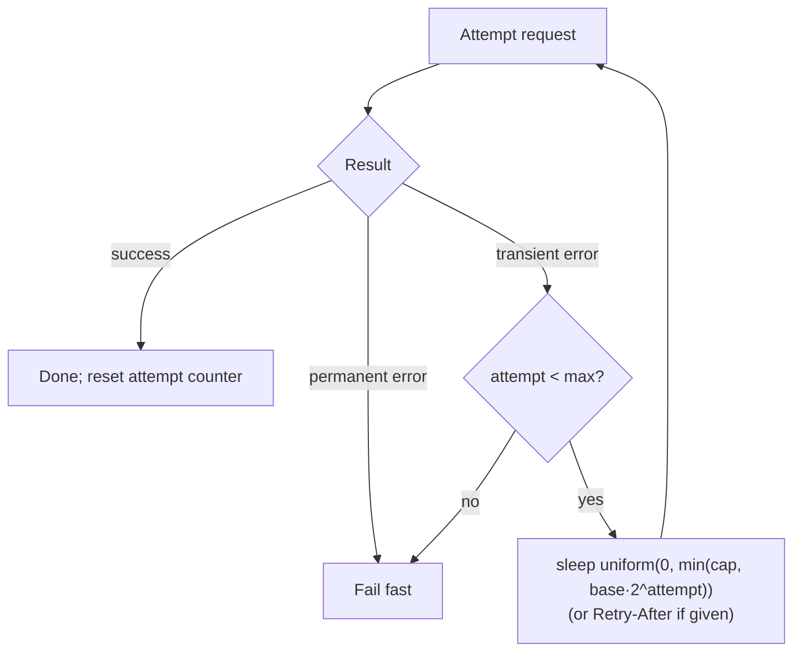

## Problem and purpose

Networks fail briefly all the time: a dropped connection, a `503` during a deploy, a timeout. Retrying immediately often fails again and, when thousands of clients do it at once, makes the outage worse (**thundering herd**). **Exponential backoff with jitter** waits longer after each failure and randomizes the wait so clients spread out.

Used in every SDK that talks to a network service (AWS, Google Cloud, Stripe), TCP retransmission timers, Ethernet collision handling, and download managers.

## Core concepts and terminology

- **Transient vs permanent error** — retry `timeouts`, connection resets, `408`, `429`, `500`, `502`, `503`, `504`; do not retry `400`, `401`, `403`, `404`.
- **Backoff** — `delay = min(cap, base × 2^attempt)`.
- **Jitter** — randomness added to the delay. *Full jitter*: `uniform(0, backoff)`.
- **Retry budget** — max attempts or max total time.
- **Idempotency** — a retried operation must not cause duplicate effects; range GETs are naturally idempotent, payments need **idempotency keys**.
- **`Retry-After`** — server-specified wait (seconds or HTTP date) on `429`/`503`.

*Search keywords:* `exponential backoff full jitter`, `retry transient errors idempotency`, `Retry-After header`, `thundering herd`, `circuit breaker`.

## How it works



Delays for `base = 0.5 s`, `cap = 30 s` (upper bound of the full-jitter range):

| attempt | 1 | 2 | 3 | 4 | 5 | 6 | 7 |
|---|---|---|---|---|---|---|---|
| max delay (s) | 1 | 2 | 4 | 8 | 16 | 30 | 30 |

## Related features and components

[[pause-and-resume]] · [[segmented-download]] · [[download-queue-and-scheduler]] (re-queue with not-before time) · [[token-bucket]] (the server side that sends `429`).

## Required technical knowledge

HTTP status codes; exceptions; random number generation; [[http-range-requests]] (why resumed GETs are safe to retry).

## Implementation techniques and APIs

- Classify errors explicitly with a set of retryable statuses and exception types.
- **Reset the attempt counter when progress is made** — a long download with occasional drops should not die after 5 lifetime errors.
- Make the sleep **interruptible** (`Event.wait(delay)`) so pause/cancel is instant.
- Libraries: Python `tenacity`, `urllib3.util.Retry`; Node `p-retry`; AWS SDK retry modes; gRPC retry policy.

> [!tested] Python — `backoff_delay()` and `_retry_or_raise()` in `minidm/downloader.py`
> ```python
> def backoff_delay(attempt: int, base: float, cap: float) -> float:
>     return random.uniform(0, min(cap, base * (2 ** attempt)))
> ```
> Tests: `test_dropped_connections_are_retried_and_resumed`, `test_transient_503_is_retried`, `test_permanent_404_fails_fast`.

> [!mwe] Generic retry helper (TypeScript)
> ```ts
> export class HttpError extends Error {
>   readonly status: number;
>   constructor(status: number) {
>     super(`HTTP ${status}`);
>     this.status = status;
>   }
> }
> const RETRYABLE = new Set([408, 425, 429, 500, 502, 503, 504]);
> // Network failures (fetch throws TypeError) are transient; HTTP errors only if listed.
> const isTransient = (e: unknown) => !(e instanceof HttpError) || RETRYABLE.has(e.status);
>
> export async function retry<T>(fn: () => Promise<T>, max = 5, base = 250, cap = 30_000): Promise<T> {
>   for (let attempt = 0; ; attempt++) {
>     try {
>       return await fn();
>     } catch (err) {
>       if (attempt >= max || !isTransient(err)) throw err;
>       await new Promise((r) => setTimeout(r, Math.random() * Math.min(cap, base * 2 ** attempt)));
>     }
>   }
> }
> ```

## Error handling and edge cases

- Retrying non-idempotent requests (POST payment) without an idempotency key duplicates effects.
- Nested retries multiply: SDK retries × your retries × proxy retries = retry storm. Retry at one layer.
- Respect `Retry-After`; cap it to something sane.

## Testing and debugging

- Fault-injecting test server: fail N times, then succeed; assert N+1 requests.
- Seed or inject the random source and the sleep function to make timing assertions deterministic.
- Log attempt number, error class and delay on every retry.

## Limitations and engineering trade-offs

- Long caps make recovery slow after an outage ends; short caps hammer struggling servers.
- For persistent outages, a **circuit breaker** (stop trying for a while) protects both sides.

## Competency checklist

> [!level1] Recognition
> Classify errors as transient or permanent; explain why jitter matters.

> [!level2] Implementation
> Write a retry loop with full jitter, a budget, interruptible sleep, and progress-based reset; test it with fault injection.

> [!level3] Engineering
> Design retry policies across layers, idempotency keys, circuit breakers, and retry budgets for a fleet.

## References

- AWS Architecture Blog, *Exponential Backoff And Jitter* — https://aws.amazon.com/blogs/architecture/exponential-backoff-and-jitter/
- Google SRE Book, *Handling Overload* / *Addressing Cascading Failures* — https://sre.google/sre-book/addressing-cascading-failures/
- RFC 9110 §10.2.3 *Retry-After* — https://www.rfc-editor.org/rfc/rfc9110#section-10.2.3
