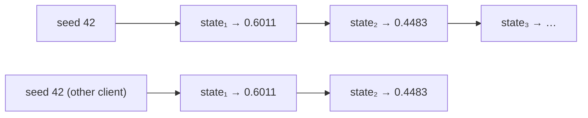

## Problem and purpose

Some features need randomness that is **repeatable**: a hand-drawn shape must wobble the same way every redraw and on every collaborator's screen; a procedurally generated game level must be the same for everyone with the same seed; a test with random inputs must fail the same way when re-run. A **seeded pseudorandom number generator (PRNG)** produces a sequence that looks random but is fully determined by its seed.

## Core concepts and terminology

- **PRNG** — deterministic algorithm producing random-looking numbers from internal state.
- **Seed** — initial state; same seed → same sequence.
- **Period** — length before the sequence repeats.
- **Non-cryptographic vs cryptographic** — fast PRNGs (mulberry32, xorshift, PCG) are predictable; for keys and tokens use a CSPRNG (`crypto.getRandomValues`, Python `secrets`).
- `Math.random()` cannot be seeded.

*Search keywords:* `seeded random javascript`, `mulberry32`, `PCG random`, `xorshift`, `deterministic procedural generation`.

## How it works



Each call mixes the state with integer multiplications, shifts and XORs and returns a number in [0, 1). The element stores only its seed; renderers recreate the same random sequence on demand.

## Related features and components

[[hand-drawn-shapes]] · property-based tests (a seed makes failures reproducible) · [[retry-with-exponential-backoff]] (jitter — *unseeded* randomness wanted there).

## Required technical knowledge

Integers and bit operations (`>>>`, `^`, `Math.imul` in JavaScript).

## Implementation techniques and APIs

> [!tested] TypeScript — `mulberry32` in `src/random.ts`
> - **Used for:** Reproducible random numbers from a 32-bit seed.
> - **Input:** A seed (any integer).
> - **Expected output:** A function returning numbers in [0, 1); two generators with seed 42 return identical sequences; over 1000 samples the mean is within 0.05 of 0.5.
>
> ```ts
> import { mulberry32 } from "./src/random.ts";
>
> const rand = mulberry32(42);
> const a = rand(), b = rand();        // the same two numbers on every machine and every run
> ```
> Test: `seeded random is reproducible and in [0, 1)`.

> [!mwe] Python equivalent
> - **Used for:** Reproducible randomness in Python tests and simulations.
> - **Input:** A seed.
> - **Expected output:** `True` — two generators with the same seed produce the same list.
>
> ```python
> import random
> a = random.Random(42); b = random.Random(42)
> print([a.random() for _ in range(3)] == [b.random() for _ in range(3)])   # True
> ```

## Error handling and edge cases

- Never use a fast PRNG for secrets, ids that must be unguessable, or encryption keys.
- Sharing one global generator between features makes outputs depend on call order — give each element/test its own generator.
- Floating-point differences between platforms do not affect integer-based PRNGs like mulberry32.

## Testing and debugging

- Same-seed equality, different-seed inequality, range and rough uniformity checks.
- Log the seed of failing randomized tests so they can be replayed.

## Limitations and engineering trade-offs

- mulberry32 has a 2³² period — plenty for jitter, too small for large simulations (use PCG or xoshiro).

## Competency checklist

> [!level1] Recognition
> Explain seeds, determinism, and PRNG vs CSPRNG.

> [!level2] Implementation
> Use a seeded PRNG for reproducible rendering or tests; know when to use `crypto.getRandomValues` instead.

## References

- PCG family — https://www.pcg-random.org/
- MDN, `Crypto.getRandomValues` — https://developer.mozilla.org/en-US/docs/Web/API/Crypto/getRandomValues
- Python `random` (seeding, not for security) — https://docs.python.org/3/library/random.html
