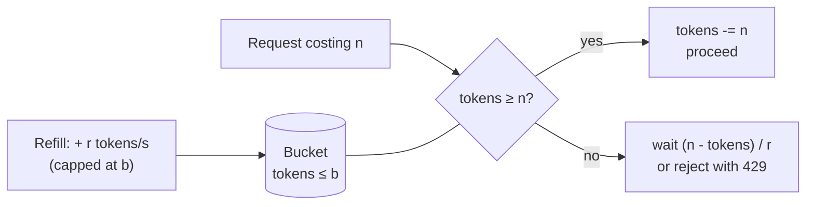

## Problem and purpose

Limit how fast something happens — bytes per second, requests per minute — **on average**, while allowing short bursts. The token bucket is the standard answer, used in download speed limiters ([[bandwidth-limiting]]), API gateways, NGINX `limit_req`, cloud provider API quotas, and network routers.

## Core concepts and terminology

- **Rate `r`** — tokens added per second.
- **Capacity `b`** — maximum tokens stored; the largest burst.
- **Cost** — tokens an action consumes (1 per request, or `n` per `n` bytes).
- **Lazy refill** — instead of a timer adding tokens, compute `elapsed × r` whenever someone asks.
- Related algorithms: **leaky bucket** (smooths output to a constant rate), **fixed window**, **sliding window log**, **sliding window counter**, **GCRA** (generic cell rate algorithm — token bucket expressed as a single timestamp).

*Search keywords:* `token bucket algorithm`, `leaky bucket vs token bucket`, `GCRA rate limiting`, `sliding window rate limiter redis`.

## How it works



> [!pseudocode] Lazy-refill token bucket
> ```
> state: tokens = b, last = now()
>
> consume(n):
>     tokens = min(b, tokens + (now() - last) * r)
>     last = now()
>     if tokens >= n: tokens -= n; return OK
>     else: return WAIT((n - tokens) / r)
> ```

**Worked example** — `r = 100/s`, `b = 100`: after idling, 100 requests pass instantly (burst). The 101st must wait 10 ms. Over a long period, throughput converges to 100/s.

## Related features and components

[[bandwidth-limiting]] (bytes as tokens) · [[download-queue-and-scheduler]] (rate of task starts) · API rate limiting and DDoS protection (planned Cloudflare slice) · [[retry-with-exponential-backoff]] (the client-side counterpart when you are the one being limited).

## Required technical knowledge

Monotonic clocks; locks for thread safety; basic arithmetic with floats.

## Implementation techniques and APIs

- **Thread-safe:** guard refill+consume with one lock; sleep **outside** the lock.
- **Distributed:** store `tokens, last` in Redis and update atomically with a Lua script, or use GCRA (one timestamp per key).
- **Libraries:** Python `aiolimiter`, `limits`; Node `bottleneck`, `rate-limiter-flexible`; Guava `RateLimiter` (Java); NGINX `limit_req` (leaky-bucket style).

> [!tested] Python — `examples/download-manager/python/minidm/ratelimit.py`
> ```python
> class TokenBucket:
>     def consume(self, n: int) -> None:
>         while n > 0:
>             take = min(n, self.capacity)            # avoid deadlock for n > capacity
>             with self._lock:
>                 self._refill()
>                 if self._tokens >= take:
>                     self._tokens -= take; n -= take; continue
>                 wait = (take - self._tokens) / self.rate
>             self._sleep(wait)                        # never sleep holding the lock
> ```
> Fake-clock tests: `test_token_bucket_burst_then_throttle`, `test_token_bucket_request_larger_than_capacity`.

> [!mwe] TypeScript (non-blocking check, for request limiting)
> ```ts
> export class TokenBucket {
>   private tokens: number;
>   private last = performance.now();
>   constructor(private rate: number, private capacity = rate) { this.tokens = capacity; }
>   tryTake(n = 1): boolean {
>     const now = performance.now();
>     this.tokens = Math.min(this.capacity, this.tokens + ((now - this.last) / 1000) * this.rate);
>     this.last = now;
>     if (this.tokens < n) return false;     // caller answers 429 Too Many Requests
>     this.tokens -= n;
>     return true;
>   }
> }
> ```

## Error handling and edge cases

- Use monotonic time; wall-clock jumps (NTP, DST) create or destroy tokens.
- `n > capacity` never succeeds unless split.
- Floating-point drift is negligible for practical rates; integer microsecond arithmetic avoids it entirely.
- Per-key buckets (per user/IP) need eviction of idle keys or memory grows forever.

## Testing and debugging

- Inject `clock` and `sleep`; assert exact waits (see tested example).
- Property test: over any long sequence, consumed ≤ `b + r × elapsed`.

## Limitations and engineering trade-offs

| Algorithm | Bursts | Memory per key | Precision |
|---|---|---|---|
| Token bucket | allowed up to `b` | 2 numbers | good |
| Leaky bucket (queue) | smoothed | queue | constant output |
| Fixed window counter | 2× at window edges | 1 counter | coarse |
| Sliding window log | none | 1 timestamp per request | exact, expensive |
| Sliding window counter | small | 2 counters | approximate, cheap |

## Competency checklist

> [!level1] Recognition
> Explain rate vs capacity, and compare token bucket with fixed and sliding windows.

> [!level2] Implementation
> Implement a thread-safe, lazily refilled token bucket with an injectable clock and tests.

> [!level3] Engineering
> Implement distributed rate limiting (Redis + Lua or GCRA), per-key eviction, and hierarchical limits.

## References

- Token bucket — https://en.wikipedia.org/wiki/Token_bucket
- Generic cell rate algorithm — https://en.wikipedia.org/wiki/Generic_cell_rate_algorithm
- Cloudflare blog, *How we built rate limiting capable of scaling to millions of domains* — https://blog.cloudflare.com/counting-things-a-lot-of-different-things/
- NGINX `limit_req` — https://nginx.org/en/docs/http/ngx_http_limit_req_module.html
