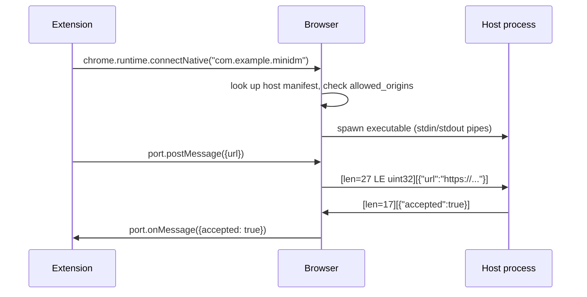

## Problem and purpose

Browser extensions are sandboxed: they cannot start programs, read arbitrary files, or open local sockets freely. Desktop apps cannot see what happens in the browser. **Native messaging** is the browser-approved channel between them: the browser launches a registered executable and exchanges JSON messages over its stdin/stdout.

Used by download managers ([[browser-download-capture]]), password managers, smart-card/e-ID software, and enterprise security agents.

## Core concepts and terminology

- **Native messaging host** — the local executable.
- **Host manifest** — JSON naming the host (`com.example.minidm`), the executable path, `type: "stdio"`, and `allowed_origins` (extension IDs).
- **Message framing** — each message is a 32-bit **native byte order** length followed by UTF-8 JSON. Max 1 MB host→browser, 64 MiB browser→host (Chrome).
- `runtime.sendNativeMessage` (one-shot, new process each time) vs `runtime.connectNative` (long-lived port).
- **IPC** — inter-process communication in general: pipes, sockets, shared memory.

*Search keywords:* `chrome native messaging host manifest`, `connectNative`, `native messaging length prefix`, `allowed_origins`, `NativeMessagingHosts registry`.

## How it works



Host manifest locations (Chrome; other browsers have analogous paths):

| OS | Location |
|---|---|
| Windows | registry `HKCU\Software\Google\Chrome\NativeMessagingHosts\com.example.minidm` → path to manifest |
| macOS | `~/Library/Application Support/Google/Chrome/NativeMessagingHosts/` |
| Linux | `~/.config/google-chrome/NativeMessagingHosts/` |

## Related features and components

[[browser-download-capture]] · [[producer-consumer-queue]] (host forwards requests to the app's queue).

## Required technical knowledge

Processes and pipes; binary framing (length-prefixed messages); JSON; extension basics (Manifest V3).

## Implementation techniques and APIs

> [!mwe] Native host in Python (3.10+)
> ```python
> #!/usr/bin/env python3
> import json, struct, sys
>
> def read_message() -> dict | None:
>     raw_len = sys.stdin.buffer.read(4)
>     if len(raw_len) < 4:
>         return None                                 # browser closed the pipe
>     (length,) = struct.unpack("=I", raw_len)        # native byte order, 32-bit
>     return json.loads(sys.stdin.buffer.read(length))
>
> def send_message(obj: dict) -> None:
>     data = json.dumps(obj).encode()
>     sys.stdout.buffer.write(struct.pack("=I", len(data)) + data)
>     sys.stdout.buffer.flush()
>
> while (msg := read_message()) is not None:
>     # validate before acting: never trust the message blindly
>     ok = isinstance(msg.get("url"), str) and msg["url"].startswith(("http://", "https://"))
>     send_message({"accepted": ok})
> ```
> Anything printed to stdout that is not a framed message corrupts the channel — log to stderr or a file.

> [!mwe] Host manifest `com.example.minidm.json`
> ```json
> {
>   "name": "com.example.minidm",
>   "description": "minidm download handler",
>   "path": "/opt/minidm/native_host.py",
>   "type": "stdio",
>   "allowed_origins": ["chrome-extension://<your-extension-id>/"]
> }
> ```

## Error handling and edge cases

- `Specified native messaging host not found` → manifest not in the right place or name mismatch.
- `Native host has exited` → the host crashed or wrote non-framed output to stdout.
- On Windows, stdin/stdout must be in binary mode (Python's `.buffer` handles this).
- Hosts started via `sendNativeMessage` are short-lived; forward work to the long-running app (local socket, named pipe) instead of downloading inside the host.

## Testing and debugging

- Test the host without a browser: `python3 -c 'import struct,sys,json; m=json.dumps({"url":"https://x"}).encode(); sys.stdout.buffer.write(struct.pack("=I",len(m))+m)' | ./native_host.py | xxd`.
- Chrome: launch with `--enable-logging --v=1` to see host launch errors.

## Limitations and engineering trade-offs

- Each browser and OS needs separate manifest installation — part of the app installer.
- Alternatives: a localhost HTTP/WebSocket server (works from any browser but must defend against other web pages calling it — check `Origin`, use a secret token).

## Competency checklist

> [!level1] Recognition
> Explain why extensions need native messaging, and how messages are framed.

> [!level2] Implementation
> Write and register a host, exchange messages with an extension, and debug launch failures.

## References

- Chrome native messaging — https://developer.chrome.com/docs/extensions/develop/concepts/native-messaging
- MDN native messaging — https://developer.mozilla.org/en-US/docs/Mozilla/Add-ons/WebExtensions/Native_messaging
