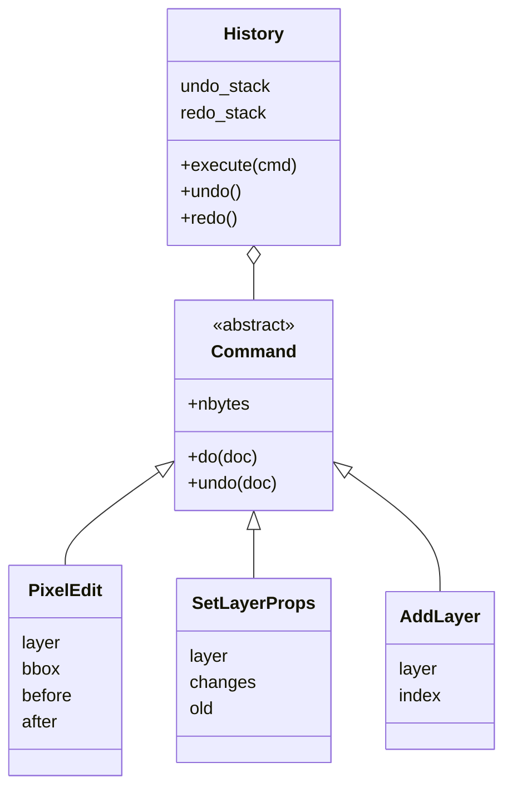

## Problem and purpose

When UI code changes data directly (`layer.opacity = 0.5`), there is no record of what happened: nothing to undo, replay, log, send over the network or test in isolation. The **command pattern** turns each change into an object with `do()` and `undo()`. The UI creates commands; one place executes them.

Used for undo/redo ([[undo-redo-history]]), macro recording (Photoshop Actions), job queues, collaborative editing operation logs, database migrations (up/down), and game input replays.

## Core concepts and terminology

- **Command** — object holding everything needed to perform and revert one action.
- **Invoker** — the component that executes commands and keeps history.
- **Receiver** — the data the command changes (the document).
- **Memento** — saved state used by `undo()` (the "before" pixels).
- **Idempotent redo** — redo replays stored results instead of recomputing.
- **Macro / composite command** — a command made of commands (one Photoshop Action).

*Search keywords:* `command pattern undo redo`, `memento pattern`, `macro command`, `operation log replay`.

## How it works



## Related features and components

[[undo-redo-history]] · [[finite-state-machine]] (tools emit a command when their interaction completes) · [[copy-on-write]] (cheap mementos) · [[producer-consumer-queue]] (commands as queued jobs).

## Required technical knowledge

Classes, interfaces/abstract classes, polymorphism; ownership and lifetimes in C++ (`std::unique_ptr`).

## Implementation techniques and APIs

> [!tested] Python — `pixkit/history.py`
> - **Used for:** Making layer property changes undoable.
> - **Input:** A document with one layer; a `SetLayerProps` command changing opacity to 0.5.
> - **Expected output:** After `execute`, opacity is 0.5; after `undo`, it is back to 1.0.
>
> ```python
> from pixkit import Document, History, SetLayerProps
>
> doc = Document(4, 4); doc.new_layer("a")
> hist = History(doc)
> hist.execute(SetLayerProps(0, opacity=0.5)); print(doc.layers[0].opacity)   # 0.5
> hist.undo();                                 print(doc.layers[0].opacity)   # 1.0
> ```

> [!tested] C++ — `examples/image-editor/cpp/undo_stack.cpp`
> - **Used for:** Command objects owned by the history through `std::unique_ptr`.
> - **Input:** None (self-checking program).
> - **Expected output:** `undo_stack: all checks passed`.
>
> ```cpp
> struct Command {
>   virtual ~Command() = default;            // virtual destructor: deleting through base pointer
>   virtual void apply(Canvas& c) = 0;
>   virtual void revert(Canvas& c) = 0;
> };
> std::vector<std::unique_ptr<Command>> undo_, redo_;   // history owns its commands
> ```

## Error handling and edge cases

- `do()` that fails halfway must roll back before raising, or the history and data disagree.
- Commands must not hold references that become invalid (deleted layers); use stable IDs.
- Non-invertible operations (lossy resize) need full mementos rather than an inverse computation.

## Testing and debugging

- Each command: `do` then `undo` → state equals original (byte-exact).
- Sequences: random command lists, undo all, compare with the initial state.

## Limitations and engineering trade-offs

- Every mutation must go through commands; one direct write breaks undo silently. Enforce it by making the document mutable only via the invoker.
- Inverse operations save memory but are hard to get exact (floating point); mementos are exact but large.

## Competency checklist

> [!level1] Recognition
> Explain command, invoker, receiver and memento; list uses beyond undo.

> [!level2] Implementation
> Implement commands for several edit types with exact undo and tests.

> [!level3] Engineering
> Design macro commands, coalescing, persistence of command logs, and collaborative/branching histories.

## References

- Gamma, Helm, Johnson, Vlissides, *Design Patterns* (1994) — Command, Memento.
- *Game Programming Patterns*, "Command" — https://gameprogrammingpatterns.com/command.html
- Refactoring.Guru, *Command* — https://refactoring.guru/design-patterns/command
