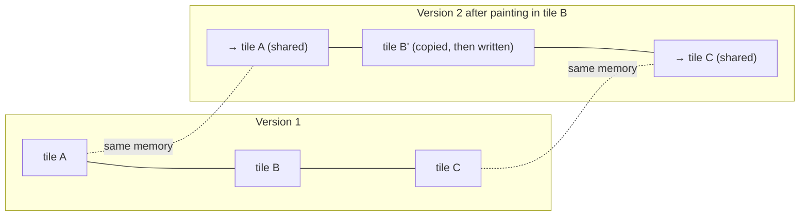

## Problem and purpose

Undo history, snapshots and "duplicate layer" all want *copies* of large data, but most of each copy is identical to the original. **Copy-on-write (COW)** shares the data and copies only the part that is about to change. A 50-step history of small brush strokes then costs a few tiles per step instead of 50 full images.

COW appears in OS `fork()` (memory pages), filesystems (Btrfs, ZFS, APFS snapshots), Git objects, persistent data structures in Clojure/Immutable.js, Swift arrays, and container image layers.

## Core concepts and terminology

- **Sharing** — several owners reference the same block.
- **Reference count** — number of owners; a write to a block with count > 1 copies it first.
- **Structural sharing** — new versions reuse unchanged parts of old versions.
- **Granularity** — what is copied: pages (4 KB), tiles (e.g. 256×256 px), whole objects.

*Search keywords:* `copy on write tiles undo`, `structural sharing persistent data structure`, `reference counting copy on write`, `fork copy on write pages`.

## How it works



> [!pseudocode] Tile store with copy-on-write
> - **Used for:** Showing the write path that makes snapshots cheap.
> - **Input:** A tile grid where each tile has a reference count; a write to pixel (x, y).
> - **Expected output:** Only the written tile is duplicated, and only if it is shared.
>
> ```
> snapshot(): for each tile: tile.refcount += 1; return copy of the tile *grid* (pointers only)
> write(x, y, value):
>     t = grid[y / TILE][x / TILE]
>     if t.refcount > 1:                 # shared with a snapshot
>         t.refcount -= 1
>         t = clone(t); t.refcount = 1   # private copy
>         grid[y / TILE][x / TILE] = t
>     t.pixels[y % TILE][x % TILE] = value
> ```

## Related features and components

[[undo-redo-history]] · [[tiled-image-processing]] · [[layers-and-blend-modes]] (duplicate layer shares tiles until edited).

## Required technical knowledge

References/pointers, reference counting; [[command-pattern]]; [[raster-images-and-pixel-formats]] (tile memory size).

## Implementation techniques and APIs

- **Python:** NumPy views share memory; `arr.copy()` makes a private copy. A simple COW tile store keeps a dict `(ty, tx) -> ndarray` and replaces entries on write.
- **C++:** `std::shared_ptr<Tile>` with `use_count() > 1` → clone before writing. Watch thread-safety: the check-then-clone must be done under a lock or by a single writer.
- **Swift/Rust:** `isKnownUniquelyReferenced`, `Rc::make_mut` / `Arc::make_mut` implement exactly this.

> [!mwe] C++ — copy-on-write tile with `shared_ptr`
> - **Used for:** Sharing tiles between document versions and copying only on write.
> - **Input:** Two `TileRef`s sharing one tile; a write through the second.
> - **Expected output:** The first still sees the old value; the second sees the new one; only one tile was cloned.
>
> ```cpp
> #include <array>
> #include <cstdint>
> #include <memory>
> using Tile = std::array<uint8_t, 256 * 256 * 4>;
>
> struct TileRef {
>   std::shared_ptr<Tile> p = std::make_shared<Tile>();
>   uint8_t read(size_t i) const { return (*p)[i]; }
>   void write(size_t i, uint8_t v) {
>     if (p.use_count() > 1) p = std::make_shared<Tile>(*p);   // clone shared tile first
>     (*p)[i] = v;
>   }
> };
> // TileRef a; TileRef b = a;  b.write(0, 255);  -> a.read(0) == 0, b.read(0) == 255
> ```

## Error handling and edge cases

- Forgetting the COW check on one write path corrupts *every* version sharing that tile — centralize writes.
- Reference counts across threads need atomic operations (`shared_ptr` provides this) and a single-writer policy.
- Memory accounting must count shared tiles once.

## Testing and debugging

- After writing through one version, assert all other versions are unchanged.
- Count allocations/clones to verify only touched tiles were copied.

## Limitations and engineering trade-offs

- The first write to a shared tile pays a copy; many small scattered writes after a snapshot copy many tiles.
- Granularity trade-off: small tiles copy less per write but cost more metadata.

## Competency checklist

> [!level1] Recognition
> Explain COW, reference counts and structural sharing; name systems that use it.

> [!level2] Implementation
> Implement a COW tile store or wrapper and test that versions stay independent.

> [!level3] Engineering
> Build a thread-safe COW tile store for undo with memory accounting and disk spill.

## References

- Wikipedia, *Copy-on-write* — https://en.wikipedia.org/wiki/Copy-on-write
- Krita source, tiled image storage with undo mementos (`libs/image/tiles3`) — https://invent.kde.org/graphics/krita
- Okasaki, *Purely Functional Data Structures* (1998).
