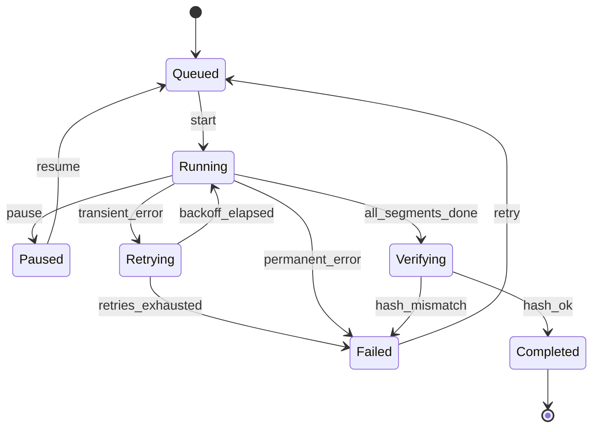

## Problem and purpose

A download can be queued, running, paused, retrying, verifying, completed or failed. Without explicit rules, code accumulates flags (`is_paused`, `is_running`, `has_error`) whose combinations become impossible to reason about: *can you pause a task that is verifying? What happens if "resume" arrives twice?* A **finite state machine** names every state, lists the allowed transitions, and rejects everything else.

FSMs model order lifecycles (Salesforce opportunities, e-commerce orders), TCP connections, UI flows, parsers, game AI, and workflow engines.

## Core concepts and terminology

- **State** — one of a finite set of named situations.
- **Event** — something that happens (`pause`, `chunk_failed`, `all_done`).
- **Transition** — `(state, event) → new state`, optionally with an **action** (side effect) and a **guard** (condition).
- **Transition table** — the full mapping; anything not listed is invalid.
- **Terminal state** — no outgoing transitions (Completed).
- **State pattern** (GoF) — OOP variant where each state is a class.
- **Statecharts** — FSMs with nesting and parallel regions (XState, SCXML).

*Search keywords:* `finite state machine transition table`, `state pattern`, `statechart XState`, `illegal state transition`, `enum state machine python`.

## How it works



Same machine as a table — the form you implement:

| State \ Event | start | pause | resume | transient_error | permanent_error | all_segments_done | hash_ok |
|---|---|---|---|---|---|---|---|
| Queued | Running | — | — | — | — | — | — |
| Running | — | Paused | — | Retrying | Failed | Verifying | — |
| Paused | — | — | Queued | — | — | — | — |
| Verifying | — | — | — | — | — | — | Completed |

## Related features and components

[[pause-and-resume]] · [[download-queue-and-scheduler]] (dispatcher reacts to transitions) · UI state (planned) · workflow automation (planned Salesforce slice).

## Required technical knowledge

Enums, dictionaries/maps, event handling.

## Implementation techniques and APIs

> [!mwe] Table-driven FSM (Python 3.10+)
> - **Used for:** Enforcing a download task's lifecycle: only listed state transitions are allowed.
> - **Input:** Events passed to `task.fire()`, e.g. `"start"` then `"pause"`.
> - **Expected output:** The task's `state` changes (`QUEUED → RUNNING → PAUSED`) and listeners are notified; an event not allowed in the current state raises `IllegalTransition`. Running the snippet prints nothing; the final `assert` passes.
>
> ```python
> from enum import Enum, auto
>
> class S(Enum):
>     QUEUED = auto(); RUNNING = auto(); PAUSED = auto(); RETRYING = auto()
>     VERIFYING = auto(); COMPLETED = auto(); FAILED = auto()
>
> TRANSITIONS: dict[tuple[S, str], S] = {
>     (S.QUEUED, "start"): S.RUNNING,
>     (S.RUNNING, "pause"): S.PAUSED,
>     (S.PAUSED, "resume"): S.QUEUED,
>     (S.RUNNING, "transient_error"): S.RETRYING,
>     (S.RETRYING, "backoff_elapsed"): S.RUNNING,
>     (S.RETRYING, "retries_exhausted"): S.FAILED,
>     (S.RUNNING, "permanent_error"): S.FAILED,
>     (S.RUNNING, "all_segments_done"): S.VERIFYING,
>     (S.VERIFYING, "hash_ok"): S.COMPLETED,
>     (S.VERIFYING, "hash_mismatch"): S.FAILED,
>     (S.FAILED, "retry"): S.QUEUED,
> }
>
> class IllegalTransition(Exception): pass
>
> class Task:
>     def __init__(self) -> None:
>         self.state = S.QUEUED
>         self.listeners = []                          # UI, scheduler, persistence
>
>     def fire(self, event: str) -> None:
>         new = TRANSITIONS.get((self.state, event))
>         if new is None:
>             raise IllegalTransition(f"{event!r} not allowed in {self.state.name}")
>         old, self.state = self.state, new
>         for cb in self.listeners: cb(old, event, new)
>
> t = Task(); t.fire("start"); t.fire("pause")
> assert t.state is S.PAUSED
> ```

> [!mwe] TypeScript with discriminated unions (data per state)
> - **Used for:** Modelling per-state data in TypeScript so the compiler rejects impossible combinations (e.g. a `bytesDone` on a queued task).
> - **Input:** A type definition — no runtime input.
> - **Expected output:** No runtime output; type errors at compile time when code reads a field that does not exist in the current state, or a `switch (task.state)` misses a case (with an exhaustiveness check).
>
> ```ts
> type Task =
>   | { state: "queued" }
>   | { state: "running"; startedAt: number }
>   | { state: "paused"; bytesDone: number }
>   | { state: "failed"; error: string };
> // The compiler forces you to handle every state in a switch over `task.state`.
> ```

Libraries: Python `transitions`; TypeScript `xstate`; C++ Boost.SML / Boost.MSM, or `std::variant` + `std::visit`.

## Error handling and edge cases

- **Duplicate events** (double-click pause): decide per event whether to ignore silently or raise; be consistent.
- **Concurrent events** from workers and UI: serialize `fire()` with a lock or a single event queue.
- **Persisted state** on restart: a task saved as *Running* is really *interrupted* — map it to *Queued* or *Paused* when loading.
- Side effects in transitions should be idempotent or happen after the state change is persisted.

## Testing and debugging

- Table-driven tests: every `(state, event)` pair, valid ones reach the expected state, invalid ones raise.
- Log every transition `(old, event, new, timestamp)` — it becomes a precise audit trail.
- Generate the Mermaid diagram from the transition table so docs never drift.

## Limitations and engineering trade-offs

- Flat FSMs explode in size when states combine (e.g. *paused while verifying*); use hierarchical statecharts.
- Overkill for two-state toggles.

## Competency checklist

> [!level1] Recognition
> Identify states, events and transitions in a product feature; draw the diagram.

> [!level2] Implementation
> Implement a table-driven FSM with illegal-transition errors, listeners, and exhaustive tests.

> [!level3] Engineering
> Handle concurrency, persistence across restarts, hierarchical states, and generate documentation from the model.

## References

- *Game Programming Patterns*, "State" — https://gameprogrammingpatterns.com/state.html
- XState docs — https://stately.ai/docs
- Harel, *Statecharts: A Visual Formalism for Complex Systems* (1987)
