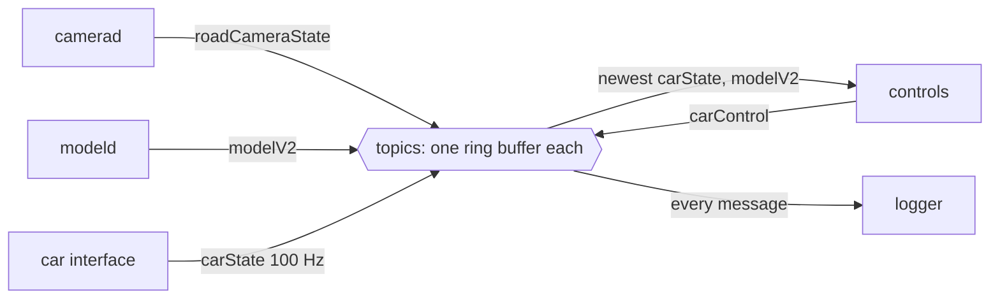

## Problem and purpose

A robot or vehicle stack has many components producing and consuming data at different rates: camera frames at 20 Hz, car state at 100 Hz, plans at 20 Hz. Wiring each producer directly to each consumer creates a tangle; one slow consumer blocks a producer. **Publish/subscribe** decouples them: publishers write to named **topics** without knowing who listens; subscribers read the topics they need. openpilot (cereal/msgq), ROS 2 (DDS), MQTT for IoT, Redis Pub/Sub and Kafka all apply the idea at different scales.

## Core concepts and terminology

- **Topic** — named stream of typed messages (`carState`, `modelV2`).
- **Schema** — message format definition (Cap'n Proto in openpilot, Protobuf in many systems); enables evolution with backward compatibility.
- **Latest-value vs every-message** — controllers usually want the newest message (conflate); loggers want all of them.
- **Liveness / validity** — is a topic arriving at its expected rate, and does the publisher mark its data valid?
- **Transport** — shared memory (same machine, zero-copy), sockets, or a broker.
- **Backpressure** — what happens when a subscriber is slow: drop (real-time systems) or block/queue (data pipelines).

*Search keywords:* `publish subscribe pattern`, `shared memory ipc ring buffer`, `cap'n proto schema evolution`, `ROS 2 topics QoS`, `latest value conflation`.

## How it works



Publishers never wait for subscribers: each topic is a ring buffer ([[ring-buffer]]). A slow subscriber skips messages (and can count how many it missed) instead of slowing the publisher.

## Related features and components

[[drive-logging-and-replay]] (the logger is just another subscriber) · [[fixed-rate-control-loops]] (liveness uses expected rates) · [[websockets]] (pub/sub across the network) · [[producer-consumer-queue]] (blocking alternative).

## Required technical knowledge

[[ring-buffer]] · [[producer-consumer-queue]] · serialization formats; processes vs threads.

## Implementation techniques and APIs

> [!tested] Python — `drivekit/messaging.py`
> - **Used for:** In-process topics backed by ring buffers, and a `SubMaster` giving the latest message per topic plus health checks.
> - **Input:** Messages published with monotonic timestamps; expected rates per subscribed topic.
> - **Expected output:** After 30 `carState` messages into an 8-slot topic, `latest` is the 30th and `dropped` is 22; `alive` turns False when a 100 Hz topic is silent for 60 ms; `all_ok` turns False when any topic publishes `valid=False`.
>
> ```python
> from drivekit.messaging import Bus, Message, SubMaster
>
> bus = Bus(capacity=8)
> sm = SubMaster(bus, {"carState": 100.0, "modelV2": 20.0})
> for i in range(30):
>     bus.publish(Message("carState", i * 0.01, {"vEgo": i}))
> bus.publish(Message("modelV2", 0.25, {"lane": 0.1}))
> sm.update()
> print(sm.latest["carState"].data, sm.dropped["carState"], sm.all_ok(now=0.30))   # {'vEgo': 29} 22 True
> ```
> Tests: `test_submaster_latest_value_and_liveness`, `test_ring_buffer_overwrite_and_dropped_count`.

Real systems: openpilot `cereal` (Cap'n Proto schemas) over `msgq` (shared-memory queues), ROS 2 with DDS, ZeroMQ, MQTT (Mosquitto), Redis Streams, Kafka.

## Error handling and edge cases

- **Silent publisher** — detect by timestamps, not by "no new message" alone; decide what is safe when inputs are stale (openpilot disengages).
- **Schema evolution** — add fields with defaults, never reuse field numbers; old logs must still parse.
- **Clock domains** — compare timestamps from the same monotonic clock.
- **Large messages** (images) — pass handles to shared buffers, not copies.

## Testing and debugging

- Unit-test liveness logic with synthetic timestamps.
- Log every topic; replay logs into the bus to reproduce issues ([[record-and-replay-testing]]).
- Tools: openpilot's `cereal/messaging` dump tools, `ros2 topic hz/echo`.

## Limitations and engineering trade-offs

- Loose coupling makes data flow harder to see; document topic producers/consumers.
- Dropping messages is right for control and wrong for logging — the subscriber chooses.

## Competency checklist

> [!level1] Recognition
> Explain topics, schemas, latest-value semantics, liveness and why publishers must not block.

> [!level2] Implementation
> Build ring-buffer-backed topics with a latest-value subscriber, liveness checks and dropped-message counts.

> [!level3] Engineering
> Design schemas for evolution, choose transports (shared memory vs network vs broker), and define safe behaviour on stale inputs.

## References

- openpilot cereal (schemas and messaging; now inside the openpilot repo) — https://github.com/commaai/openpilot/tree/master/cereal
- Cap'n Proto, *Schema language* — https://capnproto.org/language.html
- ROS 2, *About topics* and QoS — https://docs.ros.org/en/rolling/Concepts/Basic/About-Topics.html
