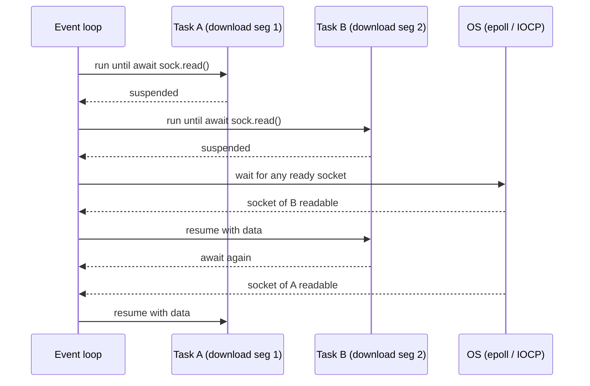

## Problem and purpose

Network programs spend most of their time **waiting**. Threads handle waiting by blocking, which costs a thread per connection. **Async I/O** lets one thread manage thousands of connections: operations start, the program continues, and an **event loop** resumes each task when its I/O is ready.

Node.js, Python asyncio, NGINX, Redis, browsers, and C++ Boost.Asio are built on this model.

## Core concepts and terminology

- **Event loop** — loop that asks the OS which sockets are ready (`epoll` on Linux, `kqueue` on BSD/macOS, IOCP on Windows) and runs the matching callbacks/coroutines.
- **Coroutine / async function** — function that can pause at `await` and resume later.
- **Task** — a scheduled coroutine.
- **Blocking call** — any call that waits without yielding (e.g. `time.sleep`, `requests.get`, heavy CPU) — it freezes *every* task on the loop.
- **Structured concurrency** — child tasks cannot outlive their scope (`asyncio.TaskGroup`, Trio nurseries).

*Search keywords:* `event loop epoll`, `asyncio TaskGroup`, `blocking the event loop`, `async vs threads`, `C10k problem`.

## How it works



## Related features and components

[[worker-pool]] (thread-based alternative) · [[segmented-download]] · [[download-queue-and-scheduler]] · [[producer-consumer-queue]].

## Required technical knowledge

Functions and callbacks; sockets basics; what "blocking" means.

## Implementation techniques and APIs

- **Python:** `asyncio.run`, `async def`, `await`, `asyncio.TaskGroup` (3.11+), `asyncio.Semaphore`, `asyncio.to_thread` for blocking calls; HTTP via `httpx.AsyncClient` or `aiohttp`. See [[python-threads-and-asyncio]].
- **TypeScript/Node:** everything I/O is async by default; `await`, `Promise.all`, `AbortController` for cancellation. See [[node-fetch-and-file-handles]].
- **C++:** Boost.Asio / standalone Asio with C++20 coroutines (`co_await`), or libcurl's multi interface for many transfers on one thread.

> [!mwe] Concurrent range downloads with httpx (Python 3.11+, httpx 0.27+)
> ```python
> import asyncio, httpx
>
> async def fetch(client: httpx.AsyncClient, url: str, start: int, end: int) -> bytes:
>     r = await client.get(url, headers={"Range": f"bytes={start}-{end}"})
>     r.raise_for_status()
>     assert r.status_code == 206, "server ignored Range"
>     return r.content
>
> async def main(url: str, total: int, parts: int = 4) -> bytes:
>     size = -(-total // parts)                     # ceiling division
>     async with httpx.AsyncClient(timeout=30) as client:
>         async with asyncio.TaskGroup() as tg:
>             tasks = [tg.create_task(fetch(client, url, s, min(s + size, total) - 1))
>                      for s in range(0, total, size)]
>     return b"".join(t.result() for t in tasks)
> ```
> Holds the whole file in memory — fine for learning, not for large files (stream to disk instead).

## Error handling and edge cases

- **Accidental blocking:** one `time.sleep()` or sync HTTP call stalls all tasks. Use async libraries or `asyncio.to_thread`.
- **Unawaited coroutines / fire-and-forget tasks** lose exceptions; prefer TaskGroup, keep references to tasks.
- **Cancellation** arrives as `CancelledError` at an `await`; clean up in `finally`, do not swallow it.
- **File I/O** is not truly async on most OSes in Python/Node (thread pools under the hood) — fine, but know it.

## Testing and debugging

- `pytest-asyncio` or `anyio` test plugins.
- `asyncio.run(main(), debug=True)` reports slow callbacks (>100 ms) — a sign of blocking.
- Node: `--trace-warnings`, `clinic doctor` for event loop delay.

## Limitations and engineering trade-offs

- "Function colouring": async code calls async code; mixing with sync code needs bridges.
- CPU-bound work still needs threads/processes.
- Threads are simpler to reason about for a handful of connections; async wins at hundreds or thousands.

## Competency checklist

> [!level1] Recognition
> Explain how an event loop serves many connections with one thread and why blocking calls are harmful.

> [!level2] Implementation
> Write concurrent HTTP requests with asyncio/Node, limit concurrency, handle cancellation and errors.

## References

- Python `asyncio` — https://docs.python.org/3/library/asyncio.html
- Node.js event loop guide — https://nodejs.org/en/learn/asynchronous-work/event-loop-timers-and-nexttick
- Dan Kegel, *The C10K problem* — http://www.kegel.com/c10k.html
