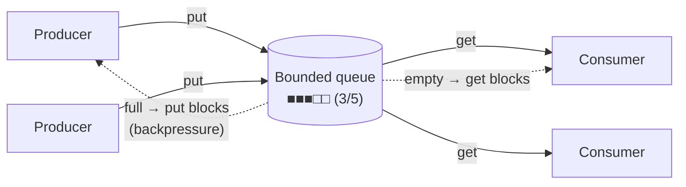

## Problem and purpose

One part of a program produces work (URLs added by the user, log lines, chunks read from the network) and another consumes it (download tasks, a log writer, a disk writer) at a different speed. A **producer-consumer queue** decouples them; a **bounded** queue also applies **backpressure** so a fast producer cannot exhaust memory.

Appears everywhere: download queues, logging handlers ([[windows-console-server-freeze|field note: console logging freezing a server]]), message brokers (RabbitMQ, Kafka, SQS), GUI event loops, audio buffers.

## Core concepts and terminology

- **Bounded buffer** — queue with a maximum size; `put` blocks (or fails) when full.
- **Backpressure** — slowing producers because consumers cannot keep up.
- **Poison pill / sentinel** — a special item telling consumers to stop.
- **Condition variable** — lets threads sleep until "not empty" / "not full".

*Search keywords:* `bounded blocking queue`, `producer consumer condition variable`, `backpressure`, `queue.Queue task_done join`, `poison pill shutdown`.

## How it works



## Related features and components

[[download-queue-and-scheduler]] · [[worker-pool]] (a pool is consumers on an internal queue) · [[async-io-event-loop]].

## Required technical knowledge

Threads, locks, condition variables (or async equivalents).

## Implementation techniques and APIs

| Language | API |
|---|---|
| Python threads | `queue.Queue(maxsize=n)`, `put`, `get`, `task_done`, `join` |
| Python asyncio | `asyncio.Queue(maxsize=n)` |
| Node.js | streams (`highWaterMark` is backpressure), or an array + Promise resolvers |
| C++ | `std::queue` + `std::mutex` + `std::condition_variable` (no standard blocking queue) |

> [!mwe] Bounded queue with sentinel shutdown (Python 3.10+)
> ```python
> import queue, threading
>
> q: queue.Queue[str | None] = queue.Queue(maxsize=2)
>
> def consumer(name: str) -> None:
>     while (item := q.get()) is not None:
>         print(name, "handles", item)
>         q.task_done()
>     q.task_done()                       # account for the sentinel
>
> workers = [threading.Thread(target=consumer, args=(f"c{i}",)) for i in range(2)]
> for w in workers: w.start()
> for i in range(5): q.put(f"job-{i}")   # blocks while 2 items wait
> for _ in workers: q.put(None)          # one sentinel per consumer
> for w in workers: w.join()
> ```

> [!mwe] C++ blocking queue (C++17)
> ```cpp
> template <class T> class BlockingQueue {
>   std::queue<T> q_; std::mutex m_; std::condition_variable not_empty_, not_full_; size_t cap_;
>  public:
>   explicit BlockingQueue(size_t cap) : cap_(cap) {}
>   void put(T v) {
>     std::unique_lock lk(m_);
>     not_full_.wait(lk, [&] { return q_.size() < cap_; });   // predicate handles spurious wakeups
>     q_.push(std::move(v)); not_empty_.notify_one();
>   }
>   T get() {
>     std::unique_lock lk(m_);
>     not_empty_.wait(lk, [&] { return !q_.empty(); });
>     T v = std::move(q_.front()); q_.pop(); not_full_.notify_one(); return v;
>   }
> };
> ```

## Error handling and edge cases

- Consumer crashes → items stay unprocessed and `join()` never returns; wrap consumer bodies in try/finally.
- Shutdown with N consumers needs N sentinels.
- Unbounded queues hide overload until memory runs out — choose a bound and a policy (block, drop oldest, reject).

## Testing and debugging

- Test with slow consumers to verify producers block at the bound.
- Assert every produced item is consumed exactly once (collect into a set, compare).

## Limitations and engineering trade-offs

- In-process queues are lost on crash; durable queues (SQLite table, Redis, Kafka) trade latency for persistence.
- FIFO only; for priorities use a [[priority-queue]].

## Competency checklist

> [!level1] Recognition
> Explain decoupling and backpressure; recognize producer-consumer in logging, downloads and message brokers.

> [!level2] Implementation
> Build a bounded queue pipeline with clean shutdown, in Python and with a condition variable in C++.

## References

- Python `queue` — https://docs.python.org/3/library/queue.html
- C++ `std::condition_variable` — https://en.cppreference.com/w/cpp/thread/condition_variable
- Node.js backpressure in streams — https://nodejs.org/en/learn/modules/backpressuring-in-streams
