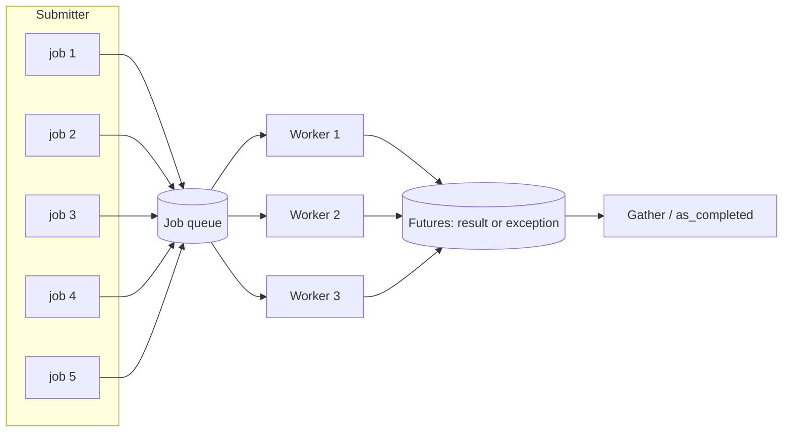
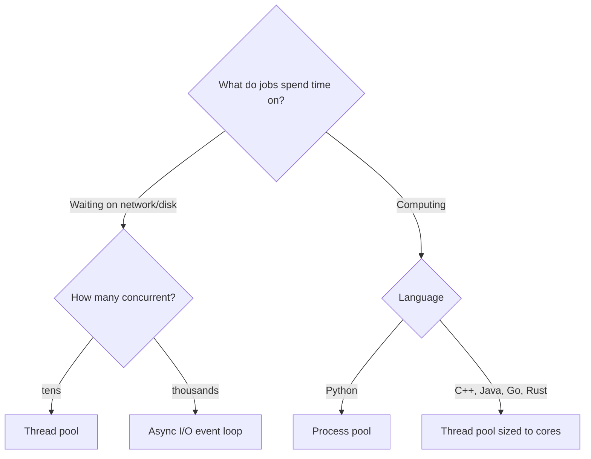

## Problem and purpose

You have many independent pieces of work — download 8 segments, resize 500 images, call 100 APIs. One-by-one is slow; one thread per item can exhaust memory, sockets or the remote server. A **worker pool** runs items on a **fixed number** of workers and collects results and errors.

## Core concepts and terminology

- **Worker** — a thread, process, or async task that takes jobs and runs them.
- **Pool size** — maximum concurrency; the main tuning knob.
- **Future / promise** — handle to a result that will exist later; carries either a value or an exception.
- **Fan-out / fan-in** — submit many jobs, then gather their results.
- **I/O-bound vs CPU-bound** — I/O-bound jobs wait on network/disk (threads or async are fine); CPU-bound jobs need multiple cores (processes in Python because of the GIL in default CPython builds; threads in C++/Java/Go).
- **Race condition** — the outcome depends on thread timing; avoided with locks, confinement, or immutable data.

*Search keywords:* `thread pool executor`, `bounded concurrency`, `I/O bound vs CPU bound GIL`, `fan-out fan-in`, `std::async thread pool`.

## How it works



Choosing between threads, processes, and async:



## Related features and components

[[segmented-download]] (one worker per segment) · [[download-queue-and-scheduler]] (pool of active downloads) · [[producer-consumer-queue]] (the queue inside every pool) · [[async-io-event-loop]] (alternative for high concurrency).

## Required technical knowledge

Threads and processes basics; shared memory and locks; exceptions across threads.

## Implementation techniques and APIs

| Language | API |
|---|---|
| Python | `concurrent.futures.ThreadPoolExecutor` / `ProcessPoolExecutor`; `asyncio.TaskGroup` + `Semaphore` |
| TypeScript | `Promise.all` / `Promise.allSettled` with a concurrency limiter (`p-limit`); `worker_threads` for CPU work |
| C++ | `std::thread` + queue + `std::condition_variable`; `std::async`; Boost.Asio `thread_pool`; TBB |

> [!mwe] Fan-out/fan-in with error collection (Python 3.10+)
> ```python
> from concurrent.futures import ThreadPoolExecutor, as_completed
> import urllib.request
>
> def size(url: str) -> int:
>     with urllib.request.urlopen(url, timeout=10) as r:
>         return len(r.read())
>
> urls = ["https://example.com", "https://example.org", "https://example.net"]
> with ThreadPoolExecutor(max_workers=3) as pool:
>     futures = {pool.submit(size, u): u for u in urls}
>     for f in as_completed(futures):
>         url = futures[f]
>         try:
>             print(url, f.result())
>         except Exception as e:          # exceptions surface here, not in the worker
>             print(url, "failed:", e)
> ```

> [!tested] Python — `Downloader._run_once()` in `minidm/downloader.py`
> One worker per pending segment; all exceptions collected after the pool exits; `ResourceChanged` preferred so the caller can restart.

## Error handling and edge cases

- **Swallowed exceptions:** an exception inside a worker is stored in its future; if nobody calls `.result()` / `.exception()`, it disappears silently.
- **Cancellation:** threads cannot be killed safely; use a shared stop flag checked between units of work.
- **Shared mutable state:** protect with a lock or give each worker its own data (each segment owns its byte range and its own file handle).
- **Pool shutdown:** leaving a `with` block waits for all jobs; a hung job hangs shutdown — always set timeouts on I/O.
- **Deadlock:** a job that waits for another job in the same full pool can wait forever.

## Testing and debugging

- Make jobs deterministic with fakes; inject delays to force interleavings.
- Run tests many times (`pytest --count=50` with `pytest-repeat`) to expose races.
- Python: `faulthandler.dump_traceback_later(30)` prints all thread stacks if a test hangs. C++: ThreadSanitizer (`-fsanitize=thread`).

## Limitations and engineering trade-offs

- Pool size: too small underuses resources; too large thrashes or gets you throttled. For I/O, size by the remote limit; for CPU, by core count.
- Threads cost memory (~8 MB virtual stack on Linux by default) — fine for tens, poor for tens of thousands; then use [[async-io-event-loop]].

## Competency checklist

> [!level1] Recognition
> Distinguish I/O-bound and CPU-bound work and pick threads, processes, or async accordingly.

> [!level2] Implementation
> Use a pool to run jobs with bounded concurrency, collect every result and exception, and stop cooperatively.

> [!level3] Engineering
> Size pools from measurements, avoid deadlocks and races, and diagnose hangs with stack dumps and sanitizers.

## References

- Python `concurrent.futures` — https://docs.python.org/3/library/concurrent.futures.html
- C++ `std::thread` — https://en.cppreference.com/w/cpp/thread/thread
- *Operating Systems: Three Easy Pieces*, Concurrency part — https://pages.cs.wisc.edu/~remzi/OSTEP/
