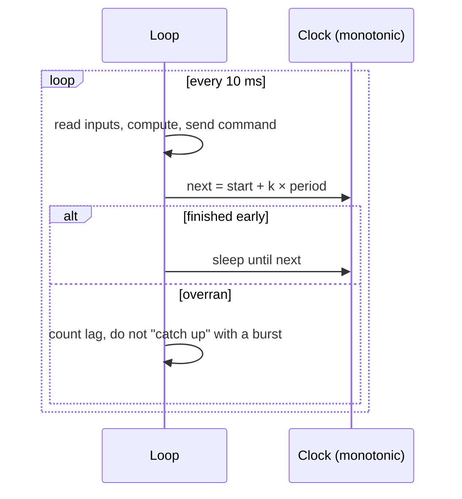

## Problem and purpose

Controllers assume time steps of a fixed length: a PID at 100 Hz expects 10 ms between updates, and a Kalman filter's model uses `dt`. If a loop sometimes runs late (garbage collection, a slow log write, CPU contention), integrals, derivatives and predictions go wrong and actuators receive commands late. **Fixed-rate loops** keep a steady period, measure **jitter**, and detect missed **deadlines**. Games (fixed-timestep physics), audio callbacks, robotics and flight controllers all do this.

## Core concepts and terminology

- **Period / rate** — 10 ms = 100 Hz.
- **Jitter** — variation in actual period. **Lag** — how late an iteration ran.
- **Deadline miss** — work did not finish within the period.
- **Monotonic clock** — never jumps backwards (unlike wall-clock time adjusted by NTP).
- **Drift-free scheduling** — sleep until `start + k·period`, not "sleep(period)" after work.
- **Real-time priority / isolation** — OS scheduling class (`SCHED_FIFO`), pinned CPU cores.

*Search keywords:* `fixed rate loop drift`, `monotonic clock`, `control loop jitter`, `SCHED_FIFO`, `fixed timestep game loop`.

## How it works



> [!mwe] Drift-free rate keeper (Python)
> - **Used for:** Running a function at a steady rate and reporting lag.
> - **Input:** A rate in Hz and a step function.
> - **Expected output:** Iterations start every 10 ms on average with no cumulative drift; `lagging` is True for iterations that started more than one period late.
>
> ```python
> import time
>
> class RateKeeper:
>     def __init__(self, hz: float):
>         self.period = 1.0 / hz
>         self.next = time.monotonic() + self.period
>
>     def keep_time(self) -> bool:
>         """Sleep until the next tick; return True if we were late (lagging)."""
>         now = time.monotonic()
>         lag = now - self.next
>         if lag < 0:
>             time.sleep(-lag)
>         self.next += self.period            # schedule from the ideal time, not from 'now'
>         if lag > self.period:                # badly late: skip ahead instead of bursting
>             self.next = now + self.period
>         return lag > self.period
>
> rk = RateKeeper(100)
> for _ in range(300):
>     step()                                   # your control step
>     lagging = rk.keep_time()
> ```

## Related features and components

[[adaptive-cruise-control]] · [[lane-centering]] · [[pid-controller]] · [[kalman-filter]] · [[publish-subscribe-messaging]] (liveness depends on expected rates).

## Required technical knowledge

Clocks and sleep; [[async-io-event-loop]] (why a blocking call delays everything); OS scheduling basics.

## Implementation techniques and APIs

- Python: `time.monotonic()`/`time.perf_counter()`; avoid allocations and logging in the hot path; a separate process per loop sidesteps the GIL.
- C++: `std::chrono::steady_clock`, `std::this_thread::sleep_until`; preallocate buffers; no heap use in the loop ([[realtime-cpp]]).
- Linux: `SCHED_FIFO` priorities, `isolcpus`, `mlockall` to avoid page faults.
- openpilot uses a `Ratekeeper` helper and logs when a process lags.

## Error handling and edge cases

- After an overrun, do not run several iterations back to back to "catch up" — stale commands are worse than skipped ones.
- Use measured dt when it differs from nominal, or flag the data invalid.
- Detect *other* processes being late via message timestamps (liveness checks, [[publish-subscribe-messaging]]).

## Testing and debugging

- Log actual periods; plot a histogram of jitter; track deadline-miss counts in CI on the target hardware.
- Inject load (stress tests) to see how timing degrades.

## Limitations and engineering trade-offs

- General-purpose OSes give no hard guarantees; hard real time needs an RTOS or microcontroller (as in the panda).
- Higher rates improve control but cost CPU and amplify noise in derivatives.

## Competency checklist

> [!level1] Recognition
> Explain period, jitter, deadlines, monotonic clocks and why drift happens with naive sleeps.

> [!level2] Implementation
> Write a drift-free rate keeper that reports lag and skips instead of bursting.

> [!level3] Engineering
> Measure and budget timing on target hardware, use real-time scheduling, and design behaviour under overload.

## References

- Glenn Fiedler, *Fix Your Timestep!* — https://gafferongames.com/post/fix_your_timestep/
- Linux `sched(7)` — https://man7.org/linux/man-pages/man7/sched.7.html
- Python `time.monotonic` — https://docs.python.org/3/library/time.html#time.monotonic
