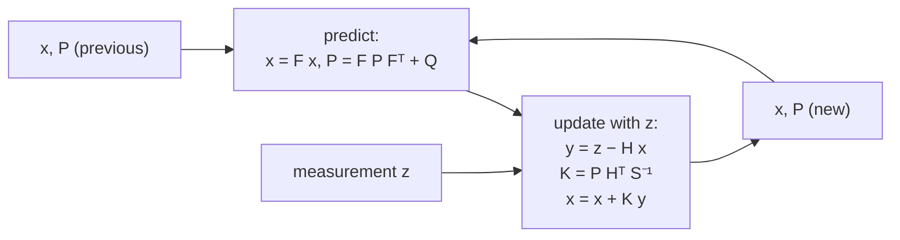

## Problem and purpose

Sensors are noisy and incomplete: a radar gives a jittery distance but no clean relative speed; a GPS jumps by metres; an IMU drifts. You need a smooth, best-guess **state** (position, speed, orientation) plus how uncertain it is. The **Kalman filter** combines a motion model (predict) with measurements (update), weighting each by its uncertainty. It runs in phones, GPS receivers, aircraft, robots and openpilot's localization and calibration.

## Core concepts and terminology

- **State `x`** and **covariance `P`** — best estimate and its uncertainty.
- **Predict** — `x = F x`, `P = F P Fᵀ + Q` (model; **process noise Q**).
- **Update** — innovation `y = z − H x`; gain `K = P Hᵀ (H P Hᵀ + R)⁻¹`; `x += K y` (**measurement noise R**).
- **Kalman gain** — how much to trust the measurement vs the prediction.
- **EKF / UKF** — extensions for nonlinear models (linearize, or use sigma points).
- **Sensor fusion** — several sensors, each with its own `H` and `R`, update the same state.

*Search keywords:* `kalman filter explained`, `constant velocity model process noise`, `extended kalman filter`, `innovation covariance`, `Joseph form`.

## How it works



Intuition: large `R` (noisy sensor) → small gain → trust the model; large `P` or `Q` (uncertain model) → large gain → trust the sensor.

## Related features and components

[[adaptive-cruise-control]] (lead distance and relative speed) · [[lane-centering]] (vehicle state) · [[model-predictive-control]] (uses the estimate as its starting state).

## Required technical knowledge

Matrices, variance and normal distributions; [[fixed-rate-control-loops]] (dt in `F` and `Q`).

## Implementation techniques and APIs

> [!tested] Python — `drivekit/kalman.py`
> - **Used for:** Estimating distance *and* relative speed to a lead car from noisy distance measurements only.
> - **Input:** 400 range measurements at 20 Hz with 1 m noise; true relative speed −2 m/s (closing from 60 m to 20 m); start guess 60 m, 0 m/s.
> - **Expected output:** After 20 s the relative-speed estimate is within 0.3 m/s of −2 and the distance within 1 m of the truth; `P` stays symmetric positive definite; the mean innovation after convergence is near 0.
>
> ```python
> import numpy as np
> from drivekit.kalman import constant_velocity
>
> kf = constant_velocity(dt=0.05, accel_std=0.5, meas_std=1.0, x0=(60.0, 0.0))
> rng, d = np.random.default_rng(0), 60.0
> for _ in range(400):
>     d += -2.0 * 0.05
>     kf.predict()
>     kf.update(d + rng.normal(0, 1.0))
> print(kf.x.round(2))     # ≈ [20.0, -2.0]: speed inferred, never measured directly
> ```
> Test: `test_kalman_estimates_relative_speed_from_noisy_range`.

Libraries: `filterpy` (Python), `rednose` (comma's EKF library with symbolic Jacobians), ROS `robot_localization`.

## Error handling and edge cases

- **Wrong noise settings** — too-small Q makes the filter sluggish and overconfident; too-large makes it jittery.
- **Numerical drift** — `P` can lose symmetry/positivity; the Joseph-form update (used in drivekit) is robust.
- **Outliers** — gate measurements whose innovation is implausibly large (Mahalanobis distance).
- **Timing** — use the actual time since the last update in `F` and `Q`.

## Testing and debugging

- Simulate truth + noise; assert estimate error and **innovation statistics** (mean ≈ 0, variance ≈ S).
- Plot estimate ± 2σ against truth; truth should stay inside about 95 % of the time.

## Limitations and engineering trade-offs

- Optimal only for linear models with Gaussian noise; nonlinear systems need EKF/UKF or particle filters.
- More state variables = more tuning and computation.

## Competency checklist

> [!level1] Recognition
> Explain predict/update, Q vs R, the Kalman gain, and what "fusion" means.

> [!level2] Implementation
> Implement a linear KF for a constant-velocity model and validate it on simulated noisy data.

> [!level3] Engineering
> Tune Q/R from data, gate outliers, fuse multiple sensors and implement an EKF for a nonlinear model.

## References

- Roger Labbe, *Kalman and Bayesian Filters in Python* (free book) — https://github.com/rlabbe/Kalman-and-Bayesian-Filters-in-Python
- Welch & Bishop, *An Introduction to the Kalman Filter* (UNC TR 95-041).
- comma.ai rednose — https://github.com/commaai/rednose
