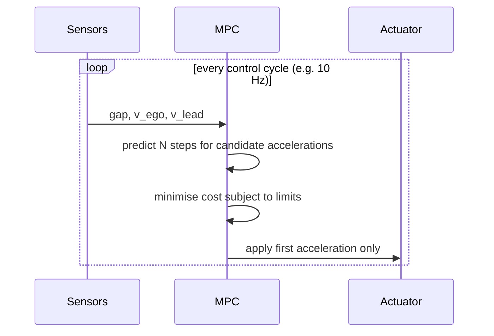

## Problem and purpose

Some control tasks need to **look ahead** and respect **constraints**: brake early for a slowing car, never exceed comfort limits, keep a minimum gap. **Model predictive control (MPC)** uses a model to predict the system's future, solves an optimization for the best input sequence under limits, applies only the first input, and repeats every cycle. It is used in vehicle planners (openpilot's longitudinal planner), chemical plants, drones, building climate control and walking robots.

## Core concepts and terminology

- **Prediction model** — e.g. `v[k+1] = v[k] + a[k]·dt`, `gap[k+1] = gap[k] + (v_lead − v[k])·dt`.
- **Horizon** — how many steps ahead are planned (N × dt seconds).
- **Cost function** — weighted sum of squared errors (gap, speed) and effort (acceleration, jerk).
- **Constraints** — hard bounds such as `a_min ≤ a ≤ a_max`.
- **Quadratic program (QP)** — linear model + quadratic cost + linear constraints; solvable fast and reliably.
- **Receding horizon** — re-solve each cycle with new measurements; only the first action is applied.
- **Soft vs hard limits** — penalties in the cost vs constraints/rate limiters that are guaranteed.

*Search keywords:* `model predictive control tutorial`, `receding horizon`, `quadratic program box constraints`, `acados`, `OSQP`, `MPC horizon tuning`.

## How it works



> [!pseudocode] One MPC step with an accelerated projected-gradient solver
> - **Used for:** Showing the full loop without a solver library.
> - **Input:** Current state; matrices `M, c` so that every weighted cost residual is `c + M·a`; a gap model `gap_k = d + J·a`; limits `a_min ≤ a ≤ a_max`.
> - **Expected output:** A feasible acceleration sequence `a` (within limits) that approximately minimises `½||c + M·a||² + ½·w_safe·Σ max(0, desired_gap − gap_k)²`; its first element is applied.
>
> ```
> H = Mᵀ M ;  g = Mᵀ c
> L = λmax(H) + w_safe · λmax(JᵀJ)                     # step size 1/L
> a = clip(previous_plan, a_min, a_max);  y = a;  t = 1
> repeat K times:
>     shortfall = max(0, −(gap_const + J y))           # only predicted gaps that are too small
>     grad = H y + g − w_safe · Jᵀ shortfall
>     a_new = clip(y − grad / L, a_min, a_max)         # gradient step, then project into the box
>     t_new = (1 + sqrt(1 + 4t²)) / 2
>     y = a_new + ((t − 1) / t_new) · (a_new − a)      # momentum (FISTA)
>     a, t = a_new, t_new
> return a[0]
> ```

## Related features and components

[[adaptive-cruise-control]] · [[pid-controller]] (simpler, reactive alternative) · [[kalman-filter]] (provides the state MPC starts from) · [[fixed-rate-control-loops]] (solver time must fit the cycle).

## Required technical knowledge

Linear algebra (matrices, least squares), basic optimization (gradients, constraints), [[pid-controller]].

## Implementation techniques and APIs

> [!tested] Python — `drivekit/mpc.py`
> - **Used for:** Following a lead vehicle, up to a driver set speed, with acceleration limits, comfort costs and a hard jerk limit.
> - **Input:** Gap, ego speed, lead speed, previous acceleration and optionally the set speed; tuning in `FollowMPC` (horizon 40 × 0.25 s = 10 s, time gap 1.5 s, standstill gap 4 m, limits −3.5…+2 m/s², jerk ≤ 4 m/s³, set speed 30 m/s).
> - **Expected output:** An acceleration command each call (about 12 ms per call). In closed loop: a lead braking from 25 to 10 m/s leaves a gap of about 19 m at 10 m/s; closing a 120 m gap behind a 25 m/s lead ends at the lead's speed; a **stopped car** 80–200 m ahead is approached and stopped behind at the 4 m standstill gap; on an open road the car reaches but never exceeds the set speed; jerk stays within 4 m/s³ throughout.
>
> ```python
> from drivekit.mpc import FollowMPC
> mpc = FollowMPC()
> plan = mpc.solve(gap=30.0, v_ego=25.0, v_lead=20.0)   # 40 planned accelerations (10 s)
> a_cmd = mpc.step(gap=30.0, v_ego=25.0, v_lead=20.0)   # first one, jerk-limited from a_prev=0
> ```
> Tests: `test_mpc_follows_braking_lead_without_collision`, `test_mpc_closes_a_large_gap_smoothly`, `test_mpc_stops_behind_a_stationary_car` (80 m / 120 m at 20 m/s, 150 m at 25 m/s), `test_mpc_never_exceeds_the_set_speed`, `test_unavoidable_collision_brakes_at_the_comfort_limit_and_reduces_impact_speed`, `test_mpc_rejects_non_finite_inputs`, plus the process-replay reference test.

Solvers in practice: **acados** (openpilot's choice; generates C code), **OSQP**, **CasADi**, `cvxpy` for prototyping.

## Error handling and edge cases

- **Infeasibility** (no input satisfies all constraints, e.g. a sudden cut-in): use soft constraints with large penalties (drivekit's one-sided `w_safe` term) and fall back to maximum safe braking. With comfort limits the planner then brakes at the limit and still collides when the distance is too short (stopping from 25 m/s needs roughly 110 m); emergency braking beyond comfort limits belongs to a separate system.
- **Solver time overruns** — warm-start from the previous plan, cap iterations, and keep a safe fallback command.
- **Model mismatch** (actuator lag, slopes) — re-planning every cycle corrects much of it; model the lag if it is large.

## Testing and debugging

- Closed-loop scenario tests with assertions on constraints and comfort (jerk) — in drivekit they revealed that the jerk *cost* alone allowed 6 m/s³ peaks, which is why a hard rate limit was added.
- **Test the case that matters most: a stopped obstacle far ahead.** The first drivekit planner (4 s horizon, symmetric gap cost) passed every following scenario yet drove through a stopped car 120 m ahead — 45 m more than needed to stop. Two fixes were needed: a horizon long enough to see the stop (10 s) and a one-sided penalty, because a cost that also rewards *closing* the gap pulls the car toward the obstacle.
- Plot the whole predicted plan each cycle, not just the applied command.

## Limitations and engineering trade-offs

- The horizon must cover the longest manoeuvre that matters: a 4 s horizon cannot plan a 7 s stop from 25 m/s. Longer horizons cost computation (drivekit: 40 steps, about 12 ms per solve) — production planners use non-uniform step sizes (short steps now, long steps later) to reach 10 s with few variables.
- Soft penalties are not guarantees: a very large `w_safe` approximates a hard constraint but can slow the solver; keep hard limits (acceleration box, jerk rate limit) outside the cost.
- Weight tuning trades comfort against tracking; hard limits should be enforced outside the cost.
- Nonlinear models (lateral dynamics at the limit) need nonlinear MPC — much harder.

## Competency checklist

> [!level1] Recognition
> Explain horizon, cost, constraints, QP and receding horizon; contrast MPC with PID.

> [!level2] Implementation
> Formulate a linear MPC with box constraints, solve it (projected gradient or OSQP) and pass closed-loop tests.

> [!level3] Engineering
> Handle infeasibility, real-time solver budgets, warm starts, model mismatch and tuning with recorded data.

## References

- Rawlings, Mayne & Diehl, *Model Predictive Control: Theory, Computation, and Design* (free PDF from the authors).
- acados — https://docs.acados.org/
- OSQP — https://osqp.org/
- openpilot longitudinal MPC (directory `selfdrive/controls/lib/longitudinal_mpc_lib` in the repository) — https://github.com/commaai/openpilot
