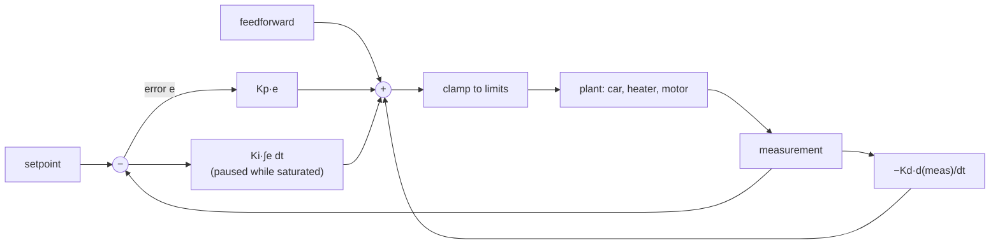

## Problem and purpose

Make a physical quantity follow a target: a car's lateral position, a room's temperature, a drone's altitude, a motor's speed. You measure the output, compare it with the target, and adjust the input — continuously. The **PID controller** is the most widely used way to do that: in industrial process control, thermostats, 3-D printers, quadcopters and car steering.

## Core concepts and terminology

- **Error** `e = setpoint − measurement`.
- **P** (proportional) — reacts to current error; alone it usually leaves a **steady-state error** under constant disturbances.
- **I** (integral) — accumulates past error; removes steady-state error, but can **wind up** while the output is saturated.
- **D** (derivative) — reacts to rate of change; damps oscillation, amplifies noise. *Derivative on measurement* avoids a spike when the setpoint jumps.
- **Feedforward** — add a known required input (e.g. steering for a known road curve) so feedback only corrects the rest.
- **Saturation / anti-windup** — clamp outputs to actuator limits; stop integrating while clamped.
- **Tuning** — choosing gains (manual, Ziegler–Nichols, model-based).

*Search keywords:* `PID controller anti-windup`, `derivative kick derivative on measurement`, `PID tuning Ziegler Nichols`, `feedforward plus feedback control`.

## How it works



## Related features and components

[[lane-centering]] · [[adaptive-cruise-control]] (low-level acceleration tracking) · [[fixed-rate-control-loops]] (PID assumes a known, steady dt) · [[model-predictive-control]] (the optimizing alternative).

## Required technical knowledge

Differences and sums as discrete derivatives/integrals; [[fixed-rate-control-loops]]; plotting time series.

## Implementation techniques and APIs

> [!tested] Python — `drivekit/pid.py`
> - **Used for:** A discrete PID with feedforward, output limits, conditional-integration anti-windup and derivative on measurement.
> - **Input:** Gains, limits, loop rate; each cycle a setpoint, a measurement and optional feedforward.
> - **Expected output:** One clamped command per call. On a first-order plant with a constant disturbance, P alone settles more than 0.1 short of the target while PI reaches it within 0.01; after a long saturation, anti-windup recovers more than 3× faster than naive integration; a setpoint jump produces no derivative spike.
>
> ```python
> from drivekit.pid import PID
>
> pid = PID(kp=2.0, ki=2.0, kd=0.0, out_min=-10, out_max=10, rate_hz=100)
> y = 0.0
> for _ in range(2000):                 # 20 s at 100 Hz
>     u = pid.update(setpoint=1.0, measurement=y)
>     y += (u - 0.5 - y) * 0.01 / 0.5   # first-order plant with a constant disturbance of -0.5
> print(round(y, 3))                    # ≈ 1.0
> ```
> Tests: `test_p_only_leaves_steady_state_error_integral_removes_it`, `test_anti_windup_recovers_faster_than_naive`, `test_derivative_on_measurement_has_no_setpoint_kick`.

Libraries: `simple-pid` (Python), Arduino PID library, ROS `control_toolbox`; MATLAB/`python-control` for analysis.

## Error handling and edge cases

- **Integrator windup** after long saturation (vehicle held against a limit) — anti-windup is essential.
- **Noisy D term** — filter the measurement or the derivative.
- **Variable dt** from late loops distorts I and D — use a fixed-rate loop or measure dt.
- **Mode switches** (engage/disengage) — reset the integrator to avoid a jolt.

## Testing and debugging

- Simulate a simple plant and assert on steady-state error, overshoot and settling time.
- Plot setpoint, measurement and each P/I/D term separately — tuning problems are obvious in plots.

## Limitations and engineering trade-offs

- Reactive: no knowledge of the future or of constraints; MPC plans ahead ([[model-predictive-control]]).
- Gains tuned at one speed may be wrong at another — gain scheduling.

## Competency checklist

> [!level1] Recognition
> Explain what P, I and D each do, windup, and derivative kick.

> [!level2] Implementation
> Implement a discrete PID with limits, anti-windup and feedforward; test it against a simulated plant.

> [!level3] Engineering
> Tune for overshoot/settling targets, handle noise and mode switches, apply gain scheduling and compare with MPC.

## References

- Åström & Murray, *Feedback Systems* (free online) — https://fbswiki.org/
- Brett Beauregard, *Improving the Beginner's PID* — http://brettbeauregard.com/blog/2011/04/improving-the-beginners-pid-introduction/
- `python-control` library — https://python-control.readthedocs.io/
