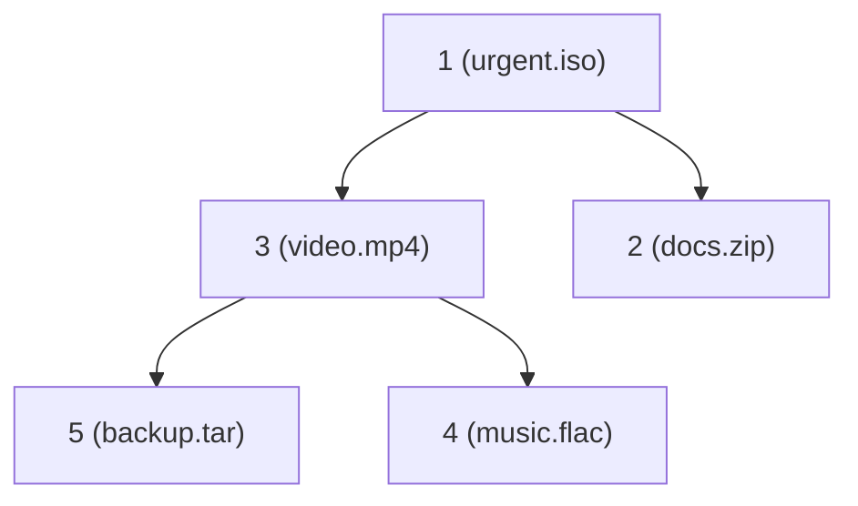

## Problem and purpose

A scheduler must repeatedly pick the **most important** pending item: the highest-priority download, the earliest timer, the next event in a simulation, the closest node in Dijkstra's shortest path. Sorting the list on every insert costs O(n log n); a **priority queue** gives O(log n) insert and remove-min.

## Core concepts and terminology

- **Binary heap** — complete binary tree stored in an array where each parent ≤ its children (min-heap). Children of index `i` are `2i+1`, `2i+2`.
- **push / pop** — O(log n) via sift-up / sift-down; **peek** O(1).
- **Stable ordering** — equal priorities in insertion order; achieved by adding a counter to the key.
- **Decrease-key / lazy deletion** — changing priority by inserting a new entry and skipping stale ones on pop.

*Search keywords:* `binary heap`, `heapq tuple tie breaker`, `priority queue decrease key lazy deletion`, `std::priority_queue custom comparator`.

## How it works



Array form: `[1, 3, 2, 5, 4]`. `pop()` removes `1`, moves the last element to the root, and sifts it down; `push(0)` appends and sifts up.

## Related features and components

[[download-queue-and-scheduler]] · timer wheels and event loops ([[async-io-event-loop]] keeps timers in a heap) · Dijkstra / A* (planned search slices).

## Required technical knowledge

Arrays, trees, Big-O notation.

## Implementation techniques and APIs

| Language | API | Note |
|---|---|---|
| Python | `heapq.heappush`, `heappop` on a list | min-heap; negate for max |
| TypeScript | no built-in; small hand-written heap or a package | |
| C++ | `std::priority_queue<T, Vec, Cmp>` | **max**-heap by default; use `std::greater<>` for min |

> [!mwe] Download queue ordered by priority, then FIFO (Python 3.10+)
> - **Used for:** Ordering a download queue by priority, keeping insertion order among equal priorities.
> - **Input:** `add(url, priority)` calls; higher number = more urgent.
> - **Expected output:** Four printed lines: `urgent.iso`, `docs.zip`, `notes.pdf`, `backup.tar`.
>
> ```python
> import heapq, itertools
>
> counter = itertools.count()
> heap: list[tuple[int, int, str]] = []
>
> def add(url: str, priority: int) -> None:          # higher number = more urgent
>     heapq.heappush(heap, (-priority, next(counter), url))
>
> add("backup.tar", 0); add("urgent.iso", 9); add("docs.zip", 5); add("notes.pdf", 5)
> while heap:
>     print(heapq.heappop(heap)[2])   # urgent.iso, docs.zip, notes.pdf, backup.tar
> ```
> The counter breaks ties so items with equal priority keep insertion order and the URL strings are never compared.

> [!mwe] C++ min-heap of (time, id)
> - **Used for:** A timer queue in C++ that always yields the earliest deadline first.
> - **Input:** `(due_time, task_id)` pairs pushed with `timers.push(...)`.
> - **Expected output:** `timers.top()` is the pair with the smallest due time — here `due = 10`, `id = 2`. (Needs `#include <queue> <vector> <functional>`.)
>
> ```cpp
> using Item = std::pair<long, int>;                     // (due_time, task_id)
> std::priority_queue<Item, std::vector<Item>, std::greater<>> timers;
> timers.push({30, 1}); timers.push({10, 2});
> auto [due, id] = timers.top(); timers.pop();          // (10, 2)
> ```

## Error handling and edge cases

- Comparing payloads on tie (Python raises `TypeError` for un-orderable objects) — always include a counter.
- Priority changes: push a new entry, mark the old one cancelled, skip cancelled entries when popping.
- Starvation of low priorities — use aging.

## Testing and debugging

- Property test: pushing random items then popping all yields a sorted sequence.
- Check stability with equal priorities.

## Limitations and engineering trade-offs

- No efficient search or arbitrary removal; use lazy deletion or an indexed heap.
- For a handful of items, a sorted list is simpler and fast enough.

## Competency checklist

> [!level1] Recognition
> Know heap complexity and where priority queues appear (schedulers, timers, shortest paths).

> [!level2] Implementation
> Use `heapq` / `std::priority_queue` with tie-breakers, max-heap tricks, and lazy deletion.

## References

- Python `heapq` — https://docs.python.org/3/library/heapq.html
- C++ `std::priority_queue` — https://en.cppreference.com/w/cpp/container/priority_queue
- Cormen et al., *Introduction to Algorithms*, ch. 6 Heapsort
