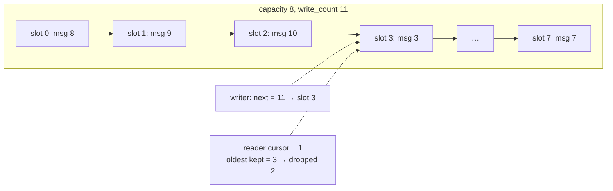

## Problem and purpose

Streams of data (sensor samples, audio, log lines, network packets, messages between processes) need a buffer between producer and consumer that never allocates, has fixed memory, and never makes the producer wait. A **ring buffer** is a fixed array used circularly: write and read positions wrap around. Variants either **block/reject** when full (lossless queues) or **overwrite the oldest** item (latest-data streams). Found in audio drivers, the Linux kernel (`io_uring`, `perf`), network cards, LMAX Disruptor, and openpilot's msgq.

## Core concepts and terminology

- **Head / tail** (write / read index), **capacity** N.
- **Monotonic counters + modulo** — store ever-increasing counters, index with `counter % N`; full when `head − tail == N`.
- **Power-of-two capacity** — `i & (N−1)` replaces the modulo.
- **Overwrite mode** — producer always wins; readers detect how many items they missed.
- **SPSC lock-free** — one producer and one consumer can share it with atomics only; memory ordering (acquire/release) publishes data safely.

*Search keywords:* `ring buffer`, `circular buffer power of two`, `SPSC lock-free queue acquire release`, `LMAX disruptor`, `false sharing alignas 64`.

## How it works



## Related features and components

[[publish-subscribe-messaging]] · [[drive-logging-and-replay]] · [[producer-consumer-queue]] (blocking counterpart) · [[fixed-rate-control-loops]] (no allocation in hot paths).

## Required technical knowledge

Arrays and modulo arithmetic; for the lock-free version: atomics and memory ordering ([[realtime-cpp]]).

## Implementation techniques and APIs

> [!tested] Python — `RingBuffer` in `drivekit/messaging.py`
> - **Used for:** An overwrite-oldest buffer whose readers know how many items they missed.
> - **Input:** Ten pushes into a 4-slot buffer; a reader starting at cursor 0.
> - **Expected output:** `read_from(0)` returns `([6, 7, 8, 9], 10, 6)` — the four newest items, the new cursor, and 6 dropped.
>
> ```python
> from drivekit.messaging import RingBuffer
> r = RingBuffer(4)
> for i in range(10):
>     r.push(i)
> print(r.read_from(0))   # ([6, 7, 8, 9], 10, 6)
> ```

> [!tested] C++ — lock-free SPSC queue, `examples/driver-assist/cpp/spsc_ring.cpp`
> - **Used for:** Passing messages between two threads without locks, in order, with no allocation.
> - **Input:** A producer thread pushing 2 000 000 `CarState` messages; a consumer thread popping them.
> - **Expected output:** `spsc_ring: 2000000 messages delivered in order`; the same program built with `-fsanitize=thread` reports no data races (CI fails if it does).
>
> ```cpp
> bool push(const T& v) {
>   const size_t h = head_.load(std::memory_order_relaxed);
>   if (h - tail_.load(std::memory_order_acquire) == N) return false;   // full
>   buf_[h & (N - 1)] = v;
>   head_.store(h + 1, std::memory_order_release);   // publish slot after writing it
>   return true;
> }
> ```

## Error handling and edge cases

- **Full vs empty ambiguity** with wrapped indices — monotonic counters avoid it.
- **Integer overflow** of counters — 64-bit counters effectively never wrap.
- **Torn reads** of large items across processes — use sequence numbers (seqlock) or double buffering.
- **False sharing** — put head and tail on separate cache lines (`alignas(64)`).

## Testing and debugging

- Overwrite and dropped-count tests; property tests against a reference list.
- Concurrency: stress with millions of items and check order; run under ThreadSanitizer.

## Limitations and engineering trade-offs

- Fixed capacity: choose for the worst burst; too big wastes memory and adds latency for latest-value readers.
- Multi-producer/multi-consumer lock-free queues are much harder; use a proven library.

## Competency checklist

> [!level1] Recognition
> Explain circular indexing, full/empty detection, overwrite vs reject, and where ring buffers are used.

> [!level2] Implementation
> Implement an overwrite ring with dropped counts, and a bounded SPSC queue; test both.

> [!level3] Engineering
> Implement a lock-free SPSC queue with correct memory ordering, verify with sanitizers, and design shared-memory variants.

## References

- Wikipedia, *Circular buffer* — https://en.wikipedia.org/wiki/Circular_buffer
- Preshing, *Acquire and Release Semantics* — https://preshing.com/20120913/acquire-and-release-semantics/
- LMAX Disruptor — https://lmax-exchange.github.io/disruptor/
