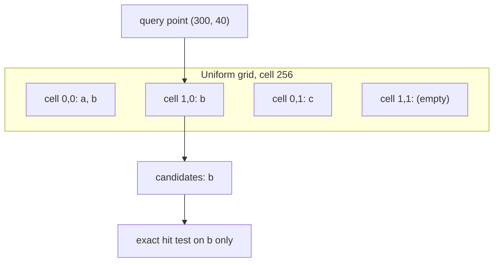

## Problem and purpose

Testing every shape on every mouse move is O(n): fine for 100 shapes, too slow for 50 000. A **spatial index** answers "which objects are near here?" by looking only at nearby ones. It is used for hit testing and culling in editors, "restaurants near me" in maps, collision detection in games, and geospatial databases (PostGIS uses R-trees via GiST).

## Core concepts and terminology

- **Bounding box** — what the index stores per object; exact tests happen afterwards.
- **Uniform grid / spatial hash** — fixed-size cells; each object listed in every cell it overlaps.
- **Quadtree** — recursively splits space into four where objects are dense.
- **R-tree** — balanced tree of bounding rectangles; the database standard.
- **Query** — rectangle or point → candidate set (may include false positives, never false negatives).

*Search keywords:* `spatial hash grid`, `quadtree vs r-tree`, `rbush`, `broad phase collision`, `PostGIS GiST index`.

## How it works



| Structure | Insert/remove | Query | Best for |
|---|---|---|---|
| Uniform grid | O(cells touched) | O(cells + items in them) | similar-sized objects, simple code |
| Quadtree | O(log n) typical | O(log n + k) | uneven density |
| R-tree | O(log n) | O(log n + k) | rectangles of mixed size, databases |

## Related features and components

[[selection-and-transform]] · [[infinite-canvas]] (culling the visible area) · [[hit-testing]] (narrow phase) · future map/search slices.

## Required technical knowledge

Hash maps, sets, trees; axis-aligned bounding boxes.

## Implementation techniques and APIs

> [!tested] TypeScript — `GridIndex` in `src/spatial.ts`
> - **Used for:** Fast candidate lookup for hit testing and box selection.
> - **Input:** Element ids with bounding boxes (`insert`, `remove`), and query boxes.
> - **Expected output:** `query(box)` returns exactly the ids whose boxes overlap the query box (the test compares 300 random boxes and 34 queries against brute force).
>
> ```ts
> import { GridIndex } from "./src/spatial.ts";
>
> const idx = new GridIndex(256);                       // cell size in scene units
> idx.insert("a", { minX: 0, minY: 0, maxX: 100, maxY: 60 });
> idx.insert("b", { minX: 250, minY: 0, maxX: 400, maxY: 90 });
> idx.query({ minX: 290, minY: 30, maxX: 310, maxY: 50 });   // Set { "b" }
> idx.remove("b");
> ```
> Test: `grid index matches brute force`.

Libraries: **rbush** (JavaScript R-tree), **flatbush** (static, very fast), Python **rtree** (libspatialindex), **shapely STRtree**, PostGIS GiST.

## Error handling and edge cases

- Update the index whenever an element moves, resizes, rotates or is deleted — stale entries cause missed hits.
- Huge objects span many grid cells; cap or store them in a separate "large objects" list.
- Negative coordinates: use `Math.floor` (not truncation) for cell numbers.

## Testing and debugging

- Property test against brute force on random boxes (as in sketchkit).
- Count candidates per query to verify the index actually prunes.

## Limitations and engineering trade-offs

- Cell size: too small → objects in many cells; too large → many candidates per cell. Start near the typical object size.
- Grids degrade with very uneven distributions; trees adapt but cost more code.

## Competency checklist

> [!level1] Recognition
> Explain broad phase vs narrow phase, and grid vs quadtree vs R-tree.

> [!level2] Implementation
> Implement a uniform grid with insert/remove/query and verify it against brute force.

> [!level3] Engineering
> Choose and tune an index for a workload; use rbush/flatbush or database spatial indexes; keep the index consistent with live edits.

## References

- Guttman, *R-Trees: A Dynamic Index Structure for Spatial Searching* (SIGMOD 1984).
- rbush — https://github.com/mourner/rbush
- Wikipedia, *Quadtree* — https://en.wikipedia.org/wiki/Quadtree
