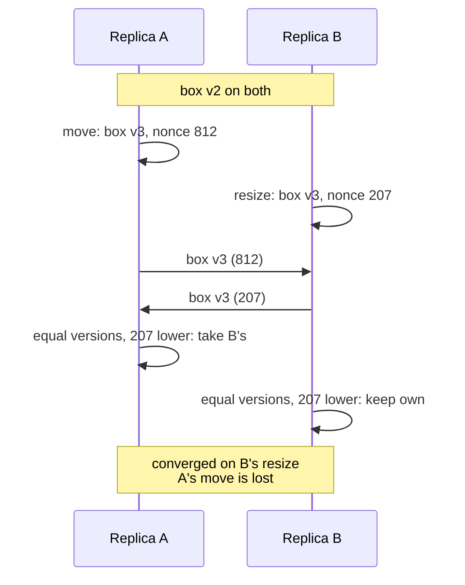

## Problem and purpose

When two people change the same data at the same time on different machines, the system must decide what the result is — and every machine must reach the **same** decision without waiting for each other. This is the core problem of collaborative editors, offline-first apps, multi-region databases and sync engines.

## Core concepts and terminology

- **Concurrent edits** — neither saw the other's change before making its own.
- **Convergence (eventual consistency)** — once all updates are delivered, all replicas are identical.
- **Last-writer-wins (LWW) register** — keep the value with the highest "timestamp"; ties broken deterministically. Simple; loses one of two concurrent edits.
- **Version counter + nonce** — Excalidraw's LWW: per-element `version`, random `versionNonce` for ties. Avoids relying on clocks.
- **Tombstone** — deletion as a flagged record, so a late update cannot resurrect a deleted item.
- **OT (operational transformation)** — rewrite concurrent operations against each other (Google Docs); usually needs a central server.
- **CRDT (conflict-free replicated data type)** — data structures designed so merges are commutative, associative and idempotent (Yjs, Automerge).

*Search keywords:* `last writer wins register`, `CRDT explained`, `operational transformation vs CRDT`, `eventual consistency convergence`, `tombstones`, `Lamport clock`.

## How it works



A merge rule converges regardless of delivery order if it is **commutative** (`merge(a, b) = merge(b, a)`), **associative**, and **idempotent** (`merge(a, a) = a`). "Pick the higher (version, −nonce) pair" is all three.

| Approach | Loses concurrent edits? | Server needed? | Complexity | Good for |
|---|---|---|---|---|
| LWW per object | yes, whole object | no | tiny | shapes, settings, cards |
| LWW per property | only same property | no | small | forms, object fields |
| OT | no | usually | high | text (Google Docs) |
| CRDT | no | no | medium–high (use a library) | text, lists, offline-first |

## Related features and components

[[real-time-collaboration]] · [[fractional-indexing]] (ordering without conflicts) · [[undo-redo-history]] (multiplayer undo) · [[pause-and-resume]] (ETag-based change detection is the client–server cousin).

## Required technical knowledge

Maps, immutability ([[vector-graphics-and-scene-model]]); basics of message passing and [[websockets]].

## Implementation techniques and APIs

> [!tested] TypeScript — `winner` and `reconcile` in `src/reconcile.ts`
> - **Used for:** Deterministic per-element LWW merging.
> - **Input:** Two versions of one element (`winner`), or a local map plus remote elements (`reconcile`).
> - **Expected output:** The higher version; on equal versions the lower `versionNonce`; `winner(a, b) === winner(b, a)`. Three replicas fed 300 random edits in shuffled orders end identical.
>
> ```ts
> import { winner, reconcile } from "./src/reconcile.ts";
>
> winner({ ...el, version: 2, versionNonce: 900 }, { ...el, version: 3, versionNonce: 999 });   // version 3
> winner({ ...el, version: 2, versionNonce: 900 }, { ...el, version: 2, versionNonce: 100 });   // nonce 100
> const merged = reconcile(localMap, remoteElements);
> ```
> Tests: `winner: higher version, then lower nonce`, `replicas converge whatever order updates arrive in`.

Libraries when LWW is not enough: **Yjs** (`Y.Map`, `Y.Array`, `Y.Text`; used by tldraw-style apps and many editors), **Automerge**, **Liveblocks**, **ShareDB** (OT).

## Error handling and edge cases

- Clock-based timestamps break when clocks are skewed — prefer counters (version) or hybrid logical clocks.
- Resurrection: an old update arriving after a delete — tombstones with a higher version prevent it.
- The user's in-progress drag must not be overwritten mid-gesture (`editingId` in sketchkit).
- Validate remote data: a buggy or malicious client can send a version of 10⁹ and "win" everything.

## Testing and debugging

- Property tests: random concurrent edits, shuffled/duplicated delivery, assert convergence (in sketchkit).
- Deterministic network simulators that reorder, delay and duplicate messages.

## Limitations and engineering trade-offs

- LWW is easy to reason about and needs no server logic, but silently discards one of two concurrent edits — acceptable for drawings, not for text.
- CRDTs keep metadata (tombstones, ids per character) that grows; libraries compact it.

## Competency checklist

> [!level1] Recognition
> Explain convergence, LWW, tombstones, OT and CRDTs, and what each loses or costs.

> [!level2] Implementation
> Implement versioned LWW with deterministic tie-breaks and test convergence under reordering.

> [!level3] Engineering
> Choose between LWW, OT and CRDTs for a product; design per-property merges, undo in multiplayer, and tombstone garbage collection.

## References

- Martin Kleppmann, *Designing Data-Intensive Applications*, ch. 5 (replication, conflict resolution).
- Shapiro et al., *Conflict-free Replicated Data Types* (2011) — https://inria.hal.science/inria-00609399
- crdt.tech (papers and implementations) — https://crdt.tech/
- Excalidraw blog, *Building Excalidraw's P2P Collaboration Feature* — https://blog.excalidraw.com/building-excalidraw-p2p-collaboration-feature/
