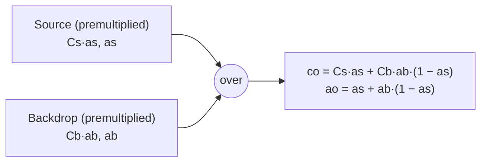

## Problem and purpose

Combining a partly transparent image over another — a logo over a photo, a soft brush stroke over a layer, a UI shadow over content — needs a precise rule for colour and transparency. **Alpha compositing** is that rule. Porter and Duff formalized it in 1984; the "source over" operator is what every layer stack, browser and game engine uses by default.

## Core concepts and terminology

- **Alpha** — coverage/opacity in [0, 1].
- **Source over** — `out = source + backdrop × (1 − source alpha)` (premultiplied form).
- **Premultiplied alpha** — store `(r·a, g·a, b·a, a)`. Makes compositing and filtering correct and cheaper; transparent pixels have no colour.
- **Straight (unassociated) alpha** — store colour and alpha independently (PNG, most editors' UI).
- **Porter-Duff operators** — over, in, out, atop, xor, … (CSS `mask-composite`, canvas `globalCompositeOperation`).
- **Blend mode** — how colours mix before compositing ([[layers-and-blend-modes]]).

*Search keywords:* `porter duff source over formula`, `premultiplied alpha why`, `alpha blending dark fringe`, `straight vs premultiplied`.

## How it works



Worked example: red at 50 % over blue at 50 % → `ao = 0.5 + 0.5·0.5 = 0.75`; premultiplied colour `(0.5, 0, 0) + (0, 0, 0.5)·0.5 = (0.5, 0, 0.25)`; straight colour `(0.667, 0, 0.333)`.

Why premultiply before blurring or resizing: averaging a white opaque pixel with a transparent pixel stored as black gives grey in straight alpha (dark fringe) but correct semi-transparent white in premultiplied.

## Related features and components

[[layers-and-blend-modes]] · [[brush-painting]] · [[image-filters]] (premultiplied blur) · [[selections-and-masks]] (masks scale alpha).

## Required technical knowledge

[[raster-images-and-pixel-formats]] · linear interpolation.

## Implementation techniques and APIs

> [!tested] Python — `pixkit.composite`
> - **Used for:** Compositing a straight-alpha source over a backdrop with any blend mode, opacity and mask.
> - **Input:** Two `(H, W, 4)` float arrays; here a 50 % red pixel over a 50 % blue pixel.
> - **Expected output:** `[0.6667, 0, 0.3333, 0.75]` — the worked example above, returned in straight alpha.
>
> ```python
> import numpy as np
> from pixkit import composite
> red = np.array([[[1, 0, 0, 0.5]]], np.float32)
> blue = np.array([[[0, 0, 1, 0.5]]], np.float32)
> print(composite(blue, red).round(4))   # [[[0.6667 0. 0.3333 0.75]]]
> ```

> [!mwe] C++ — source over on premultiplied RGBA8
> - **Used for:** The integer inner loop real compositors use.
> - **Input:** Source and destination pixels as premultiplied 8-bit RGBA.
> - **Expected output:** `dst` updated in place; e.g. src (128,0,0,128) over dst (0,0,255,255) gives (128,0,127,255).
>
> ```cpp
> #include <cstdint>
> // x * y / 255 rounded, without division: exact for 8-bit inputs
> inline uint8_t mul255(uint32_t x, uint32_t y) { uint32_t t = x * y + 128; return (t + (t >> 8)) >> 8; }
>
> void over(const uint8_t src[4], uint8_t dst[4]) {
>   uint8_t inv = 255 - src[3];
>   for (int c = 0; c < 4; ++c) dst[c] = src[c] + mul255(dst[c], inv);
> }
> ```

## Error handling and edge cases

- Unpremultiplying where alpha = 0 divides by zero — define colour as 0.
- Repeated premultiply/unpremultiply round trips in 8-bit lose colour precision in very transparent pixels.
- Mixing conventions (premultiplied data treated as straight) produces too-dark or too-bright edges.

## Testing and debugging

- Identities: transparent source leaves the backdrop unchanged; anything over a transparent backdrop equals the source.
- Worked numeric examples (above) as unit tests.
- Visual: composite a soft white brush over transparent and then over black — edges must not darken.

## Limitations and engineering trade-offs

- Premultiplied storage is faster and more correct for processing but loses precision at low alpha in 8-bit.
- Order matters: over is associative but not commutative.

## Competency checklist

> [!level1] Recognition
> State the source-over formula; explain premultiplied alpha and dark fringes.

> [!level2] Implementation
> Implement over in straight and premultiplied forms, with tests for identities and a worked example.

> [!level3] Engineering
> Write fast integer/SIMD compositing, choose storage conventions for a pipeline, and handle precision at low alpha.

## References

- Porter & Duff, *Compositing Digital Images* (1984) — https://dl.acm.org/doi/10.1145/964965.808606
- W3C, *Compositing and Blending Level 1* — https://www.w3.org/TR/compositing-1/
- Alvy Ray Smith, *Image Compositing Fundamentals* (Microsoft tech memo 4, 1995) — https://alvyray.com/Memos/CG/Microsoft/4_comp.pdf
