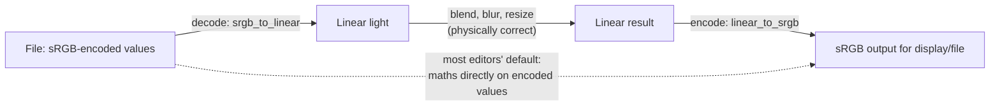

## Problem and purpose

Pixel values are not light intensities. In an 8-bit sRGB image, value 128 is not "half as bright" as 255 — it is about 22 % of the light. Images are stored **gamma-encoded** so the 256 levels are spent where human vision is sensitive (dark tones). Knowing when your maths runs on encoded vs **linear** values explains why blurs darken edges, why resized images change brightness, and why colour pickers disagree.

## Core concepts and terminology

- **Colour space** — primaries (which red/green/blue), white point, and **transfer function** (encoding curve). sRGB is the web/default space; Adobe RGB and Display P3 are wider.
- **Gamma encoding / decoding** — sRGB uses a piecewise curve close to a power of 2.2.
- **Linear light** — values proportional to physical light; correct for blending, blurring, resizing.
- **ICC profile** — file describing an image's or device's colour space; editors convert between profiles.
- **Perceptual spaces** — CIELAB, OKLab: distances roughly match perceived differences.

*Search keywords:* `sRGB transfer function`, `gamma correct blending`, `linear vs gamma resize`, `ICC color management`, `OKLab`.

## How it works



sRGB decoding (IEC 61966-2-1): `linear = v / 12.92` if `v ≤ 0.04045`, else `((v + 0.055) / 1.055) ^ 2.4`. Encoded 0.5 decodes to 0.214; linear 18 % grey encodes to 0.461.

Photoshop blends 8- and 16-bit RGB documents in the encoded space by default (there is a "Blend RGB colors using gamma" setting); 32-bit documents work in linear light.

## Related features and components

[[tonal-adjustments]] · [[layers-and-blend-modes]] · [[image-filters]] · [[raster-images-and-pixel-formats]].

## Required technical knowledge

Exponents and piecewise functions; floating-point precision.

## Implementation techniques and APIs

> [!tested] Python — `pixkit/color.py`
> - **Used for:** Converting between sRGB-encoded and linear values.
> - **Input:** Floats or arrays in [0, 1].
> - **Expected output:** `0.21404` for `srgb_to_linear(0.5)`, `0.46135` for `linear_to_srgb(0.18)`; round trip within 1e-5.
>
> ```python
> from pixkit import srgb_to_linear, linear_to_srgb
> print(float(srgb_to_linear(0.5)), float(linear_to_srgb(0.18)))
> ```

> [!mwe] Gamma-correct 50 % mix of black and white (Python)
> - **Used for:** Showing how the answer depends on the space you average in.
> - **Input:** Black (0.0) and white (1.0), sRGB-encoded.
> - **Expected output:** `0.5` when averaging encoded values (looks too dark), `0.7354` when averaging in linear light and re-encoding (perceived as the true midpoint of the light).
>
> ```python
> from pixkit import srgb_to_linear, linear_to_srgb
> naive = (0.0 + 1.0) / 2
> correct = float(linear_to_srgb((srgb_to_linear(0.0) + srgb_to_linear(1.0)) / 2))
> print(naive, round(correct, 4))   # 0.5 0.7354
> ```

Libraries: `colour-science` (Python), LittleCMS (C), browser CSS Color 4 (`color(display-p3 …)`), Pillow `ImageCms`.

## Error handling and edge cases

- Clamp before encoding; negative or >1 linear values produce NaN or out-of-range codes.
- Do not decode twice (common when chaining libraries).
- Untagged images: assume sRGB, but say so.

## Testing and debugging

- Known values above; round-trip tests across all 256 levels.
- Visual test: a 1-px black/white checkerboard viewed from afar should match a flat 0.735 patch, not 0.5.

## Limitations and engineering trade-offs

- Linear-light 8-bit loses shadow precision — use 16-bit or float for linear work.
- Users are used to encoded-space blending results; switching changes how familiar blend modes look.

## Competency checklist

> [!level1] Recognition
> Explain why encoded values are not light, what a transfer function and ICC profile are, and where linear maths matters.

> [!level2] Implementation
> Implement sRGB encode/decode, blend or blur in linear light, and verify with known values.

## References

- IEC 61966-2-1 sRGB; summary — https://en.wikipedia.org/wiki/SRGB
- John Novak, *What every coder should know about gamma* — https://blog.johnnovak.net/2016/09/21/what-every-coder-should-know-about-gamma/
- Björn Ottosson, *A perceptual color space for image processing* (OKLab) — https://bottosson.github.io/posts/oklab/
