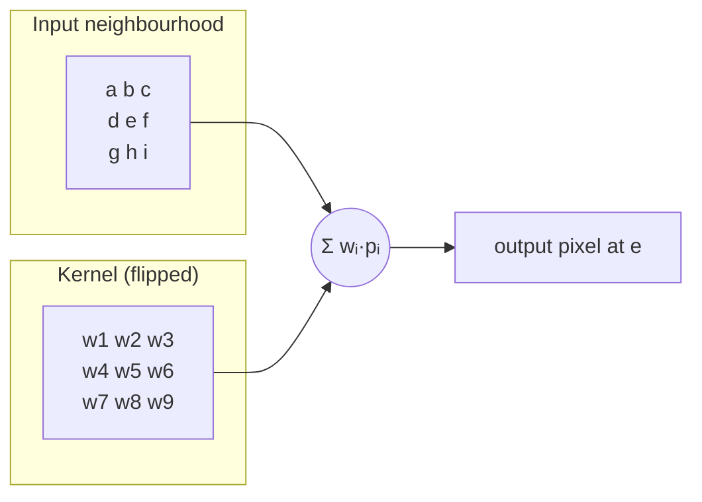

## Problem and purpose

Blur, sharpen, edge detection, emboss and feathering all compute each output pixel as a **weighted sum of its neighbours**. The weights form a **kernel**; sliding it over the image is **convolution**. The same operation is the core of signal processing (audio filters) and of convolutional neural networks.

## Core concepts and terminology

- **Kernel** — small matrix of weights, usually odd-sized (3×3, 5×5) with a centre.
- **Convolution vs correlation** — convolution flips the kernel; for symmetric kernels (blur) they are identical. CNN "convolutions" are actually correlations.
- **Normalized kernel** — weights sum to 1, so flat areas stay unchanged.
- **Separable kernel** — `K = v ⊗ hᵀ`; apply 1-D `v` vertically then `h` horizontally: O(2k) instead of O(k²).
- **Boundary handling** — clamp (repeat edge), reflect, wrap, zero.
- **Common kernels** — box, Gaussian, sharpen `[[0,−1,0],[−1,5,−1],[0,−1,0]]`, Sobel edges.

*Search keywords:* `2d convolution image kernel`, `separable gaussian blur`, `convolution vs cross-correlation`, `sobel operator`, `box blur sliding window`.

## How it works



> [!pseudocode] Direct 2-D convolution
> - **Used for:** Defining the operation precisely before optimizing it.
> - **Input:** Image `I` (H×W), kernel `K` ((2r+1)×(2r+1)), border rule.
> - **Expected output:** Image `O` of the same size.
>
> ```
> for y in 0..H-1, x in 0..W-1:
>     O[y][x] = Σ_{dy=-r..r} Σ_{dx=-r..r} K[r-dy][r-dx] · I[border(y+dy)][border(x+dx)]
> ```

## Related features and components

[[image-filters]] · [[selections-and-masks]] (feather) · [[tiled-image-processing]] (halo = kernel radius) · machine-learning CNNs.

## Required technical knowledge

Nested loops and array indexing; [[raster-images-and-pixel-formats]]; sums and normalization.

## Implementation techniques and APIs

> [!tested] Python — `pixkit/filters.py`
> - **Used for:** Separable and general 2-D convolution with selectable border handling.
> - **Input:** A float image, a 1-D kernel (separable) or 2-D kernel, `edge` in `clamp`, `reflect`, `wrap`, `zero`.
> - **Expected output:** Same-shape float array. Sharpening a flat image leaves it unchanged; on an edge it overshoots.
>
> ```python
> import numpy as np
> from pixkit.filters import convolve2d, convolve_separable, gaussian_kernel
>
> blurred = convolve_separable(img, gaussian_kernel(1.5), edge="reflect")
> sharpen = np.array([[0, -1, 0], [-1, 5, -1], [0, -1, 0]], np.float32)
> crisp = np.clip(convolve2d(img, sharpen, edge="clamp"), 0, 1)
> ```
> Tests: `test_impulse_response_is_kernel_outer_product`, `test_convolve2d_flips_kernel`, `test_box_blur_known_values`.

Speed-ups: separability; **running sums** make box blur O(1) per pixel regardless of radius (three box blurs ≈ Gaussian); FFT for very large kernels; SIMD/GPU. Libraries: `scipy.ndimage.convolve`, OpenCV `cv2.filter2D` (correlation!), `torch.nn.functional.conv2d` (correlation).

## Error handling and edge cases

- Kernels must be odd-sized to have a centre.
- Integer images: accumulate in float or wider ints, then round and clamp.
- Correlation-vs-convolution mismatch only shows with asymmetric kernels (Sobel direction flips).

## Testing and debugging

- **Impulse response:** convolving a single 1-pixel image reproduces the (flipped) kernel.
- Normalized kernels leave constant images unchanged.
- Compare with `scipy.ndimage` on random inputs.

## Limitations and engineering trade-offs

- Direct convolution is O(k²) per pixel; large non-separable kernels need FFT.
- Border choice changes results near edges; document it.

## Competency checklist

> [!level1] Recognition
> Explain kernels, normalization, separability and border modes; recognize blur/sharpen/edge kernels.

> [!level2] Implementation
> Implement direct and separable convolution with border modes; test with impulse responses.

> [!level3] Engineering
> Optimize with running sums, SIMD, tiling and FFT; reason about precision and correlation conventions across libraries.

## References

- Gonzalez & Woods, *Digital Image Processing*, ch. 3.
- Wikipedia, *Kernel (image processing)* — https://en.wikipedia.org/wiki/Kernel_(image_processing)
- Ivan Kutskir, *Fastest Gaussian blur (in linear time)* — https://blog.ivank.net/fastest-gaussian-blur.html
