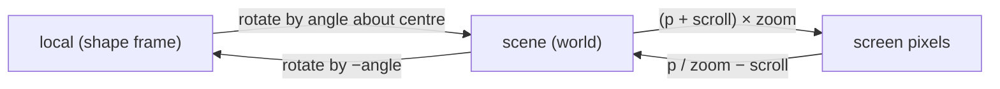

## Problem and purpose

The same point has different coordinates depending on who asks: the mouse reports **screen** pixels, shapes live in **scene** coordinates, and a rotated shape has its own **local** frame. Converting between these frames correctly is the basis of pan/zoom, hit testing rotated shapes, resize handles, and every 2-D or 3-D renderer.

## Core concepts and terminology

- **Translation, scale, rotation** — the basic transforms; combined they form an **affine transform**.
- **Transformation matrix** — 2-D affine transforms as a 3×3 matrix (canvas uses `a b c d e f`).
- **Composition** — applying one transform after another = multiplying matrices; order matters.
- **Inverse transform** — maps back (screen → scene); for hit testing you transform the *point* by the inverse instead of transforming the shape.
- **Rotation about a centre** — translate centre to origin, rotate, translate back.

*Search keywords:* `2d affine transformation matrix`, `world to screen coordinates`, `rotate point around center`, `inverse transform hit test`, `canvas setTransform matrix`.

## How it works



Rotating point `p` around centre `c` by angle θ (y axis pointing down, so positive θ turns clockwise on screen):

- **Used for:** Placing a rotated shape's corners, or un-rotating a click point for hit testing (use −θ).
- **Input:** Point `(px, py)`, centre `(cx, cy)`, angle θ in radians.
- **Expected output:** The rotated point `(x', y')`; e.g. `(10, 0)` about the origin by π/2 gives `(0, 10)`.

```
x' = cx + (px − cx)·cosθ − (py − cy)·sinθ
y' = cy + (px − cx)·sinθ + (py − cy)·cosθ
```

## Related features and components

[[infinite-canvas]] · [[selection-and-transform]] · [[hit-testing]] · [[image-filters]] and Photoshop's free transform (the raster side).

## Required technical knowledge

Trigonometry (sin, cos, radians), vectors; optionally matrix multiplication.

## Implementation techniques and APIs

> [!tested] TypeScript — `rotate` in `src/geometry.ts` and `src/viewport.ts`
> - **Used for:** Rotating points about a centre and converting between screen and scene coordinates.
> - **Input:** A point, a centre and an angle in radians; or a point and a viewport.
> - **Expected output:** `rotate({x:10,y:0}, {x:0,y:0}, π/2)` ≈ `{x: 0, y: 10}`; `sceneToScreen(screenToScene(p, v), v)` equals `p`.
>
> ```ts
> import { rotate } from "./src/geometry.ts";
> import { sceneToScreen, screenToScene } from "./src/viewport.ts";
>
> const q = rotate({ x: 10, y: 0 }, { x: 0, y: 0 }, Math.PI / 2);   // ≈ { x: 0, y: 10 }
> const view = { scrollX: -120, scrollY: 35, zoom: 1.75 };
> const back = sceneToScreen(screenToScene({ x: 412, y: 233 }, view), view);   // ≈ { x: 412, y: 233 }
> ```
> Tests: `rotate by 90 degrees`, `screen and scene coordinates round-trip`.

> [!mwe] Canvas: draw a rotated shape with the transform stack
> - **Used for:** Letting the canvas apply the viewport and an element's rotation.
> - **Input:** A 2D context, a viewport `view`, an element `el` with x, y, width, height, angle.
> - **Expected output:** The rectangle drawn rotated about its centre at the right screen position; the context restored afterwards.
>
> ```ts
> ctx.setTransform(view.zoom, 0, 0, view.zoom, view.scrollX * view.zoom, view.scrollY * view.zoom);
> ctx.save();
> ctx.translate(el.x + el.width / 2, el.y + el.height / 2);   // move origin to the centre
> ctx.rotate(el.angle);
> ctx.strokeRect(-el.width / 2, -el.height / 2, el.width, el.height);
> ctx.restore();
> ```

`DOMMatrix` (browsers) offers `multiply`, `inverse` and `transformPoint` when you need full matrices.

## Error handling and edge cases

- Degrees vs radians: canvas and `Math` use radians.
- Composition order: scale-then-translate ≠ translate-then-scale.
- Non-invertible transforms (zoom 0) — clamp zoom.
- Floating-point drift after many incremental rotations — store the absolute angle, not repeated deltas.

## Testing and debugging

- Round-trip tests (forward then inverse returns the input).
- Known angles: 90°, 180°, 360° give exact expected points within 1e-9.
- Draw axes of each frame on screen to see what the transform does.

## Limitations and engineering trade-offs

- Hand-written formulas are clearer for 2-D; matrices scale better for nested transforms (groups inside groups).

## Competency checklist

> [!level1] Recognition
> Name the coordinate frames in an editor and the transforms between them.

> [!level2] Implementation
> Implement screen↔scene conversion and rotation about a centre; test round trips.

> [!level3] Engineering
> Use matrices for nested transforms, inverse transforms for hit testing, and handle precision.

## References

- MDN, *Transformations* (canvas tutorial) — https://developer.mozilla.org/en-US/docs/Web/API/Canvas_API/Tutorial/Transformations
- MDN, `DOMMatrix` — https://developer.mozilla.org/en-US/docs/Web/API/DOMMatrix
- Wikipedia, *Affine transformation* — https://en.wikipedia.org/wiki/Affine_transformation
