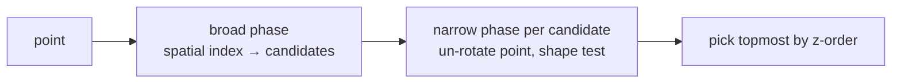

## Problem and purpose

"Which shape did the user click?" — answered by testing whether a point lies in, or close enough to, each shape. The same geometry tests drive tooltips on charts, clicking units in games, snapping in CAD and collision detection in physics.

## Core concepts and terminology

- **Point in rectangle** — compare coordinates with the box.
- **Point in ellipse** — `((x−cx)/rx)² + ((y−cy)/ry)² ≤ 1`.
- **Distance to segment** — project the point onto the segment, clamp to its ends, measure.
- **Point in polygon** — **ray casting** (count edge crossings; odd = inside) or **winding number**.
- **Tolerance** — margin around thin shapes, expressed in screen pixels.
- **Broad phase / narrow phase** — cheap filter (bounding boxes, [[spatial-index]]) then exact test.

*Search keywords:* `point to line segment distance`, `ray casting point in polygon`, `winding number`, `point in rotated rectangle`, `broad phase narrow phase`.

## How it works



Distance to segment: with `d = b − a`, `t = clamp(((p − a)·d) / |d|², 0, 1)`, closest point `a + t·d`. Clamping is what distinguishes a segment from an infinite line.

Ray casting: for each edge, check if a horizontal ray to the right of `p` crosses it; an odd count means inside. Works for concave polygons; self-intersecting ones use the even-odd rule.

## Related features and components

[[selection-and-transform]] · [[infinite-canvas]] (tolerance scales with zoom) · [[flood-fill]] (the raster way to select a region).

## Required technical knowledge

Vectors, dot product; [[coordinate-transforms]] (un-rotating the point); [[spatial-index]].

## Implementation techniques and APIs

> [!tested] TypeScript — `src/geometry.ts` and `hitTest` in `src/elements.ts`
> - **Used for:** Exact hit tests for rectangles, ellipses, lines and freehand strokes, including rotated shapes.
> - **Input:** A point and a segment or polygon; or an element, a point and a tolerance.
> - **Expected output:** `distanceToSegment({x:5,y:3}, {x:0,y:0}, {x:10,y:0})` is `3`; for a point beyond the end it measures to the endpoint (`5` for `{x:-3,y:4}`); `pointInPolygon` is `false` inside the notch of an L-shape.
>
> ```ts
> import { distanceToSegment, pointInPolygon } from "./src/geometry.ts";
>
> distanceToSegment({ x: 5, y: 3 }, { x: 0, y: 0 }, { x: 10, y: 0 });   // 3
> distanceToSegment({ x: -3, y: 4 }, { x: 0, y: 0 }, { x: 10, y: 0 });  // 5 (to endpoint a)
> const L = [{x:0,y:0},{x:10,y:0},{x:10,y:4},{x:4,y:4},{x:4,y:10},{x:0,y:10}];
> pointInPolygon({ x: 8, y: 8 }, L);                                     // false (in the notch)
> ```
> Tests: `distance to segment clamps to the endpoints`, `point in polygon handles concave shapes`, `ellipse, line and closed freedraw hit tests`.

Browser alternatives: `ctx.isPointInPath(path, x, y)` and `isPointInStroke` with a `Path2D`; SVG elements receive pointer events natively.

## Error handling and edge cases

- Zero-length segments (a single click of the line tool) — fall back to point distance.
- Points exactly on polygon edges/vertices are ambiguous with ray casting; tolerance hides this for UI.
- Very thin or tiny shapes need a minimum hit area.

## Testing and debugging

- Table tests: inside, outside, on the edge, beyond segment ends, concave notches, rotated shapes.
- Visual debugging: colour every pixel by hit/miss to "see" the hit region.

## Limitations and engineering trade-offs

- Exact tests on long freehand paths are O(n); simplify paths (Ramer–Douglas–Peucker) or use the spatial index per segment.
- `isPointInPath` is easy but requires building paths and is slower for many shapes than plain maths.

## Competency checklist

> [!level1] Recognition
> Name the standard tests (box, ellipse, segment distance, ray casting) and the broad/narrow phase idea.

> [!level2] Implementation
> Implement and test hit tests for basic shapes, rotation and tolerance.

> [!level3] Engineering
> Scale to large scenes with spatial indexes and path simplification; handle degenerate geometry robustly.

## References

- Christer Ericson, *Real-Time Collision Detection* (2004), ch. 5.
- Wikipedia, *Point in polygon* — https://en.wikipedia.org/wiki/Point_in_polygon
- MDN, `isPointInPath` — https://developer.mozilla.org/en-US/docs/Web/API/CanvasRenderingContext2D/isPointInPath
