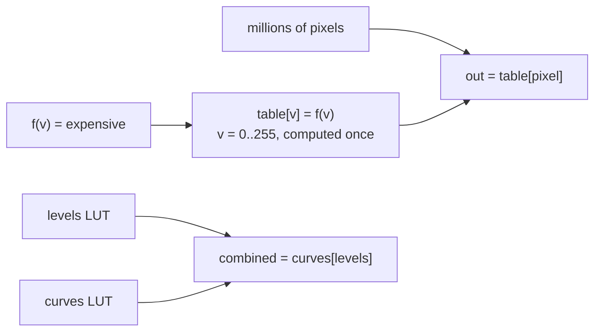

## Problem and purpose

If an expensive function of a pixel value (`pow`, a spline, a chain of adjustments) is applied to millions of pixels but the input has only 256 possible values, compute the 256 answers once and **look them up**. A **lookup table** trades a little memory for a lot of speed, and lets many adjustments be combined into one table.

Beyond images: CRC and trigonometry tables, gamma tables in displays, sine tables in audio synths, colour grading `.cube` files, character-class tables in parsers.

## Core concepts and terminology

- **1-D LUT** — one table per channel (Levels, Curves, gamma).
- **3-D LUT** — table indexed by (R, G, B), typically 17³–65³ entries with interpolation; can express hue shifts that 1-D LUTs cannot.
- **Composition** — `lut_b[lut_a]` is one table equal to applying `a` then `b`.
- **Quantization** — tables for continuous inputs (floats) need interpolation between entries.

*Search keywords:* `lookup table image processing`, `compose LUTs`, `3d lut trilinear interpolation`, `cube lut format`.

## How it works



Cost: building = 256 evaluations of `f`; applying = one memory read per channel per pixel, independent of how complex `f` is.

## Related features and components

[[tonal-adjustments]] · [[color-spaces-and-gamma]] (gamma tables) · [[image-filters]] (not applicable: filters depend on neighbours, not just the value).

## Required technical knowledge

Arrays and indexing; [[raster-images-and-pixel-formats]] (8-bit vs 16-bit inputs).

## Implementation techniques and APIs

> [!tested] Python — `pixkit/adjust.py`
> - **Used for:** Building tables from any function and applying or composing them with NumPy fancy indexing.
> - **Input:** A function of `x` in [0, 1]; a uint8 image `img_u8`.
> - **Expected output:** `table` is a uint8 array of 256 entries; `out` has the same shape as `img_u8`; `both` equals applying levels then invert.
>
> ```python
> from pixkit import apply_lut, invert_lut, levels_lut
> from pixkit.adjust import build_lut
>
> table = build_lut(lambda x: x ** 0.8)              # brighten midtones
> out = apply_lut(img_u8, table)                      # out[..., c] = table[img[..., c]]
> both = invert_lut()[levels_lut(black=20, white=230)]  # compose: levels, then invert
> ```

> [!mwe] C++ — apply a LUT in place
> - **Used for:** The inner loop of a 1-D LUT on interleaved RGBA8.
> - **Input:** Pixel buffer `px` (RGBA, `n` pixels) and a 256-entry `lut`.
> - **Expected output:** RGB bytes replaced by `lut[value]`; alpha untouched.
>
> ```cpp
> #include <array>
> #include <cstddef>
> #include <cstdint>
> void apply_lut(uint8_t* px, size_t n, const std::array<uint8_t, 256>& lut) {
>   for (size_t i = 0; i < n * 4; i += 4) {
>     px[i] = lut[px[i]]; px[i + 1] = lut[px[i + 1]]; px[i + 2] = lut[px[i + 2]];
>   }
> }
> ```

## Error handling and edge cases

- Index type: NumPy needs integer arrays; floats must be quantized first.
- 16-bit images need 65 536-entry tables (still small: 128 KB).
- Composing 8-bit LUTs accumulates rounding; compose the *functions* at higher precision, then quantize once.

## Testing and debugging

- Identity function → identity table.
- Compare `apply_lut` with direct evaluation of `f` on every input level.

## Limitations and engineering trade-offs

- Only valid for **point operations** (output depends on the pixel's own value).
- 3-D LUTs need interpolation (trilinear or tetrahedral) and more memory.

## Competency checklist

> [!level1] Recognition
> Recognize point operations that a LUT can replace; explain 1-D vs 3-D LUTs and composition.

> [!level2] Implementation
> Build, apply and compose LUTs; test against direct evaluation.

## References

- Wikipedia, *Lookup table* — https://en.wikipedia.org/wiki/Lookup_table
- Wikipedia, *3D lookup table* — https://en.wikipedia.org/wiki/3D_lookup_table
- NumPy indexing (integer array indexing) — https://numpy.org/doc/stable/user/basics.indexing.html
