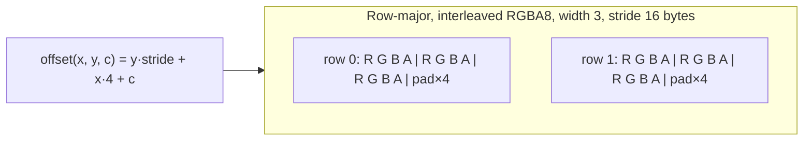

## Problem and purpose

Every image feature — layers, filters, brushes — operates on a block of memory holding pixels. How that memory is laid out (channel order, bytes per channel, row padding, alpha representation) decides correctness, speed and interoperability. Most "the image looks wrong" bugs (swapped red/blue, sheared rows, dark edges) are pixel-format bugs.

## Core concepts and terminology

- **Raster / bitmap** — a grid of pixels; contrast with **vector** graphics (shapes, as in Illustrator).
- **Channel** — one component (R, G, B, A). **Interleaved** `RGBARGBA…` vs **planar** `RRR…GGG…`.
- **Bit depth** — 8-bit (0–255), 16-bit (0–65535), 32-bit float (HDR, values beyond 1).
- **Stride / pitch** — bytes from one row to the next; may exceed `width × bytes_per_pixel` for alignment.
- **Straight vs premultiplied alpha** — colour stored as-is, or already multiplied by alpha ([[alpha-compositing]]).
- **Channel order** — RGBA (PNG, canvas), BGRA (Windows DIB, many GPUs), ARGB.
- **Coordinate convention** — origin top-left; NumPy indexes `[y, x]`, most APIs take `(x, y)`.

*Search keywords:* `image stride pitch`, `RGBA vs BGRA`, `premultiplied alpha`, `numpy image shape height width channels`, `16-bit image banding`.

## How it works



Memory size: `width × height × channels × bytes_per_channel`. A 24-megapixel photo (6000×4000) is 96 MB as RGBA8, 192 MB as RGBA16 and 384 MB as RGBA float32 — per layer, before undo snapshots.

## Related features and components

All Photoshop features: [[layers-and-blend-modes]], [[image-filters]], [[tonal-adjustments]], [[brush-painting]], [[selections-and-masks]] (masks are 1-channel rasters), [[undo-redo-history]] (memory cost).

## Required technical knowledge

Arrays and memory addresses; integer vs floating point; [[random-access-file-io]] (images as files).

## Implementation techniques and APIs

| Language | Typical buffer | Notes |
|---|---|---|
| Python | NumPy `ndarray` shape `(H, W, C)` | Pillow `np.asarray(img)` gives uint8 `(H, W, 4)` for RGBA |
| TypeScript (browser) | `ImageData.data`: `Uint8ClampedArray`, RGBA8, no padding | values clamp and round on store |
| C++ | `std::vector<uint8_t>` + width/height/stride | stb_image, libpng, OpenCV `cv::Mat` (BGR by default!) |

> [!mwe] Python: inspect and convert formats
> - **Used for:** Loading an image, checking its layout, and converting to the float RGBA convention used in pixkit.
> - **Input:** Any PNG/JPEG file path, here `photo.png`.
> - **Expected output:** Prints shape and dtype, e.g. `(4000, 6000, 4) uint8 96.0 MB`; `f` is float32 in [0, 1] with the same shape.
>
> ```python
> import numpy as np
> from PIL import Image
>
> a = np.asarray(Image.open("photo.png").convert("RGBA"))
> print(a.shape, a.dtype, a.nbytes / 1e6, "MB")
> f = a.astype(np.float32) / 255.0        # 8-bit -> float, ready for maths
> red_at_x10_y20 = a[20, 10, 0]           # NumPy indexes [y, x, channel]
> bgr = a[..., [2, 1, 0]]                 # channel reorder, e.g. for OpenCV
> ```

## Error handling and edge cases

- **Swapped colours** (blue skies look orange): RGB vs BGR mismatch.
- **Sheared/diagonal image:** wrong stride — rows assumed tightly packed when they are padded.
- **Overflow:** `uint8` arithmetic wraps (`200 + 100 = 44`); convert to a wider type or float first.
- **Rounding:** `int(x * 255)` truncates; use `round` to avoid a darkening bias.
- **Colour profile ignored:** pixels are numbers in some colour space ([[color-spaces-and-gamma]]); reading a wide-gamut image as sRGB shifts colours.

## Testing and debugging

- Round-trip tests: u8 → float → u8 is identity.
- Use tiny synthetic images (3×2) with distinct values per pixel so layout errors are visible in the printed array.
- Dump intermediate buffers to PNG to look at them.

## Limitations and engineering trade-offs

- 8-bit is compact but bands under strong edits; float is precise but 4× larger.
- Interleaved suits per-pixel operations; planar suits per-channel SIMD and some codecs.
- Huge images need tiling ([[tiled-image-processing]]) rather than one contiguous buffer.

## Competency checklist

> [!level1] Recognition
> Explain channels, bit depth, stride, interleaved vs planar, and compute an image's memory size.

> [!level2] Implementation
> Convert between uint8/float and RGB/BGR/RGBA correctly, with round-trip tests.

> [!level3] Engineering
> Handle padded strides, 16-bit/float pipelines, colour profiles and memory budgets for multi-layer documents.

## References

- MDN, *Pixel manipulation with canvas* — https://developer.mozilla.org/en-US/docs/Web/API/Canvas_API/Tutorial/Pixel_manipulation_with_canvas
- Pillow, *Concepts: modes* — https://pillow.readthedocs.io/en/stable/handbook/concepts.html
- PNG specification (W3C) — https://www.w3.org/TR/png-3/
