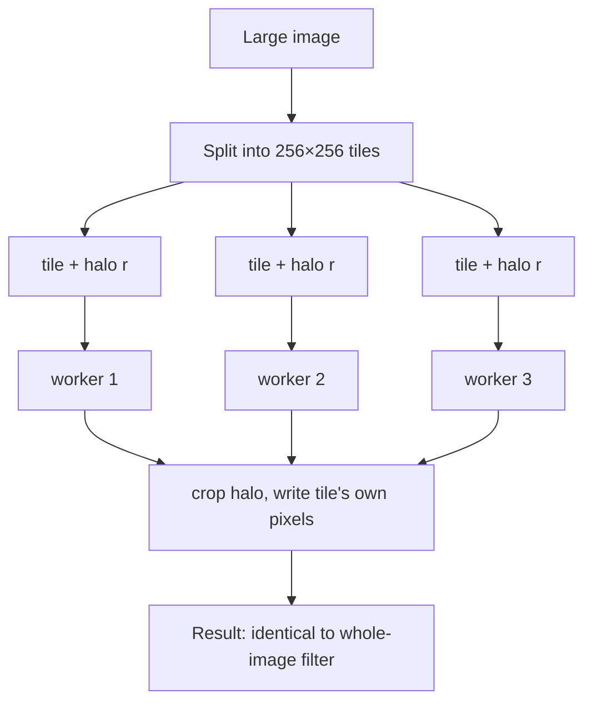

## Problem and purpose

A 30 000 × 20 000 poster is 2.4 GB as RGBA8 — more than fits comfortably in memory alongside layers and undo. Even when it fits, processing it as one block cannot use all CPU cores well and invalidates every cache. **Tiling** splits the image into fixed-size blocks (e.g. 256×256) that can be processed in parallel, cached, swapped to disk, and shared between undo states.

Used by Photoshop (Cache Tile Size, scratch disk), GIMP/GEGL, Krita, map tiles in Google Maps/OpenStreetMap, deep-zoom image viewers, GPU texture streaming.

## Core concepts and terminology

- **Tile** — fixed-size rectangle; edge tiles may be smaller.
- **Halo / apron** — extra border read around a tile for neighbourhood filters; must be ≥ the kernel radius or seams appear.
- **Dirty tile** — modified since last render; only dirty tiles are re-composited.
- **Image pyramid / mipmaps** — pre-downsampled copies (½, ¼, …) for fast zoomed-out display (Photoshop's *Cache Levels*).
- **Out-of-core** — data larger than memory, paged to disk (Photoshop's *scratch disk*).

*Search keywords:* `tiled image processing halo`, `image pyramid mipmap`, `out of core image editing`, `GEGL tiles`, `deep zoom tiles`.

## How it works



## Related features and components

[[image-filters]] · [[undo-redo-history]] (snapshot only changed tiles — [[copy-on-write]]) · [[layers-and-blend-modes]] (re-composite dirty tiles only).

## Required technical knowledge

[[worker-pool]] · [[convolution-and-kernels]] (kernel radius → halo) · [[raster-images-and-pixel-formats]] · [[random-access-file-io]] (paging tiles to disk).

## Implementation techniques and APIs

> [!tested] Python — `pixkit/tiles.py`
> - **Used for:** Running any neighbourhood filter tile by tile on a thread pool, with a halo.
> - **Input:** An image, a function `tile -> tile`, tile size, halo (≥ kernel radius; Gaussian sigma 2 → radius 6), worker count.
> - **Expected output:** An image equal (within 1e-6) to applying the function to the whole image at once. With `halo=0` visible seams appear at tile borders.
>
> ```python
> from pixkit import apply_tiled, gaussian_blur
>
> out = apply_tiled(img, lambda t: gaussian_blur(t, 2.0), tile=256, halo=6, workers=8)
> ```
> Test: `test_tiled_blur_matches_whole_image` (tile sizes 7, 32, 100; also checks that halo 0 is wrong).

Why threads work in Python here: NumPy releases the GIL inside large array operations, so tiles really run in parallel. Pure-Python per-pixel loops would not.

## Error handling and edge cases

- Halo too small → seams exactly at tile borders (the test proves it).
- Edge tiles are smaller; never assume full size.
- Border handling must use the *image* border, not the tile border: clip halos at the image edge and let the filter's own border rule apply there.
- Writes from workers must go to disjoint regions (each worker writes only its tile).

## Testing and debugging

- Compare tiled vs whole-image results for several tile sizes, including sizes that do not divide the image.
- Visualize tile boundaries with a grid overlay to find seams.

## Limitations and engineering trade-offs

- Tile size: small tiles give fine-grained dirty tracking and parallelism but more overhead and more halo re-reads; large tiles the opposite. 64–512 px is common.
- Global operations (histogram equalization, FFT) need all tiles — two passes or a different algorithm.

## Competency checklist

> [!level1] Recognition
> Explain tiles, halos, dirty tiles, pyramids and scratch disks, and why editors use them.

> [!level2] Implementation
> Implement tiled parallel filtering with halos that exactly matches the whole-image result.

> [!level3] Engineering
> Design a tile store with copy-on-write, dirty tracking, LRU caching, disk paging and pyramid levels.

## References

- GEGL (GIMP's tiled image engine) — https://gegl.org/
- Adobe, *Optimize performance* (cache levels, tile size, scratch disks) — https://helpx.adobe.com/photoshop/kb/optimize-photoshop-cc-performance.html
- Mipmap — https://en.wikipedia.org/wiki/Mipmap
