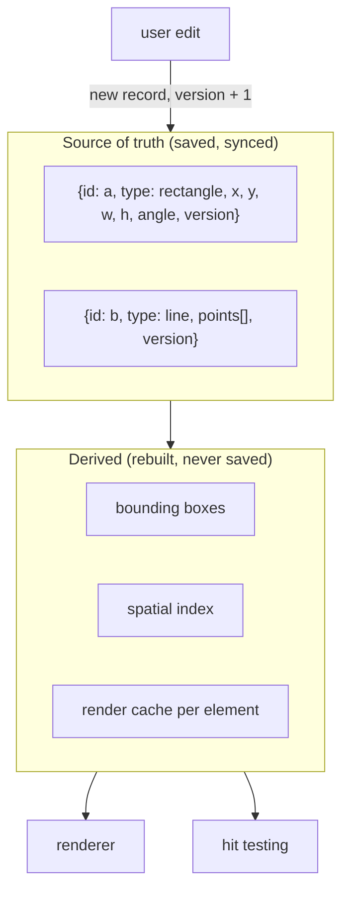

## Problem and purpose

A whiteboard, a diagram tool or Illustrator stores **shapes**, not pixels: "a rectangle at (10, 20), 100 × 60, rotated 15°". Shapes can be moved, resized, recoloured and rendered sharp at any zoom. The **scene model** is the data structure that holds them, and everything else — rendering, hit testing, saving, collaboration — reads from it.

Contrast with raster editors like Photoshop, which store pixels ([[raster-images-and-pixel-formats]]).

## Core concepts and terminology

- **Vector graphics** — geometry described mathematically (points, lines, curves), rasterized when displayed.
- **Element / node** — one shape record with an id.
- **Scene graph** — elements arranged in a tree (groups, frames) with inherited transforms; a flat list is the simplest scene graph.
- **Retained mode** — the app keeps a scene and the renderer redraws it (SVG DOM, scene graphs); **immediate mode** — the app issues draw calls every frame (canvas 2D, Dear ImGui).
- **Immutable records** — edits create new element objects; old ones stay valid for undo, diffing and caches.
- **Derived data** — bounds, render caches and spatial indexes computed from elements, never saved.

*Search keywords:* `scene graph`, `retained vs immediate mode rendering`, `vector graphics data model`, `immutable state editor`.

## How it works



## Related features and components

[[hand-drawn-shapes]] · [[scene-files-and-export]] · [[selection-and-transform]] · [[real-time-collaboration]] · [[layers-and-blend-modes]] (the raster counterpart of a scene).

## Required technical knowledge

Records/objects, maps keyed by id, immutability; [[coordinate-transforms]].

## Implementation techniques and APIs

> [!tested] TypeScript — `src/elements.ts`
> - **Used for:** Defining shape records and changing them immutably.
> - **Input:** Initial fields for `newElement`; changes for `updateElement`.
> - **Expected output:** A new frozen-in-spirit object each time: `a.x` stays `0`, `b.x` is `5`, `b.version` is `a.version + 1`, and `b.versionNonce` is a fresh random number.
>
> ```ts
> import { newElement, updateElement } from "./src/elements.ts";
>
> const a = newElement({ id: "a", type: "rectangle", x: 0, y: 0, width: 100, height: 60 });
> const b = updateElement(a, { x: 5 });
> ```
> Test: `updates return new objects with a bumped version`.

Rendering options in the browser: **canvas 2D** (immediate; fast for thousands of shapes, you implement hit testing), **SVG DOM** (retained; browser does hit testing and events, slows with many nodes), **WebGL/WebGPU** (fastest, most work). Excalidraw renders to canvas.

## Error handling and edge cases

- Never mutate an element that may be shared (render cache, undo stack, a message being sent) — always copy.
- Ids must be unique across collaborators: use random ids (e.g. 21-char nanoid), not counters.
- Unknown element types in loaded files: keep and ignore them rather than dropping data.

## Testing and debugging

- Tests that edits produce new objects and leave the old ones unchanged.
- Dump the scene as JSON when debugging — it is the whole truth.

## Limitations and engineering trade-offs

- Immutable updates allocate; for huge scenes use structural sharing ([[copy-on-write]]).
- Flat lists are simple; groups, frames and nested transforms need a real tree.

## Competency checklist

> [!level1] Recognition
> Distinguish vector vs raster, retained vs immediate mode, source-of-truth vs derived data.

> [!level2] Implementation
> Design element records with ids and versions, update them immutably and derive bounds and indexes.

> [!level3] Engineering
> Design a scene graph with groups and transforms, efficient caches, and a renderer choice (canvas/SVG/WebGL) justified by scale.

## References

- MDN, *SVG* vs *Canvas* tutorials — https://developer.mozilla.org/en-US/docs/Web/SVG and https://developer.mozilla.org/en-US/docs/Web/API/Canvas_API
- Wikipedia, *Scene graph* — https://en.wikipedia.org/wiki/Scene_graph
- Wikipedia, *Immediate mode (computer graphics)* — https://en.wikipedia.org/wiki/Immediate_mode_(computer_graphics)
