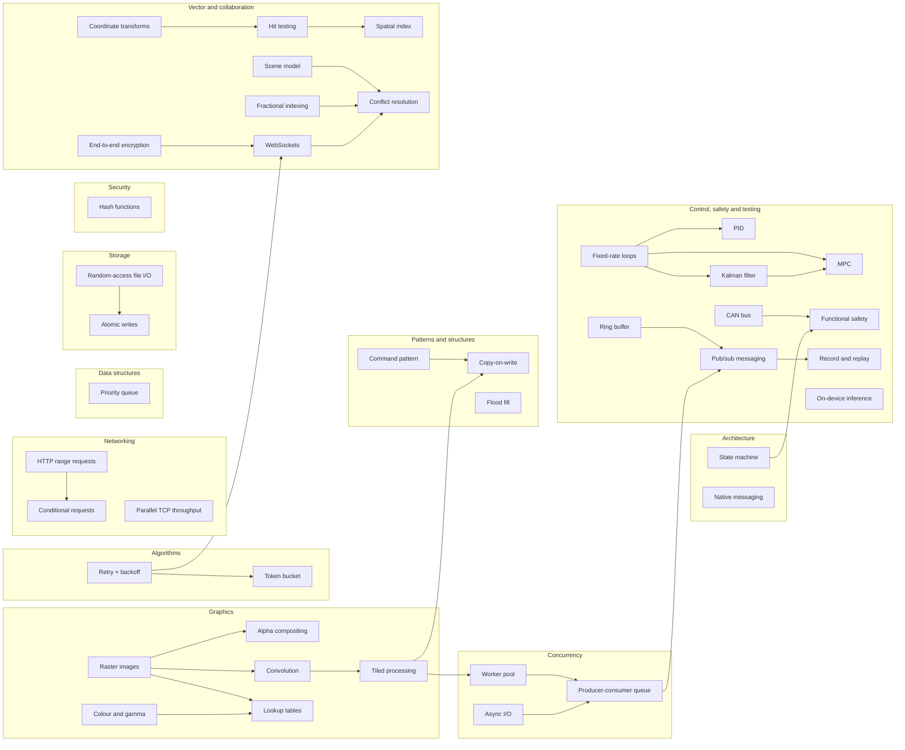

Technology-agnostic concepts: what a technique is, why it works, its trade-offs. Language-specific API detail lives in the [[cookbook/index|Cookbook]]; each concept page links to it.

| Domain | Concepts |
|---|---|
| Networking | [[http-range-requests]] · [[http-conditional-requests]] · [[parallel-tcp-throughput]] · [[websockets]] · [[can-bus]] |
| Concurrency | [[worker-pool]] · [[producer-consumer-queue]] · [[async-io-event-loop]] |
| Algorithms | [[token-bucket]] · [[retry-with-exponential-backoff]] · [[flood-fill]] · [[seeded-pseudorandom-numbers]] · [[fractional-indexing]] · [[debounce-and-throttle]] |
| Data structures | [[priority-queue]] · [[spatial-index]] · [[ring-buffer]] |
| Storage | [[random-access-file-io]] · [[atomic-writes-and-crash-safety]] |
| Security | [[cryptographic-hash-functions]] · [[end-to-end-encryption]] |
| Distributed systems | [[conflict-resolution]] |
| Control and estimation | [[pid-controller]] · [[model-predictive-control]] · [[kalman-filter]] · [[fixed-rate-control-loops]] |
| Safety | [[functional-safety]] |
| Testing | [[record-and-replay-testing]] |
| Machine learning | [[on-device-ml-inference]] |
| Graphics | [[raster-images-and-pixel-formats]] · [[color-spaces-and-gamma]] · [[alpha-compositing]] · [[convolution-and-kernels]] · [[lookup-tables]] · [[tiled-image-processing]] · [[vector-graphics-and-scene-model]] · [[coordinate-transforms]] · [[hit-testing]] |
| Architecture & patterns | [[finite-state-machine]] · [[browser-extension-native-messaging]] · [[command-pattern]] · [[copy-on-write]] · [[publish-subscribe-messaging]] |

Planned domains with the next slices: databases (indexing, transactions, multi-tenancy), caching (HTTP caching, eviction policies, consistent hashing), search (inverted index, ranking). See [[roadmap]].
