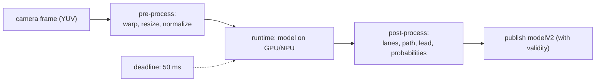

## Problem and purpose

Perception for driving (lanes, cars, path) and driver monitoring must run **in the car**, every frame, with no network round trip and within a strict time budget (openpilot's driving model runs at 20 Hz). **On-device inference** means running a trained neural network on the device's own CPU/GPU/NPU: phones (face unlock, photo enhancement), cameras, cars, drones and browsers do it.

## Core concepts and terminology

- **Training vs inference** — learn weights offline on big machines; run the fixed model on the device.
- **Model format / runtime** — export to ONNX, TFLite, CoreML…; run with ONNX Runtime, TFLite, TensorRT, or openpilot's own **tinygrad**.
- **Latency budget** — the model must finish well within the frame period (50 ms at 20 Hz), including pre/post-processing.
- **Quantization** — 16- or 8-bit weights for speed and memory; may cost accuracy.
- **Pre-processing** — resize, colour conversion, normalization; must exactly match training.
- **Outputs with uncertainty** — predicted values plus confidence, so downstream logic can ignore bad predictions.

*Search keywords:* `onnxruntime inference python`, `int8 quantization accuracy`, `latency budget inference`, `tinygrad`, `TensorRT`.

## How it works



## Related features and components

[[lane-centering]] · [[driver-monitoring]] · [[adaptive-cruise-control]] (lead detection) · [[fixed-rate-control-loops]].

## Required technical knowledge

Arrays/tensors ([[numpy-image-processing]]), [[raster-images-and-pixel-formats]] (camera formats), basics of neural networks.

## Implementation techniques and APIs

> [!mwe] Run an ONNX model and measure latency (Python)
> - **Used for:** Loading an exported model, feeding a correctly shaped input, and checking it fits the time budget.
> - **Input:** `pip install onnxruntime numpy`; a model file `model.onnx` whose first input is a float32 image tensor (shape read from the model, dynamic dimensions treated as 1).
> - **Expected output:** The output tensor shapes and a median latency in milliseconds; fail loudly if the 95th percentile exceeds the budget.
>
> ```python
> import time
> import numpy as np
> import onnxruntime as ort
>
> sess = ort.InferenceSession("model.onnx", providers=["CPUExecutionProvider"])
> inp = sess.get_inputs()[0]
> shape = [d if isinstance(d, int) else 1 for d in inp.shape]
> x = np.random.rand(*shape).astype(np.float32)
> for _ in range(5):
>     sess.run(None, {inp.name: x})                # warm-up
> times = []
> for _ in range(50):
>     t = time.perf_counter(); outs = sess.run(None, {inp.name: x}); times.append(time.perf_counter() - t)
> p50, p95 = np.percentile(times, [50, 95]) * 1000
> print([o.shape for o in outs], f"p50 {p50:.1f} ms, p95 {p95:.1f} ms")
> assert p95 < 50, "model does not fit a 20 Hz budget on this machine"
> ```

## Error handling and edge cases

- Pre-processing mismatch (RGB vs BGR, normalization) silently ruins accuracy — test with a known input/output pair.
- First inference is slow (allocation, kernel compilation) — warm up before measuring or driving.
- Thermal throttling on devices raises latency over time — monitor and degrade gracefully.
- Out-of-distribution inputs (snow, glare) — use the model's confidence; hand back control when unsure.

## Testing and debugging

- Golden tests: fixed input → expected output within tolerance, on the target runtime.
- Latency percentiles (p95/p99) on the real device, not a desktop GPU.
- Replay recorded drives through the model and compare outputs across versions ([[record-and-replay-testing]]).

## Limitations and engineering trade-offs

- Bigger models are more accurate but slower and hotter; quantization and pruning trade accuracy for speed.
- Neural networks have no hard guarantees — keep explicit limits and safety checks downstream ([[independent-safety-layer]]).

## Competency checklist

> [!level1] Recognition
> Explain training vs inference, runtimes, latency budgets, quantization and pre-processing pitfalls.

> [!level2] Implementation
> Run an exported model, verify outputs on a golden input, and measure latency percentiles against a budget.

## References

- ONNX Runtime — https://onnxruntime.ai/docs/
- tinygrad (used by openpilot) — https://github.com/tinygrad/tinygrad
- TensorFlow Lite / LiteRT — https://ai.google.dev/edge/litert
